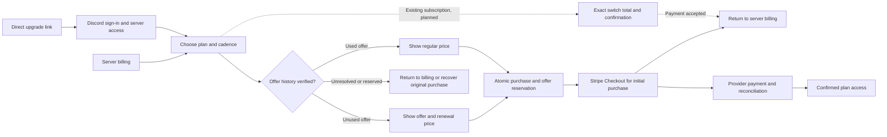

# Introductory offer history

This source path prepares independent monthly and annual offer eligibility. It
does not activate offers or implement the payment flow for existing-subscription
switches. `STRIPE_INTRO_OFFER_LEDGER_ENABLED` defaults to false, independently of
`STRIPE_SUBSCRIPTION_TRANSITIONS_ENABLED`. Provider coupon configuration alone
cannot advertise or apply a fresh introductory offer. Genuine owned frozen
reservations can still recover after enrollment or rollout is disabled.

A server can accept each offer once, in either order. Monthly Basic is $6/month
for three months, then $10/month. Annual Basic is $60 for the first year, then
$100/year. Regular paid purchases and complimentary access consume neither.
Payer changes, cancellation and reinstalling the bot do not reset settled use.
The active-subscription purchase guard still prevents a second Checkout.



## Writer registration

Activation requires a reviewed `TFVAR_STRIPE_INTRO_OFFER_LEDGER_ENABLED` variable,
Terraform apply and a backend deployment. No activation was performed for this
source change. New deployment images require renewed writer verification and
coverage before fresh offers are available.

A normal initial paid purchase can record its actual ECS task and image without
activating either offer. The operator registration command rereads that original
invoice and subscription, verifies the provider account and mode, and checks all
running API service tasks at the expected immutable image. It checks the service
before and after enumeration. Registration stores a deployment boundary with a
condition on the genuine completed purchase revision. It never manufactures a
purchase or changes the current subscription.

Use the approved operational environment and private evidence directory. Examples
below show flag names with placeholders, not runnable provider identities:

```text
yarn billing:history register --account ACCOUNT --mode test --guild SERVER --cluster CLUSTER_ARN --service SERVICE_ARN --container api --image SHA256_DIGEST --report PRIVATE_REPORT
yarn billing:history import --account ACCOUNT --mode test --guild SERVER --cutoff UNIX_SECONDS --report PRIVATE_REPORT
yarn billing:history invalidate --account ACCOUNT --mode test --revision BOUNDARY_REVISION --report PRIVATE_REPORT
```

All commands default to dry-run. `--apply` enables only their bounded application
metadata writes. Source delivery is not authorization to run a production import,
register a production boundary, enable offers or modify Stripe resources.

## Import and catch-up

Import always verifies the native account and mode and performs a fresh paginated
scan of invoices and Checkout sessions at the explicit cutoff. The cutoff must
follow the registered writer deployment boundary. Complete invoice enumeration
alone does not close older pending Checkouts whose invoices might appear later.
Those sessions must expire without a subscription or invoice, match an assessed
original invoice, or match settled use recorded by a verified normal writer.
Unknown ownership and campaign identities stay unresolved. The page limit cannot
turn an incomplete inventory into complete coverage.

Invoice evidence uses the immutable original subscription metadata, gross price,
coupon terms, cadence and payment status. Credit-covered zero-cash settlement
counts as use. Archived coupon validity and an inactive price do not erase valid
historical evidence. A voided unpaid first invoice is only an attempt result;
the subscription must also be terminal. Renewals are covered only when they match a proven paid original use and the
original native subscription, customer, operation, price and campaign evidence.
Undiscounted renewals also verify the gross regular price and absence of discounts.
A renewal without a proven original use stays unresolved. Existing settled use always wins over later
voids, and the importer never restores or replaces a used ledger row.

The private report contains verified account/server/mode/cutoff, run identity,
outcomes and unresolved invoice/Checkout references and reasons. Stdout contains
only status, mode and counts. Reports contain no customer or meeting content.
Unknown probe resources are not automatically excluded.

Applied import transactions check the observed subscription pointer, purchase
attempt, offer-use revision and prior coverage revision. Unused coverage also
checks the stored deployment boundary. A reserved offer requires recovery through
its original operation. Imports use a separate history record and never replace
the current purchase control record or mint a normal writer witness.

## Eligibility and reservation

A missing use row does not prove an unused offer. Availability requires complete
unused coverage for the exact account, mode, server and offer, a matching stored
boundary, and this API task's actual image. Settled use remains consumed even
when the boundary is invalidated. Completed regular purchases are history, so
they do not block the other offer. A pending unrelated purchase remains unavailable.

Display availability is not payment authorization. A private typed authority
carries the coverage and boundary revisions into the same transaction that saves
the initial purchase and offer reservation. If either changes before reservation,
no customer or Checkout creation follows. This authority never comes from user
input or Stripe metadata. New servers also need verified coverage; an absent
record is not silently treated as an empty historical account.

## Verification boundary

Local tests cover native read shapes, pagination, both offer orders, immutable
used history, concurrency fences, owned recovery and dry-run behavior. They do
not prove hosted payment, live account completeness, deployed IAM or activation.
The existing `ConditionCheckItem` IAM prerequisite still applies. Full switching,
exact payment consent and renewal-scheduled changes remain separate work.

Fresh browser offers expire at the enrollment timestamp on Home, Upgrade and
Billing, with immediate local state replacement and a query refetch. The timer
also rechecks on focus and visibility changes. An owned server reservation is
marked separately for display only and keeps its frozen terms past enrollment;
server-side recovery still verifies ownership, expiry and offer-use state.
