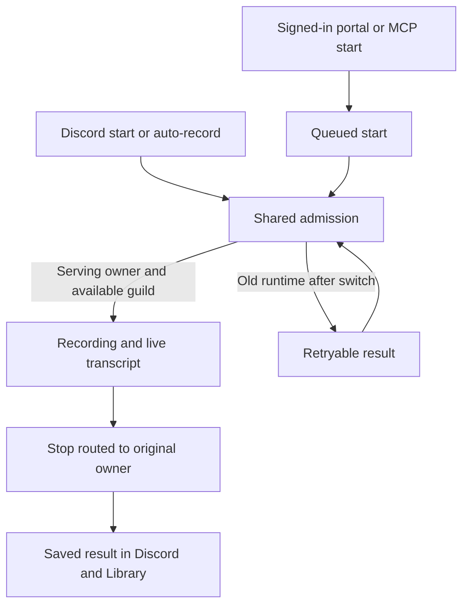
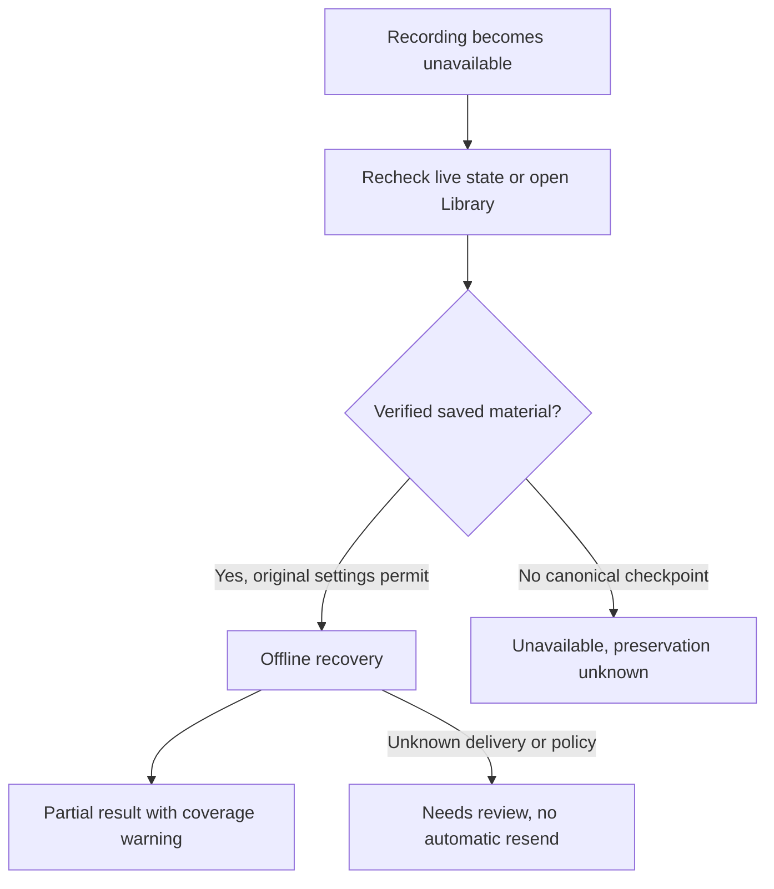
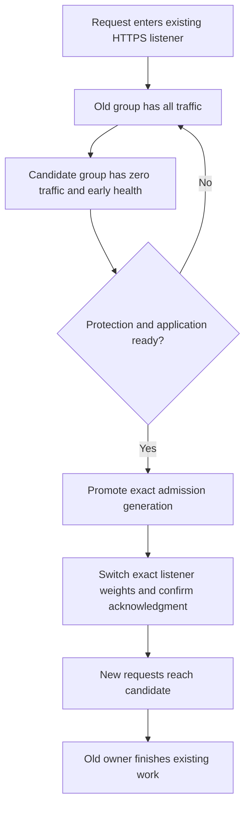

# Recording handoff and recovery

This change lets a healthy replacement accept new work while the previous runtime finishes its recordings. It also preserves verified recording material for offline recovery after an interruption. The approved scope is implementation and review in one product PR. Deployment and hosted acceptance require a separate instruction for this task.

Local tests and generated native fixtures provide different evidence. Neither establishes the current Sandbox or production runtime. The one-time [production introduction procedure](production-introduction.md) defines the legacy admission fence, compatible fallback and preservation requirements. Its source is staged, but activation remains blocked on the post-bind human gate, private durable delivery, trusted collector/store and separate operational approval.

## What a participant experiences

A recording already in progress keeps its owner during an ordinary handoff. Other eligible servers can start on the replacement after it is ready. A start that reaches the old runtime after the switch can receive a retryable result. Existing server permissions, limits and explicit-stop suppression still apply.

### Start or finish a recording during a handoff

### Read an interrupted recording

Recovery never rejoins voice. Successful notes do not make interrupted capture complete. An unknown physical end time remains unknown. A no-first-checkpoint orphan has no canonical recovery claim; the live view can become unavailable without inventing saved coverage or a recovery promise.

## Runtime and deployment contract

`Control.servingMembers` names exact identities under one generation. Admission checks that map, runtime mode, fresh readiness, protection and the runtime's original authorization in the write transaction. An epoch change alone does not interrupt healthy serving work. Promotion checks the coordinator token/epoch, expected member map and fresh candidate proof. Selected retained bot/API members can continue under the next generation. API readiness does not pretend to have a Discord gateway.

An ECS control cannot be bootstrapped by a local identity. Local bootstrap is restricted to explicit mock storage or opted-in loopback DynamoDB with local/dummy credentials. It preserves existing leases, histories and unresolved voice guards, retains fresh disjoint bot/API members and refuses overlapping fresh owners.

For normal compatible deployments, both workflows use the same coordinator. The one-time [production introduction](production-introduction.md) is separate and cannot be inferred from a successful build or image publication. The normal coordinator requests minimum healthy percent 100, maximum percent 200, unchanged desired count and stopTimeout 120. ECS early success uses healthyPercent 100 with sourceServiceRevisionCleanup `DEFERRED`. That result is not application readiness, promotion or retirement. A health-only listener starts before bounded exact-task protection retries; full application readiness remains unqualified until protection and boot complete. Early health does not grant user traffic; the routing contract below keeps warming candidates at zero weight.

After promotion, existing work renews and finishes under its original claim. Runtime retirement moves through `draining`, `releasing`, then `retired`. The releasing state is durable before the native disable call. Unknown disable outcomes retain uncertainty. A coordinator never uses a missing task, lease expiry or zero cached counters to release protection.

Rollback to the exact prior serving identities is allowed only before any retirement request, with a matching durable deployment phase and fresh readiness/protection. It advances the generation while preserving candidate-owned work. A later rollback or insufficient surge capacity requires operational reconciliation, never stopping a busy task to make room.

A same-compatible-image replacement can enter serving through exact completed-deployment lineage or the durable compatible-replacement receipt. Incomplete, rolled-back, newer or absent lineage refuses it. The old runtime becomes draining, with its counts and voice guard retained. This is not a general restart or legacy bootstrap policy.

### Handoff starts only on a quiet serving runtime

ECS refuses to protect more tasks than the service's desired count, which is 1. Once the warming candidate holds native protection, the outgoing task's protection renewals fail with `DEPLOYMENT_BLOCKED`. The outgoing runtime then has at most `RUNTIME_PROTECTION_MINUTES` minus `RUNTIME_PROTECTION_MARGIN_SECONDS` (about eight minutes) before its safety handler shuts it down, and ECS stops the task when its health checks fail. A recording or finalization still running at that point is cut off. Promotion cannot help, because it is a Control and listener change that ECS never sees.

`prepare` therefore reads the serving runtime's `workCounts` before taking the coordinator lease, and launches only while `recording`, `finalization` and `voice_operation` are all zero. It polls for up to `HANDOFF_QUIET_SECONDS` (30 minutes) and then fails with `outgoing_busy` without writing anything, so the next deployment simply tries again. Other work kinds do not hold the handoff. The check runs before launch rather than before promotion because waiting after launch only spends the outgoing runtime's remaining protection.

This is the simple, safe answer, not a complete one. Admission stays open while the candidate warms, so a recording that starts in that window can still be cut off. Keeping the outgoing task protectable through the handoff (for example by raising the desired count for its duration) is a separate design. The one-time production introduction keeps its own reviewed action sequence and does not apply this gate.

`workCounts` is the runtime's in-memory counter, republished on every heartbeat. A leaked counter can refuse every deployment, including the one that repairs it. A retained count can also represent an unresolved voice or provider operation after notes were delivered. Its age, completed history, or zero recording count does not prove a leak. Inspect the exact session, voice attempt and outstanding effects before authorizing an override.

For a separately approved emergency handoff, start the deploy workflow manually with `handoff_quiet_override` checked. The coordinator reads `HANDOFF_QUIET_OVERRIDE=1`, prints a `::warning` naming the counts it overrode and launches without waiting. Push-triggered deploys never set it. Any work the old runtime really holds is cut off when its protection lapses, so verify no active capture or unresolved work is being interrupted under that approval. The override does not release leases or prove voice settlement.

### Delayed voice acknowledgment

The voice service's initial bounded result can be `uncertain` while a matching disconnect acknowledgment is still pending. It keeps the original connection sealed and permits no second leave or reconnect. A monotonic status update for the same known session and original channel does not invalidate a later matching leave acknowledgment.

An acknowledgment-only timeout retains passive observation. `whenOwnedVoiceSettled` resolves only after the matching acknowledgment, actual send drain and durable settlement of the exact original voice attempt. Original-session cleanup must still verify actual local work, preserved or recovered history, notices, nickname cleanup and the exact lease before releasing its work handle. Reconciliation does not regenerate notes or repost messages.

Genuinely ambiguous sends, missing acknowledgments, changed ownership and unproved persistence remain held. A timer, current Discord voice-state absence or a missing local operation cannot supply settlement proof. These cases require separately proven recovery, not a counter reset or automatic lease deletion. See the [voice acknowledgment recovery design](superpowers/specs/2026-10-31-voice-acknowledgment-recovery-design.md).

A submitted lease delete is retained and is not automatically replayed, including after an error or a read that still finds the original lease. A request may have an unknown remote outcome after its client promise settles. A failed or unreadable verification therefore keeps the original reservation held for separately proven recovery. The initial stop response remains bounded. Budget expiry prevents new cleanup writes but does not cancel a dispatched delete.

Voice settlement requires the exact original in-process reservation. A missing or reconstructed reservation causes no best-effort database write; the existing durable `joining` state still blocks admission, just as `uncertain` does. Failure to persist a late acknowledgment also retains the hold instead of replaying an unproved write.

### Outgoing task stopped before acknowledging

If the outgoing task dies after promotion, it can never write its retirement acknowledgment. `retire` then times out with `retirement_incomplete`, `reconcile` reports `recovery_required`, and every later `prepare` would refuse an environment still in `retiring`.

The coordinator completes such a deployment itself. `retire` checks the outgoing task on every poll where the acknowledgment is still missing, and finishes through the continuation as soon as ECS reports it `STOPPED` instead of waiting out its deadline. The next `prepare` does the same before acquiring the environment, and operators can run the same code alone with `node scripts/deployment/coordinator.cjs continue-stopped-outgoing`. It refuses, changing nothing, unless all of the following hold:

- Control is in `retiring`, and the previous coordinator's lease has expired (or the caller holds that same run token).
- The candidate is the exact promoted membership under `originalGeneration + 1`, its runtime row is `serving` and ready, and its native protection is confirmed.
- The ECS service has converged exactly as `retire` requires (candidate task definition, one running, none pending, one `COMPLETED` deployment), and its only running task is the candidate.
- Owned routing, if present, is acknowledged on the candidate and passes the same listener and target checks `retire` makes.
- The outgoing runtime still holds this deployment's retirement request with no acknowledgment.
- `describe-tasks` reports the exact outgoing task `STOPPED` with a `stoppedAt`. ECS prunes stopped tasks after about an hour, so a `MISSING` task also counts, but only because the service no longer lists it and the native protection its runtime row last published has expired.

One conditional transaction then marks the outgoing runtime `retired` with a `retirementContinuation` record (stop reason and time, its last `workCounts`, the continuing run and time) and moves Control to `complete`. The Control condition matches the coordinator fields `save` guards, and the runtime condition requires the row to be unchanged since it was read, so a concurrent coordinator or a still-heartbeating runtime wins. The record lives on the runtime row because running runtimes parse Control strictly, and a new Control field would break every runtime still on older code.

Work the dead task still counted is lost; the coordinator prints a `::warning` with those counts and records them on the row. It never deletes a row, releases protection, stops a task or touches a lease. Recovery of that work follows the ordinary lease and recovery paths. A lost transaction race refuses with `continuation_refused`; reread state before retrying.

## Continuing an existing Sandbox candidate

The existing `sandbox-identity.yml` workflow supports an explicit continuation
of a compatible deployment that remains in `warming` with source routing.
Its default still performs the read-only identity check. Select
`continuation_action: inspect` to validate the current operation without writes
and print its canonical binding checksum. Select `continue` only after reviewing
the private binding receipt, supplying that checksum as
`continuation_binding_sha256`. Bootstrap inputs and the denial probe cannot be
combined with either continuation action. A repeated workflow attempt refuses;
refresh and review state before any later dispatch.

The private binding is `continuationBinding(control, candidateIdentity)` from
`scripts/deployment/continue-sandbox.cjs`. Hash it with the exported `bindingHash`.
Keep the full object with the private execution evidence. It binds the original
token, epoch, serving generation and identities, candidate task identity, pinned
image, task definitions, runtime mode and routing topology. Renewable expiration
and update timestamps are excluded from the checksum and checked independently.
The CLI prints only the checksum and outcome. It does not print the binding or
provider error bodies. A checksum proves matching metadata, not execution approval
or successful promotion.

Continuation retains the Sandbox environment gate, scoped OIDC role, exact STS
identity verification and shared deployment concurrency group. The new role
session identifies the continuation workflow's actual run and attempt. The
coordinator token comes from the verified original Control record. These are
separate identities. Dispatch from the reviewed source on an allowed existing
`master` or `codex/*` ref. This extends an already registered workflow and does not
require a new workflow registration or IAM permission expansion.

Before its first coordinator write, continuation revalidates the frozen binding,
original serving membership, exact ready candidate, settled service, native
protection, healthy owned targets, revision bindings and source listener action.
It runs the existing `promote` then `retire` phases without building an image,
registering a definition, invoking `prepare` or forcing deployment. Original work
continues to govern retirement. Changed phase, candidate or membership, stale
proof, pending tasks, a stopped outgoing task, missing source targets and uncertain
routing refuse continuation. Any later failure
preserves state and receipts for review; there is no automatic rollback or retry
of a listener submission. Do not report success until fresh native readback proves
the exact serving runtime, acknowledged routing, runtime-owned retirement and
complete service convergence. Production and billing flag changes remain outside
this entry point.

## Ownership, preservation and delivery

Seven actual producers contribute to retirement: pending admission, recording, finalization, personal processing, recovery processing, voice operation and ancillary delivery. Registration precedes awaits. An admitted reservation stays counted through initialization; finalization transitions the same handle. Existing owner controls have a separately counted child plus exact lease/attempt proof. Personal and recovery workers own their real claim, provider, renewal and ancillary promises.

Voice settlement is independent of capture and processing. An attempted connection needs sealed callbacks, settled transports, a closed connection and a matching session/sequence gateway leave acknowledgment. Expiry or task disappearance does not satisfy it. Offline recovery never clears that guard.

Checkpoint uploads precede manifest publication and canonical history CAS. The original capture provenance and requested flags remain immutable when recovery advances the execution version. Frozen context includes only validated inputs required by the existing notes and summary engines. Original cancellation/proceed intent and the original completion policy survive replacement. Complete short automatic recordings with unknown policy require review.

Verified saved text can recover without audio. Saved text with no exact processing-coverage proof does not suppress verified PCM. Each confirmed PCM interval is processed separately, preserving gaps. This can cost extra transcription requests or duplicate wording; it does not silently discard preserved speech.

Before final summary or notes mutations, ordinary finalization persists coarse delivery intent. Unknown intent prevents dispatch. No usable recovered speech sends the deterministic interruption notice with no notes, summary generation or Notion export. The notice uses the same durable delivery intent and acknowledgment discipline. Unknown sends or acknowledgment writes retain known message IDs and `needs_reconciliation`; recovery never automatically replays them. Exact terminal readback can reconcile already acknowledged delivery without sending again. Existing enabled Notion automation follows newly recovered usable notes only after delivery proof. An unknown ancillary mutation retains its own ownership and is never reclassified as a generation retry.

## Candidate traffic and routing ownership

During normal compatible handoff, ordinary portal, OAuth, desktop, webhook and MCP requests stay on the old application while the candidate acquires native protection and finishes booting. The separate [legacy production introduction](production-introduction.md#what-users-may-experience) includes approved maintenance downtime. The existing rolling service uses two ALB target groups, with one group bound to each service revision. The listener assigns the serving group weight 100 and the candidate group weight 0, with stickiness disabled. Both groups remain associated for early `/health` checks. This keeps the DEFERRED/100 protection convergence path without sending ordinary traffic to an unavailable application.

### When does a request move to the replacement?

Admission promotion and ALB routing are separate operations. New correction requests reaching the old API during that short transition receive a typed retryable response. Existing requests and owner-directed recording controls keep their original owner. A failed or unknown provider operation can prolong the transition, so this design does not promise zero request failures under provider failure. Retirement requires acknowledged candidate routing, fresh readiness and native protection.

The coordinator checks exact listener, groups, revision bindings, container port, task IP targets, health and empty spare membership. Foreign actions, extra listener rules, stickiness, ambiguous revisions, and occupied or draining spare targets refuse rollout. Each new rollout reverses the two group roles only after the previous rollout has completed and the spare is empty. Same-group launches are refused. A replacement after loss of the only available application still needs to boot; this routing contract cannot make an unavailable application healthy.

A durable submitted routing marker precedes `ModifyListener`. The actual CLI child forces one total attempt for that write, overriding inherited retry settings; safe reads retain their configured retries. If that call or its acknowledgment is unknown, the marker remains unresolved. A later read showing the intended weights does not prove the original RPC has settled. It cannot authorize replay, opposite routing, retirement or slot reuse. This conservative rule can leave extra protected tasks and a blocked rollout until separately authorized reconciliation. A known successful response plus exact readback allows the acknowledgment transition. Ordinary Dynamo write-response loss still uses exact readback of the written fields.

Before retirement starts, rollback validates both protected identities and the old application, grants old admission a fresh generation, and reverses the exact weights. The old destination must be healthy; the failed candidate must retain exact ownership, registration and revision proof but need not be healthy. A restart after membership commit repeats fresh destination and candidate ownership/protection checks before the first reverse write. Candidate-owned work remains protected. Rollback stays `recovery_required`, because changing the ECS primary revision would launch another deployment. The coordinator does not do that or retire candidate work automatically.

### Infrastructure introduction and permissions

Terraform owns group and listener identities, health settings and the create-time weighted action. After introduction, the coordinator owns `aws_ecs_service.app_service.load_balancer` and `aws_lb_listener.api_https.default_action`; Terraform explicitly ignores those attributes and its existing task-definition drift. Applying Terraform to an existing simple-forward listener does not rewrite the ignored action. The separately approved [production introduction](production-introduction.md) must establish the exact dual-group action and compatible Control before normal coordinator use. The Sandbox introduction follows its own [bootstrap contract](sandbox-bootstrap.md). No merge, runtime default or missing input activates this topology.

Set the existing GitHub environment variables `DEPLOYMENT_LISTENER_ARN`, `DEPLOYMENT_TARGET_GROUP_A` and `DEPLOYMENT_TARGET_GROUP_B` to the exact reviewed Terraform `deployment_routing` output. An ALB-backed service with missing inputs refuses deployment. Bot-only services without a load-balancer binding omit all three. Do not change desired count, rolling strategy, min100/max200 or DEFERRED/100.

Terraform source attaches the generated `deployment_routing_policy_arn` to the scoped production and Sandbox backend deployment roles. Its write permission is `elasticloadbalancing:ModifyListener` on the exact listener. ELB describe operations use their required wildcard resource scope; ECS revision/deployment reads are scoped to this service. Source attachment is not verified live authority. The [production identity requirements](../_infra/README.md#production-backend-deployment-identity) still require reviewed application, exact identity and permission acceptance. Runtime roles receive no routing permission. The coordinator has no target registration, task stop or forced-unprotection operation. Serialize other authorized listener writers with this coordinator; ELB offers no conditional compare-and-swap.

AWS documents [revision-specific immutable configuration](https://docs.aws.amazon.com/AmazonECS/latest/developerguide/service-revision.html), [load-balancer update behavior](https://docs.aws.amazon.com/AmazonECS/latest/APIReference/API_UpdateService.html), [deferred source cleanup](https://docs.aws.amazon.com/AmazonECS/latest/developerguide/early-success-criteria.html), and [weighted target groups](https://docs.aws.amazon.com/elasticloadbalancing/latest/application/rule-action-types.html). Generated local tests compose actual HTTP listeners, protection retries, persisted Dynamo admission and routing decisions. They do not prove hosted ALB propagation or protected source registration retention. Those facts, first activation and the legacy admission bridge remain separate acceptance requirements.

## Evidence and remaining acceptance

The H7/R6 rows below are historical evidence carried into the October 15, 2026 handoff merge. They have not been rerun as acceptance of the production introduction. The table separates those observations from the October 22 source-stage status.

| Evidence                                  | What it establishes                                                                                                                  | Limit                                                                 |
| ----------------------------------------- | ------------------------------------------------------------------------------------------------------------------------------------ | --------------------------------------------------------------------- |
| H7 combined test                          | Actual producers, real local Dynamo transactions, failed warmup, promotion, old controls, persisted results, retirement and rollback | Generated external responses; no hosted provider proof                |
| R6 native fixtures                        | Node 24.15 PID 1, native Opus/ffmpeg, real signals and generated storage acknowledgments                                             | Network disabled; no ECS/S3/Discord acceptance                        |
| R6 timing receipt                         | Segment closure about 30.014 seconds and cutoff about 60.005 seconds with four short PCM sources                                     | Not representative load or a loss guarantee                           |
| Shutdown composition                      | Earliest shared 100-second budget and retained actual tails                                                                          | No real 100-second provider outage measured                           |
| Sandbox and production                    | UNKNOWN                                                                                                                              | No hosted operation authorized in this task                           |
| Production introduction source            | Engine and non-operational workflow accepted in task review on October 22                                                            | Final branch validation and operational wiring remain pending         |
| Local production introduction             | Scoped lifecycle/carryforward, strict binding/refusal, HTTP and signed synthetic-webhook checks passed                               | Generated provider ports, no hosted acceptance                        |
| CI at final combined head                 | UNKNOWN                                                                                                                              | Published exact-head checks and final feedback audit remain pending   |
| Production introduction Sandbox rehearsal | UNKNOWN                                                                                                                              | Separate rehearsal and literal Sandbox bootstrap rules apply          |
| Actual production runtime                 | UNKNOWN                                                                                                                              | No actual-task, live routing, restoration or retained-work acceptance |
| Financial/provider acceptance             | UNKNOWN                                                                                                                              | No authorized live acceptance or fixture-preservation proof           |

The 64 MiB bound is additional PCM accounting, not total process RSS. The native RSS observation is one sample, not a peak bound. Host audio verification is unavailable because the host Opus binding is missing. Use the retained native receipt and current runtime-source correspondence, then fresh exact-head hosted CI for merged code. Do not infer acceptance from an image tag or a green workflow alone.

## Prepare a Sandbox acceptance dry-run

`scripts/deployment/verify-sandbox-handoff.cjs` accepts only `--dry-run --config <file>`. It validates an explicit Sandbox configuration, prints its checksum, fixture checksums and intended stages, and runs no providers or tests. Its resource labels do not verify an account or environment. It has no production defaults and no execution mode.

The JSON must contain `environment: "sandbox"`, `accountId`, `region`, `cluster`, `service`, `tablePrefix`, `bucket`, and `old`, `candidate`, `rollback` artifacts. Each artifact supplies full `sourceCommit`, `imageDigest` and `taskDefinition`. Each resource name must explicitly identify Sandbox. `fixture` supplies `runId` as a UUID, generated `guildId`, `voiceChannelId`, `textChannelId`, `ownerUserId`, `prefix` equal to `generated/handoff/<runId>/`, and at least one SHA-256 in `checksums`. Keep actual resource identities and generated audio out of public reports.

The private unpublished introduction packet records the resource route, identity evidence, legacy admission bridge, compatible rollback, retained voice proof and acceptance receipts. Current/old/candidate/rollback bindings remain UNKNOWN until refreshed under an authorized scope. A quiet lease scan or task protection alone cannot make the legacy binary obey the new gate.

## Retention gap

The transcript bucket currently aborts incomplete multipart uploads after seven days. It does not delete completed objects. No completed-meeting-object deletion route was found in product storage code or the private Sandbox runbook. Placing checkpoints under a meeting folder does not close that gap.

The dry-run module includes `planGeneratedDescendantRemoval`, a pure generated-local review helper. It requires exact terminal history, independent verified capture/recovery/current-work settlement receipts, complete descendant enumeration and the canonical meeting folder recorded in the checkpoint. That folder must match the reviewed fixture's guild, channel, meeting and reservation time under its generated run prefix. Every key must belong to that meeting folder, including when another meeting shares the same run prefix. Active, uncertain, absent or expired ownership evidence refuses the plan. It covers completed checkpoint objects and unreferenced attempt descendants, while refusing foreign paths. Its accepted plan is neither a live ownership fence nor deletion authority.

An authorized operational deletion procedure, with current ownership revalidation and complete descendant coverage, is still MISSING. No retention period, expiry rule, live deletion command or deletion permission is introduced. Do not delete histories, leases, voice guards or unverified legacy artifacts as a substitute.

## Engineering references

- [Production introduction procedure](production-introduction.md)
- [Production legacy-introduction decision](adr-20261020-production-legacy-introduction.md)
- [Approved design](superpowers/specs/2026-10-12-deployment-drain-and-interruption-design.md)
- [Handoff implementation plan](superpowers/plans/2026-10-12-deployment-handoff-plan.md)
- [Recovery implementation plan](superpowers/plans/2026-10-12-interrupted-recording-recovery-plan.md)
- Combined local acceptance: `test/deployment/warmHandoff.integration.test.ts`.
- Fault and compatible-replacement acceptance: `test/deployment/recordingRecoveryFaults.integration.test.ts`.
- Generated cleanup refusal and dry-run validation: `test/deployment/sandboxHandoffRunner.test.ts`.

Whole-branch review, published exact-head checks, clean mergeability and the post-30-minute feedback audit remain the PR readiness gate. Sandbox acceptance, first [production activation](production-introduction.md) and historical repair are separate outcomes.

## First Sandbox bootstrap tooling

For the separately reviewed one-time introduction from an incompatible runtime, see [Sandbox bootstrap tooling](sandbox-bootstrap.md). Normal deployments still use the existing coordinator. The bootstrap and read-only observation commands do not apply infrastructure, stop legacy work, register an image, alter the listener or start a monitor automatically.

## Stripe receipt admission and retention

Authenticated callbacks persist an event ID and lease even when runtime proof is unavailable. No event payload is stored. A genuinely new proved receipt records immutable `birth` provenance under `stripe-receipt-admission-v1`. A lease retry updates only `leaseToken` and `leaseUntil` and removes unresolved TTL. It never replaces birth or first-admission history.

Every recognized callback must atomically record its continuation admission with the existing Control and runtime admission conditions before invoking its handler. Admission binds the unexpired receipt token, attempt ID, exact runtime and serving generation. A lost transaction response prevents handler invocation. A legacy or unproven processing receipt remains retained and returns a retryable failure. A running prior admission cannot replay after lease expiry. Only a failed attempt that performed no mutation can receive fresh admission while preserving its first admission.

The registered billing owner covers the complete handler, nested domain and provider writes, and final receipt persistence. Reads and pure computation do not start mutation tracking. A read failure before any mutation can release its attempt. A lost mutation acknowledgment, a failure after an acknowledged domain or provider write, or a failed final receipt write leaves unresolved ownership. Matching later reads do not create acknowledgment. Successful completed duplicates retain their existing acknowledgment behavior.

New and reclaimed unresolved receipts have no TTL. Successful completion restores 30-day retention. Untouched legacy rows retain any existing TTL until separately inventoried. The change does not migrate them. Longer unresolved metadata retention can increase storage cost, which has not been priced. Analytics deduplication markers retain their existing retention periods and event properties.

`scripts/deployment/retained-receipts.cjs` exports the versioned safe projection and `preservedUnadmittedReceipt` predicate. The projection represents any admission or first-admission object as a presence Boolean, so malformed empty history still blocks classification. A matching predicate returns `preserved_unadmitted_receipt`, meaning future work that has never crossed this admission boundary. It does not mean a payment is settled. The ordinary retained-work classifier continues to block those receipts.

Task7 must obtain authenticated, complete inventory of every serving and draining callback receiver, exact reviewed source and image bindings, acknowledged legacy retirement and routing evidence, and the current exact hold. It must bind that evidence to the reviewed disposition and source through the existing compatibility contract before introducing an opaque authorizing closure. The Task6 schema checks shape and compatibility only. Caller-supplied objects, source hashes or a nonauthorizing predicate result cannot release a hold. Unknown or omitted receivers block reopening.

## Standalone renewal coverage audit

`scripts/billing-renewal-recovery.ts` supports read-only coverage audit, bounded pagination and resume, provider identity checks, and existing index/deployed-writer coverage evidence. Standalone `--apply` is disabled and fails before any domain or provider write. The audit cannot register or refresh renewal recovery records. Existing admitted renewal workers retain their current behavior.

Restoring standalone writes requires a separately reviewed admitted executor. Do not initialize an arbitrary runtime, bypass billing admission, or treat an audit report as write authority. Historical apply reports remain readable, but they cannot resume in apply mode.

## Sandbox source-loss recovery

A separately approved stopped-source operation uses [Sandbox source-loss recovery](sandbox-source-loss.md). It restores the existing candidate's admission and routing while preserving pending settlement. Healthy-source continuation and normal retirement still require their original evidence.

The separately approved [historical carryforward contract](sandbox-carryforward.md) can archive an availability-restored incident without settling it and hand Control to a new normal protected deployment. Ordinary preparation retains its refusal of unrelated unfinished operations.

## Production introduction workflow status

The manual `production-introduction.yml` is source-staged and operationally blocked. It defaults to inspection, binds one exact proposal with read-only identity evidence, and validates the late private envelope before refusing at `Post-bind human authority unavailable; preserve state`. It shares uncancelled production deployment concurrency. A collector alone cannot unlock execution.

The [production introduction procedure](production-introduction.md) explains the accepted eventual phase contract, current missing human gate and private delivery/collector/store, exact-run authority, recovery limits, Terraform confidentiality and acceptance status. No exact private execution packet is available yet. Ordinary frontend publication waits for backend success; docs publication precedes the backend and is independent of its result.

The separate [production interruption contract](production-interruption-contract.md) records A's maintenance boundary, current source refusal, private Apply guard, connection-sync permission exposure and unproved execution prerequisites.
