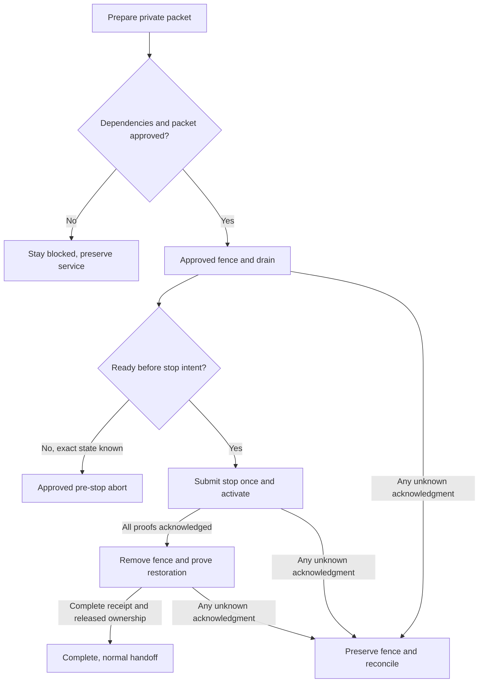

# First production introduction

This document describes the separate staged fence-and-drain protocol. The selected A interruption and test-before-reopen contract is documented in [Production interruption contract](production-interruption-contract.md). Their manifests, receipts and execution authority are not interchangeable.

This procedure covers the one-time transition from the legacy production runtime to the protected handoff protocol. BASIC approved preparation and a brief maintenance window after existing work finishes. Production execution still needs its own exact packet and approvals. Recordings must finish, valid uploads must survive, and unfinished work must remain recoverable.

**Execution is BLOCKED as of October 22, 2026.** The source-staged workflow binds a proposal and validates its private authorization envelope, then refuses at `Post-bind human authority unavailable; preserve state`. Both introduction jobs use read-only AWS sessions. The introduction CLI also refuses consequential phases without a trusted collector. Adding the collector alone must not enable execution.

Use [recording handoff and recovery](deployment-handoff.md) for ordinary compatible deployments. Use [Sandbox bootstrap tooling](sandbox-bootstrap.md) only for its literal Sandbox scope. A Sandbox manifest, `testOnly` receipt or standing Sandbox deployment approval cannot authorize this procedure.

## What users may experience

Preparation leaves the running application in place. During approved maintenance, the temporary role policy denies new meeting acquisition and new personal-upload processing claims. Existing owners must finish their recordings, processing, delivery and voice operations. Upload intake, valid upload URLs and finalization must remain usable where the proved legacy request contract permits them. This is a narrow admission fence, not a blanket write deny or a friendly maintenance-page guarantee.

After all active work settles and retained work is proved compatible, shutdown creates a period without a serving API or bot. Portal requests, OAuth callbacks, desktop and MCP requests, and incoming webhooks may fail. A cached static frontend may still load without a working API. No fixed downtime duration or provider retry/delivery guarantee has been accepted. Local signed-webhook tests do not establish hosted recovery or permit replaying real events.

The compatible candidate must prove readiness, protection, ownership and acknowledged routing before admission reopens. Ordinary deployments thereafter keep the old application serving while a candidate warms.

## Activation prerequisites

Keep these decisions separate from source approval:

- Approve any isolated rehearsal resources and IAM before provider rehearsal.
- Resolve Terraform confidentiality before any fresh production plan or apply. [Private Terraform delivery](terraform-private-delivery.md) is implemented in source and requires private storage for saved plans and detailed output, with exact producer source, artifact bytes, checksum and human apply approval. No archive destination, region, encryption, retention, IAM, bootstrap method or live configuration has been selected or approved. Native acceptance remains pending.
- Review the fresh production plan, saved apply artifact and exact actual-task probe scope. Source policy attachment does not prove live permissions or task-principal behavior. See [production backend deployment identity](../_infra/README.md#production-backend-deployment-identity).
- Implement and independently review a real human gate after proposal binding, approved durable private delivery, and the authenticated collector/store. Accept the exact job topology through a separately authorized harmless gate check. No environment name, hash comment, Boolean approval or alternate credential bridge substitutes for this.
- Approve the exact final maintenance packet and each phase's current-run authority. The packet must include the compatible backend and matching static frontend fallback, retained-work evidence, expiry/deadlines and recovery limits.

The October 22 environment metadata refresh found no protection rules or deployment branch policy, with administrator bypass enabled. Those settings do not supply the required approval. Refresh them before activation; the staged refusal remains required until reviewed wiring and acceptance replace it.

## Operator decision

### Can this introduction advance safely?

This diagram describes the accepted engine contract after its activation prerequisites are met. It is not an executable cutover recipe. The current workflow cannot perform the mutating branches.

## Prepare without entering maintenance

1. Bind the reviewed source commit to the image digest and task definition. Bind the legacy task/source, existing service and roles, table routes, listener/groups, original policies/controllers, known writers, collector command and evidence store. Independently bind the fallback source, digest and definition. Candidate and fallback must both differ from legacy; an explicitly bound fallback may equal the candidate.
2. Check current and cached frontend requests against the candidate. Preserve a matching static fallback and compatible backend or a separately reviewed repair-forward decision. Backend rollback does not restore static files. Exact artifact identities and hosted compatibility are still UNKNOWN.
3. Collect read-only discovery under the exact account, role and session. Identify every producer and external writer. Include standalone recovery publication apply and reconciliation tools, which write private objects or external messages outside ECS runtime counters and the eight-table inventory. Their reconciliation mode is not a read-only collector.
4. Assemble the immutable private manifest and retain complete original captures before publishing compact references. Capture readback must match the original bytes, SHA-256 and length in the approved store. Hashes alone do not make the body available to a reviewer or prove approval.
5. Review one phase against the current durable receipt predecessor. The staged workflow accepts `phase`, `operation_id` and `manifest_sha256`, defaults to `inspect`, and permits only `master` attempt 1. It shares `chronote-deploy-production` concurrency with ordinary deployment and does not cancel a running deployment. These are source contracts, not evidence of a dispatched or approved run.

Binding freezes the proposal hash. The dependent job checks private body hash = expected delivery hash = bind output, along with exact source, operation, run, session, expiry and predecessor. The proposal currently exists only in private runner files; approved durable delivery to the reviewer remains missing. There are no cutover command examples while those dependencies are absent.

## Approved maintenance and preservation

The following sequence is implemented in the engine and requires the prerequisites above before operational use.

1. `fence` requires absent initial Control, the unchanged original service and the bound candidate definition. It installs only the operation-owned policy on the bound app role and requires fresh actual-principal denial evidence. Independent unrelated permissions stay bound to their original hash.
2. `drain` keeps the legacy runtime running. Two complete, explicitly paginated projected inventories must agree after authenticated policy, task, owner, controller, writer, effect and compatibility observations. The eight slots are leases, history, controls, uploads, segments, billing, webhooks and payments. This is not an atomic AWS snapshot or proof against arbitrary manual writers.
3. Active or uncertain work blocks shutdown. Retain terminal records and receipts. Pending or queued uploads and their segments may carry forward only with exact row-bound source input, token, schema, ownership and claim-protocol compatibility evidence that remains valid. Expired leases, terminal labels and message IDs alone do not prove settlement. Preserve all [seven producer classes and voice guards](deployment-handoff.md#ownership-preservation-and-delivery).
4. `activate` rechecks the drain, journals shutdown intent, then submits one desired-count-zero update. Only exact stopped legacy identity, no replacement, settled native inventory, unchanged bindings and still-valid original actual-principal proof allow routing and Control initialization. Do not attempt to probe a stopped task or extend the old proof's lifetime.
5. Launch only the bound compatible definition. The target uses rolling deployment, min100/max200, DEFERRED/100 early success, circuit breaker enabled and automatic rollback disabled. Fresh candidate readiness, native protection, ownership and exact acknowledged routing precede conditional promotion. The operation-owned deny stays in place until `complete`.

Keep `STRIPE_SUBSCRIPTION_TRANSITIONS_ENABLED`, `STRIPE_RENEWAL_GRACE_ENABLED`, `STRIPE_INTRO_OFFER_LEDGER_ENABLED` and `STRIPE_RENEWAL_REACTIVATION_ENABLED` disabled in the production candidate. This procedure activates no offer/history behavior and grants no authority over reserved financial fixtures.

## Abort, uncertainty and failed startup

A pre-stop `abort` is allowed only at acknowledged fence or drained stages, before shutdown submission. It requires the exact original service, fresh owned-policy evidence, removal of only this operation's policy, and subsequent permission-restoration proof. It does not delete work or erase receipts. A submitted but unacknowledged write cannot take this shortcut.

Any unknown provider-write acknowledgment stops advancement. Keep the fence and immutable submitted intent, then reconcile through read-only evidence collection. A later GET showing the desired value cannot prove the original request settled. Do not replay shutdown, listener, initialization, launch or policy removal, clear the stage, force expiry, delete leases, unprotect tasks or relaunch legacy code. Unknown private capture-write acknowledgment also stops; it does not permit automatic resume.

After shutdown, preserve the fence on failure. Only a separately approved same-operation, same-manifest recovery envelope with exact failure capture and predecessor may select the prebound compatible fallback. The engine requires a sole native PRIMARY FAILED deployment, rollback disabled, no other active deployment, settled tasks, no active owner and generation zero with no serving members. A live or protected candidate requires a separate recovery decision. The one bound fallback launch may use the same candidate definition with a native new-deployment trigger. It is not a general retry policy.

Recovery proposals currently contain `recovery: null`. Reviewed private failure-evidence delivery is missing, so the workflow cannot authorize that fallback. Even after wiring, `reconcile` reports unresolved state without provider mutation, stage clearing or replay. An expired authority refuses further execution and leaves the deny in place. A later run cannot silently renew the original proof or reopen admission.

## Complete and resume normal handoff

`complete` starts only after acknowledged promotion. It proves an idle, protected serving candidate before removing the exact owned fence, then proves restored permissions and current serving ownership. Shared-role restoration also requires complete task inventory and the bound controller/writer evidence that excludes legacy resurrection. Once the fence is removed, legitimate newly admitted work may remain active; completion must preserve it. The exact generation/member transaction releases the introduction coordinator and records completion.

Keep runtime, routing, restoration, retained-record and frontend/backend evidence together before calling the introduction complete. No automatic legacy resurrection is available. Later compatible deployments return to the ordinary coordinator's prepare, promote, runtime-owned retire and reconciliation contract. Source merge, infrastructure apply, an image tag or a successful API response alone does not establish this outcome.

## Evidence and private handoff

The exact private execution packet is not yet available. Its link belongs in the private operations handoff together with exact manifests, hashes, bindings, original captures/page chains, provider receipts, approvals, artifact fallbacks and financial limits. Do not publish packet bodies, resource or customer identities, raw histories or secret values in this repository, workflow logs or public artifacts. Private delivery options remain proposals.

| Evidence class     | Status at October 22, 2026                                                                                                                      | What remains                                                                                                                         |
| ------------------ | ----------------------------------------------------------------------------------------------------------------------------------------------- | ------------------------------------------------------------------------------------------------------------------------------------ |
| Source             | Introduction engine and staged workflow accepted in task review                                                                                 | Final whole-branch validation/review and activation wiring                                                                           |
| Local              | Strict binding/refusal, local Dynamo lifecycle/carryforward, cached-client contracts and signed synthetic-webhook checks passed in scoped tasks | Synthetic ports do not prove provider behavior or hosted publication failure                                                         |
| CI                 | UNKNOWN for the final combined branch head                                                                                                      | Published exact-head checks and post-30-minute feedback audit                                                                        |
| Sandbox            | UNKNOWN for this production-introduction procedure                                                                                              | Separately approved rehearsal and acceptance; Sandbox bootstrap retains its own rules                                                |
| Production runtime | UNKNOWN                                                                                                                                         | Actual task-principal denial/restoration, complete collector/store evidence, live identity/readiness/voice/routing and retained work |
| Financial/provider | UNKNOWN                                                                                                                                         | Authorized provider acceptance and preserved-fixture evidence; no replay implied                                                     |

Historical H7/R6 observations in the [handoff guide](deployment-handoff.md#evidence-and-remaining-acceptance) are separate evidence. They do not establish this procedure's current acceptance.

## References

- [Introduction decision](adr-20261020-production-legacy-introduction.md)
- [Production role and permission limits](../_infra/README.md#production-backend-deployment-identity)
- [Ordinary handoff and recording recovery](deployment-handoff.md)
- [Separate Sandbox bootstrap](sandbox-bootstrap.md)
- Source contracts: `scripts/deployment/staged-production-manifest.cjs`, `production-evidence.cjs`, `staged-introduce-production.cjs` and `production-workflow.cjs`.
- Local lifecycle coverage: `test/deployment/productionIntroduction.integration.test.ts` and `productionCarryforward.integration.test.ts`.
