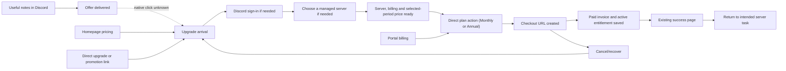
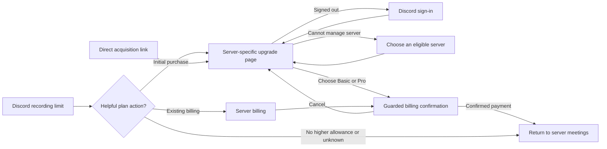

# Product lifecycle analytics

## Three lifecycle funnels

Chronote's measurement plan has three main journeys: onboarding, purchase, and cancellation/loss. Renewal restoration is a recovery branch of the loss journey. Turning renewal off is a leading signal; actual loss of a paid relationship happens later. Product inactivity is a separate retention measure, not inferred from billing cancellation.

| Journey           | Main question                                                 | Milestones                                                                                | Source coverage now                                                                                                                                                                                    |
| ----------------- | ------------------------------------------------------------- | ----------------------------------------------------------------------------------------- | ------------------------------------------------------------------------------------------------------------------------------------------------------------------------------------------------------ |
| Onboarding        | Does an installed server reach useful output?                 | Server installed, setup steps, first usable meeting notes                                 | Existing server_installed, onboarding_step_reached and meeting_completed with usable_notes. The useful-notes milestone is a technical value proxy, not a proven retention-based activation definition. |
| Purchase          | Does an eligible server start paying?                         | Eligible pricing/upgrade entry, plan action, Checkout created, verified paid access saved | Existing upgrade and billing events below. Keep initial purchases separate from renewals and plan changes. Existing positive-payment qualification does not certify every zero-cash purchase.          |
| Cancellation/loss | Why does a paid server stop paying, and where can it recover? | Paid cohort, renewal-off confirmation, either renewal restored or paid relationship ended | Lifecycle producers are implemented behind a separate default-off gate. Existing payment success alone does not cover this journey.                                                                    |

Use the server as the business unit across these journeys. An organizer, payer and later manager can be different people. Keep a separate person-level purchase-friction view with guild held constant. Native PostHog groups are not currently configured, so use the existing ordered same-guild analysis rather than quietly enabling group analytics or pretending guild-only webhook events belong to the original purchaser.

### Cohorts, windows and outcomes

- Onboarding: first observed install per server in the cohort; seven days to first useful notes is the approved default reporting window. Also show setup step completion. Later reinstall is not automatically a new first-time customer.
- Purchase: retain the existing seven-day same-server conversion windows and first-entry attribution below. Show overall conversion, step conversion and elapsed time. Separate anonymous/unresolved entries from known server cohorts.
- Voluntary loss: enter on the first confirmed renewal-off transition in an episode. Follow it to the provider's verified paid-period end, which may be months away. Count only cohorts whose boundary has passed when reporting realized loss. Turning renewal back on is a save attempt; the next verified paid renewal is the stronger retained-payment outcome.
- Involuntary loss: show payment failure, recovery of that failed invoice, or paid relationship ending. Classify voluntary versus payment-related loss only from known provider evidence; otherwise use unknown. A payment failure is neither an immediate cancellation nor proof that access ended.
- Win-back after an ended subscription is a new verified paid purchase for the same server, separate from undoing pending cancellation. Use the approved 30-day default reporting window. Saved query configuration remains a separate step.
- A Pro-to-Basic downgrade is contraction, not loss of all paid service. A complimentary grant can preserve product access after Stripe payment ends. Current paid state and continued use must remain separate measures.

Cohort maturity must be calculable, not guessed from month/year cadence. For a known boundary, the standard event timestamp plus remaining_seconds_to_scheduled_end gives the observed scheduled end. Update it with terms_updated if that date changes while renewal remains off; that does not create another cancellation entry. A missing or out-of-range boundary is unknown and excluded from the mature-cohort rate, with its count shown separately. Use actual ended/settled outcomes as observed results and reconcile boundary drift against bounded application state. This adds a justified duration property, not an invoice/episode identifier or an import of private provider records into PostHog. Include this timing category in the privacy notice before capture.

Hosted Stripe cancellation intent is not directly instrumented today. Manage billing can mean updating a card or viewing an invoice, so it must not be labeled cancellation intent. Confirmed native renewal-off and ended transitions enter the loss analysis even without an earlier observed browser visit.

The new measurement work is specified in the [renewal design](superpowers/specs/2026-10-14-renewal-reactivation-design.md#posthog-measurement) and its [implementation plan](superpowers/plans/2026-10-14-renewal-reactivation.md). Implemented event producers and new loss definitions are not claims of deployed capture or configured PostHog insights. Confirm exact existing saved views before creating anything; prefer updating the existing Chronote reporting and daily health summary.

### Loss and recovery events

| Event                                  | Producer and meaning                                                                                                                                                                                                                                                                                                                                     |
| -------------------------------------- | -------------------------------------------------------------------------------------------------------------------------------------------------------------------------------------------------------------------------------------------------------------------------------------------------------------------------------------------------------- |
| billing_renewal_off_viewed             | Browser visibility of the renewal-off card, once per visible server/terms state in a page visit. Not inferred from a provider webhook or component mount.                                                                                                                                                                                                |
| billing_renewal_reactivation_clicked   | Explicit eligible primary-action click. Kept separate from the accepted backend request.                                                                                                                                                                                                                                                                 |
| billing_subscription_state_changed     | Shared authoritative reconciliation, after the conditional state write wins. A real transition between renewal_on, renewal_off and ended, or a changed scheduled end while renewal remains off. The change enum distinguishes terms_updated from a new cancellation episode. Initial observation is a baseline, not an invented historical cancellation. |
| billing_renewal_reactivation_requested | Protected service after consent and the first durable operation claim. Records an actual accepted request, not a button impression or provider success.                                                                                                                                                                                                  |
| billing_renewal_reactivation_result    | First persisted terminal operation result: confirmed, rejected or needs_review. Retries and status polling do not emit another result. Processing is not a failure.                                                                                                                                                                                      |
| billing_payment_failed                 | Verified first failure for a known subscription invoice. Provider retries do not inflate the count.                                                                                                                                                                                                                                                      |
| billing_payment_recovered              | Verified settlement of that same previously failed invoice, matched internally. A later unrelated payment is not called recovery.                                                                                                                                                                                                                        |
| billing_renewal_settled                | Verified normal renewal invoice settled with continuing paid service, including a fully credit-covered renewal. It is not a cash-revenue event and is not another purchase.                                                                                                                                                                              |

The save-action branch is renewal-off viewed, explicit click, accepted request, provider-confirmed renewal on, then a later settled renewal. Its conversion denominator differs from all servers with renewal off, including those who never saw the card. Reuse billing_entitlement_saved for its existing qualified initial-purchase, renewal and plan-change outcomes. Do not relabel a renewal as another acquisition or silently change that event's positive-payment contract.

Payloads use guild_id, an actual acting Discord user when known, environment/surface/version and fixed state, plan, cadence, cause and outcome enums. One additional bounded duration is recorded for cohort maturity: remaining_seconds_to_scheduled_end, from 0 to 31,622,400 seconds, with boundary_known. It is derived from the provider-confirmed scheduled end and a server observation time used as the standard event timestamp, never from browser input. No provider, invoice, operation or meeting IDs, amounts, prices, cancellation text, raw errors or new product identifiers. Provider/operation IDs may support private internal deduplication but are never sent to PostHog. Automatic outcomes use guild identity; original purchaser metadata is not evidence of who canceled or restored renewal.

Respect browser DNT and persisted subscription/operation analytics opt-out. A later opt-out during unresolved operation recovery is sticky and cannot be cleared. Private invoice markers retain 400 days of deduplication coverage; older replays and capture gaps remain a reporting limitation. Instrument shared service/reconciliation boundaries so direct UI and hosted-provider outcomes are covered without duplicate producers. Capture remains best effort and must never affect billing. Reconcile bounded aggregate state counts with the application; event gaps and opt-outs are missing evidence, not failures or zero churn.

Privacy policy detail, provider table, last-updated date and What's New notice must cover the new lifecycle categories before capture is enabled. Use a separate default-false BILLING_LIFECYCLE_ANALYTICS_ENABLED rollout gate, independent of the renewal-action gate, so a UI rollback does not disable already-approved lifecycle reporting. The gate is still false. No live analytics configuration changes are made by this implementation.

For the general ordered-step/window model, see [PostHog funnels](https://posthog.com/docs/product-analytics/funnels). Our unit, entry episodes and outcome definitions above are Chronote product decisions. This design amendment verified project 530061 as Chronote with UTC project timezone; it did not query event rows or certify saved funnel configuration.

Custom events contain shape, never meeting content or raw error/promotion values.
The only product identifiers are `guild_id` and the acting Discord user as the
distinct ID. Actorless events use the existing guild-scoped identity.

All custom events carry `environment` and `surface`. Calls with no known user
surface are labeled `server`; Discord meetings and delivered offers identify
their surface explicitly. The configured frontend origin identifies production
(`chronote.gg`) and Sandbox (`sandbox.chronote.gg`);
localhost is local, and other origins are explicitly unknown. Production reports
must filter to production, excluding unknown and controlled operator activity.

The purchase page defaults to Monthly unless the arrival link requests Annual.
Its billing selector changes prices on the same page, without adding a checkout
step. Savings use the configured monthly/yearly pair in the same currency.

Current pages and the proposed introductory pricing use this same journey. No
new route or intermediate purchase step is added. Homepage terms are conditional;
signed-in Upgrade and Billing terms use the selected server's offer. After
payment, the existing success page lets the purchaser return to the intended
server task. Canceled checkout returns to its purchase page with the original
server, cadence, source and saved promotion intent. Future measurement views
must keep visibility, buying actions and paid invoices separate.

## Introductory offer event contract

`offer` is always one of `none`, `basic_intro_v1` or `basic_annual_intro_v1`.
It is added to `upgrade_ready`, `upgrade_plan_clicked`,
`billing_checkout_created` and `billing_entitlement_saved`, with event version 1.
Readiness and actions describe the displayed selected Basic offer. Pro actions
use `none`. Checkout describes the frozen native offer, and paid capture
describes the original fixed subscription cohort. No offer category authorizes
a purchase or proves a particular invoice was discounted.

`basic_intro_offer_exposed` has event version 1, fixed `offer` excluding `none`,
`interval` (`month` or `year`) and `surface` (`homepage_pricing`, `upgrade` or
`portal_billing`). An authenticated resolved server uses the existing `guild_id`;
homepage exposure adds no guild. The existing signed-in browser identity applies.
There are no new stable identifiers or price/content properties.

Its counting unit is one distinct displayed offer per mounted page entry and
selected server. It observes the actual `basic-intro-terms` element with
IntersectionObserver at threshold 1 and requires a visible document and nonzero
element area. Horizontal clipping, offscreen terms, hidden tabs and rendering
alone do not count. Switching from monthly to annual can count the annual offer;
switching back cannot count monthly again. Cadence query changes retain the entry.
Changing the route/page or selected server starts a new entry. There is no timer
polling. DNT suppresses capture, and delivery remains best effort. These counts
are visibility observations, not proof of reading, unique people or causal
attribution. Repeated page entries can count the same person again.

Canonical paid capture adds `invoice_price`, one of `intro_discounted`,
`regular_price`, `other_discount` or `unknown`. It classifies the actual event
invoice from native amounts and discount associations, independently of the
current subscription period. Supported evidence is a single settled, nonprorated
subscription line with a known fixed recurring Price, consistent subtotal and
tax-exclusive total, no balance/credit-note adjustment and coherent line/invoice
discount references. Regular price requires zero native discounts and equal
subtotal/tax-exclusive total. Intro pricing additionally requires the matching
frozen native coupon, correct cadence/duration and exact 40% amount. Other
supported native discounts use `other_discount`. Missing, ambiguous or failed
native evidence uses `unknown`.

String invoice discount references trigger retrieval of that exact invoice with
coupon expansion, never a latest-invoice lookup. Annual once coupons can be
consumed at finalization and absent from current subscription discounts while
remaining on the first invoice. Reordered initial events are classified using
their own invoice. Current-period `getAnnualIntroFirstYearPayment` is for billing
display and is not used to classify older webhook events. Native classification
failure cannot retry billing or change entitlement/receipt behavior.

`promo_present` still means a code originally supplied through Chronote. Both
checkout and paid capture use frozen `purchase_promo_present=true` or existing
`promo_code` presence, never native coupon use. No raw code enters analytics.
Existing DNT opt-outs and invoice receipts apply unchanged. Public privacy,
provider-table and What's New notice must publish before new capture takes effect.

| Event                       | Boundary                                                                       | Safe properties beyond environment/surface/identity                                                                                 |
| --------------------------- | ------------------------------------------------------------------------------ | ----------------------------------------------------------------------------------------------------------------------------------- |
| `upgrade_arrived`           | Once per mounted purchase-route entry                                          | source, canceled, event_version=1                                                                                                   |
| `basic_intro_offer_exposed` | Fully visible actual terms once per distinct offer per page/server entry       | offer, interval, surface=homepage_pricing/upgrade/portal_billing, event_version=1                                                   |
| `upgrade_auth_started`      | Explicit purchase-page sign-in action                                          | source, promo_present, event_version=1                                                                                              |
| `upgrade_blocked`           | Displayed blocking reason changes                                              | source, requested tier/interval, promo_present, reason, event_version=1                                                             |
| `upgrade_ready`             | Authenticated manageable server, fresh billing and exact requested price       | source, tier/interval, promo_present, offer, event_version=1                                                                        |
| `upgrade_plan_clicked`      | Explicit eligible paid-tier action on Upgrade or Billing                       | source, tier/interval, promo_present, offer, event_version=1                                                                        |
| `billing_checkout_created`  | New Stripe subscription checkout returns a URL                                 | source, tier/interval, promo_present, offer, billing_kind, event_version=1                                                          |
| `billing_checkout_rejected` | Billing configuration, price, promotion or guarded transition refuses checkout | fixed reason, source, optional tier/interval, event_version=1                                                                       |
| `billing_entitlement_saved` | Verified paid positive-value invoice, persisted active Stripe entitlement      | source, tier/interval, promo_present, offer, invoice_price, billing_kind, event_version=1                                           |
| `upgrade_offer_delivered`   | Successful CTA-bearing summary or final-notes message                          | surface=discord_summary or discord_notes, event_version=1                                                                           |
| `meeting_completed`         | Existing finalization and cancellation paths                                   | existing flags/counts plus transcription_outcome, notes_outcome, history_persistence, notes_delivery, usable_notes, event_version=2 |

Without an explicit plan in the link, readiness defaults to Basic when its action
is eligible and its exact price is available, or Pro otherwise. Explicit plan
intent remains unchanged. Shared purchase guards still block ineligible access.

`usable_notes` requires non-cancellation, ready transcription, generated non-empty
notes, successful history storage and complete notes delivery. It is a technical
activation proxy, not a user's assessment. Original `transcribed` and
`notes_generated` fields remain configuration flags for historical compatibility.

Purchase source is a user-supplied enum, never authorization: homepage_pricing,
discord_summary, discord_notes, discord_limit, portal_billing, direct, unknown.
It survives sign-in, server recovery and new-checkout provider returns/metadata.
Webhook source and purchaser identity describe the original subscription entry,
not the actor of a later automatic renewal or portal plan change. `promo_present`
describes the code originally supplied through Chronote, not a currently applied
discount or a code entered directly in Stripe.
Invalid values become unknown. Existing subscription confirmation uses the
guarded billing path and is not reported as a new-subscription checkout.

Paid outcomes have one canonical producer, `invoice.payment_succeeded`.
Subscription-upsert and checkout-completed notifications do not emit conversion.
`subscription_create`, `subscription_cycle` and `subscription_update` invoice
reasons classify initial_purchase, renewal and plan_change; other reasons are
unknown. Trials, zero-value invoices, non-active access, grants and forced plans
do not qualify. A trial's first paid cycle is not mislabeled as an initial purchase.
Existing webhook receipts suppress re-delivery. A separate invoice-keyed receipt
in the same table suppresses different event IDs for the same invoice for 30 days.
No provider ID is sent to analytics. Receipts can outlive TTL until deletion.

Capture is best effort: a crash after persistence/receipt but before delivery can
lose an event. Reconcile bounded aggregate counts with saved billing state; do
not invent historical timestamps. Unique converted guilds/payers complement
event totals. Mock checkout does not produce provider-success events.

Browser DNT, identity reset and share redaction remain supported. The checkout
request carries the browser opt-out and also checks the DNT header. It suppresses
synchronous server capture and stores an opt-out in new subscription metadata,
so later paid outcomes for that subscription are also suppressed. An opt-out
received while recovering an initial purchase is retained on its attempt even if
the provider request was already frozen. Turning tracking back on does not clear
that attempt's opt-out. Checkout and paid events retain the original attempt's
source. Existing subscriptions and Discord actions do not inherit a browser
setting retroactively.
Promotion and source values are redacted in raw and encoded return URLs; explicit
source events use the bounded enum. The purchase promo input
opts out of autocapture. Discord cannot receive browser DNT.
The public privacy and What's New notice must ship before new production capture.
Production product deploys depend on a successful docs publish and completed
CloudFront invalidation. Missing docs deployment configuration blocks the release.

A docs failure prevents both product deploy jobs from starting; the running backend
and published frontend stay at their existing versions. Backend incident recovery
can restore a previously deployed, known-good task definition directly through ECS,
independently of docs publishing. That route still requires separate production
approval, the deploy workflow's consistent-read, paginated active-meeting lease
check before replacing tasks, and verification of ECS stability and meeting
delivery. Use the recorded known-good task-definition ARN, rather than resolving
the latest revision by family. The existing
[guarded backend rollback requirement](superpowers/plans/2026-09-27-voice-decoder-diagnostics.md#release-and-readout)
also applies when docs are unavailable. Restore an already released version; new
versions with expanded capture remain subject to the notice gate. The workflow's
failure rollback after a service update is separate from this manual recovery
route. This documentation does not authorize a production rollback.

Use actor funnels with guild held constant for buying friction, and ordered guild
cohorts for Discord adoption. Count different organizers and payers separately.
Native Discord links have no click callback: offer delivery to observed arrival
is coverage, not CTR. Unknown/browser-blocked acquisition stays unknown.

## Recording-limit journey (event version 1)

`recording_limit_encountered` records each actual pressure point, including when
its notice is suppressed or fails. `limit_type` is `weekly_recording` or
`meeting_duration`. Compatible `limit_surface` values are `manual_start`,
`auto_start`, `duration_stop`, `weekly_after_meeting`, `weekly_warning` and
`mcp_start`. `outcome` is `blocked_start`, `ended_session`,
`exhausted_after_meeting` or `near_limit`. Warnings never count as limits reached.

Properties include `limit_minutes`, optional `used_minutes`, current/target tier,
`purchase_path` (initial_purchase, existing_billing, no_purchase, unknown),
`action_kind` (upgrade, manage_billing, open_meetings) and a fixed eligibility
reason. Unknown billing reads remain unknown. Existing Stripe customer or
subscription pointers exclude a server from initial-purchase eligibility.

`recording_limit_notice_result` uses the same shape plus `delivery`
(delivered, failed, suppressed), `notice_operation` (send, edit, suppress) and a
fixed reason. Accepted Discord sends/edits count as delivered. They do not prove
someone read the message. Ambiguous delivery is failed/unknown and prevents a
blind resend for that recording. MCP refusal records pressure only. A deleted duration message (Discord Unknown
Message) permits one fresh combined weekly notice. Other failed edits do not
create a second message.

Auto-start notices share a server/type/outcome receipt for 15 minutes. A definite
Discord rejection releases only its own reservation; ambiguous failure retains
it. Receipt storage failure allows the explanatory notice through. Recording
stops before duration-notice eligibility is awaited. Duration and subsequent
weekly exhaustion produce two encounters and one edited notice. A near-limit
warning after a delivered duration notice is suppressed.

`billing_entry_arrived` fires once per resolved server in a mounted Billing page,
with source, current tier and validated limit context. It is an arrival, never
purchase readiness. Ordinary Billing entry defaults to `portal_billing`;
Discord entry retains `discord_limit`. Existing checkout events carry optional
`limit_type` and `limit_surface`. Raw query values are redacted, both enums must
be compatible, and frozen checkout metadata determines paid-event context.
URL context is user supplied and is not proof that a limit was encountered.

### Funnel definitions for PostHog acceptance

Use production events only, excluding known QA servers from the private ops
exclusion list. Keep date bounds and timezone explicit. Register saved views only
after Sandbox event-row acceptance, then retain their exact query/filter settings
and IDs in chronote-ops. Native groups are not currently configured. Use
ordered same-guild HogQL cohorts rather than person funnels for these views:

| View                      | Entry cohort                                                                                                                            | Ordered outcome within seven days                                                                                                                                                                                            |
| ------------------------- | --------------------------------------------------------------------------------------------------------------------------------------- | ---------------------------------------------------------------------------------------------------------------------------------------------------------------------------------------------------------------------------- |
| Weekly initial purchase   | First weekly encounter per guild in the cohort period, purchase_path=initial_purchase, outcome blocked_start or exhausted_after_meeting | Delivered upgrade notice, matching guild resolved upgrade entry, checkout creation, then billing_entitlement_saved with billing_kind=initial_purchase and paid active access                                                 |
| Duration initial purchase | First duration encounter per guild, purchase_path=initial_purchase, outcome=ended_session                                               | Same ordered stages, including a delivered upgrade notice                                                                                                                                                                    |
| Near-limit exploration    | First weekly encounter per guild with outcome=near_limit and purchase_path=initial_purchase                                             | Same stages, kept separate from reached limits                                                                                                                                                                               |
| Existing billing          | Encounter with purchase_path=existing_billing                                                                                           | Delivered manage_billing notice, billing_entry_arrived, then a later paid plan_change that increases the relevant recording allowance; report temporal association because provider portal actor/source is not the new entry |

Keep failed/suppressed notices in every eligible encounter denominator. Conversion
requires a delivered upgrade notice after the encounter, followed by the ordered
purchase stages for the same guild and limit category. Show failed/suppressed
delivery as a diagnostic beside that funnel. Count unique guilds once per entry
cohort, resolve the earliest qualifying ordered timestamp for each stage, keep
same-guild equality throughout, and restrict paid completion to a canonical
invoice with saved active entitlement. Different organizers/payers can complete
a server journey. Never join through a third identifier or infer a native
Discord link click from an arrival.

Expansion requires the paid tier's allowance for the entry's limit category to
exceed the captured `limit_minutes`. Changing only the billing period, renewing,
or upgrading Basic to Pro for a two-hour duration ceiling does not qualify.
Classify unavailable allowance comparisons as unknown, not expansion.

Saved-query acceptance must use these synthetic sequences before publishing
views. `E` means an eligible encounter, `D` a delivered upgrade notice, `A` a
resolved entry, `C` a created initial checkout, and `P` confirmed initial paid
access. All ordered stages must fall inside the stated conversion window.

| Synthetic sequence                                            | Expected result                                                            |
| ------------------------------------------------------------- | -------------------------------------------------------------------------- |
| Actor 1 E/D in guild A, actor 2 A/C/P in guild A              | One converted server, potentially no same-person conversion                |
| Actor 1 E/D in guild A, actor 1 A/C/P in guild B              | No converted server for guild A                                            |
| Repeated eligible E in guild A, followed by ordered D/A/C/P   | One cohort server and at most one conversion                               |
| Eligible E, failed or suppressed notice, then A/C/P without D | In denominator, zero completed notice-to-purchase journeys                 |
| E, D/send, then a combined D/edit with two pressure facts     | One sent notice; separate encounter facts; at most one conversion per view |
| Forged limit-category arrival A/C/P without E                 | No encounter cohort entry                                                  |
| Existing Stripe-pointer E or existing-billing purchase        | Excluded from initial-purchase denominator; separate management view       |
| E/D/A/C followed only by a renewal invoice                    | No initial conversion                                                      |
| Basic weekly E, billing entry, paid Pro plan_change           | Expansion when its weekly allowance exceeds the captured cap               |
| Basic duration E, billing entry, paid Pro plan_change         | No duration expansion, both tiers have the same session ceiling            |
| Billing entry followed by an annual switch at the same tier   | No recording-allowance expansion                                           |
| Entry younger than seven days at readout                      | Pending; excluded from mature seven-day rate                               |
| Paid completion precedes delivery or exceeds seven days       | No completed seven-day ordered journey                                     |

These are acceptance cases for the saved HogQL implementation, not a claim that
queries or live insights have already been created or run.

Only cohorts at least seven days old enter the seven-day conversion rate.
Younger cohorts show pending counts. Repeat with a 24-hour window for an early
diagnostic, with its own mature denominator. Break down by limit type/surface,
current/target tier, notice delivery and action eligibility. Delivery breakdowns
use matching notice outcomes after the qualifying entry and before the next
matching encounter: delivered if any accepted send/edit exists, otherwise
failed if a failure exists, then suppressed or unknown. An Unknown Message edit
followed by a successful replacement is delivered, with a failed edit as a
separate diagnostic. Closely overlapping attempts without a unique temporal
match remain unknown; do not use the latest server notice as a substitute. An edited combined notice may relate
to both pressure points; do not count it as a second sent message.

A pre-authentication `upgrade_arrived` can lack a verified guild. Use
`upgrade_ready` as the resolved purchase-entry stage in the guild view and label
it as a ready entry. Do not report unjoinable pre-authentication arrivals as
known same-server arrivals.

For buying friction, use a separate person funnel from resolved upgrade_ready
to plan click, checkout created and initial paid access, holding guild constant
across steps. Report non-manager/auth/server-recovery blocks from upgrade_blocked,
and delivery-to-observed-arrival coverage separately. Missing browser events,
DNT or capture loss remain missing, never inferred clicks or failed payment.

### Page and action flow

This change adds context to existing pages. It creates no new purchase step or
live recording extension. Production capture still depends on public notice
publication. Saved insights and real conversion evidence follow deployment;
local tests do not establish ingestion or revenue.

## Checkout rejection categories

The existing fixed blocking-reason field distinguishes `offer_unavailable`,
`offer_changed_terms`, `discount_choice_required`, `purchase_pending`,
`purchase_needs_review` and `purchase_expired` from `transition_guarded`.
Services supply this category explicitly; messages and native provider errors
are never parsed or sent as analytics properties. The event, identifiers,
Do Not Track behavior and existing content exclusions remain the same.
