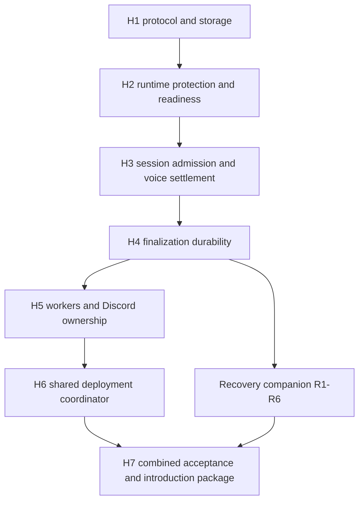

# Safe deployment handoff implementation plan

## Approved outcome and current decision status

The approved change keeps existing recordings on their original owner while a ready replacement accepts new work. Verified saved material can produce clearly partial notes after interruption. The user authorized implementation and subagent review in one PR through merge readiness. H1-H6 and R1-R6 have passed task review; H7 combines their contracts and operational introduction artifacts. Whole-branch review and exact-head PR readiness remain required.

No new product decision is requested by this reconciliation. Hosted Sandbox acceptance, first activation, compatible live rollback and historical repair remain separate. This task does not authorize deployment even where a standing Sandbox permission exists. The private introduction packet retains UNKNOWN identities until an authorized refresh. Completed-object cleanup still lacks a live operating route.

Read [Recording handoff and recovery](../../deployment-handoff.md) for the participant journey, final contracts and evidence limits. The task checklists below preserve the original verification obligations; they are not a claim that every named command ran on the final head. Task reports and the final PR audit provide that evidence.

## Participant experience during a deployment

An existing meeting keeps recording on its original runtime while the replacement gets ready. New starts continue on the old runtime until promotion, then use the ready replacement. Stop controls still reach the meeting's original owner, and notes appear after finalization. A failed candidate leaves the serving runtime unchanged. If capture is interrupted, the recovery companion applies the original settings and shows the saved coverage.

The participant keeps using the same Discord controls, portal or MCP entry point. Permissions and authentication stay unchanged. See the [participant journey](../../deployment-handoff.md) for entry paths and interrupted outcomes.

## Final routing refinement

Keep ordinary user traffic on the available old application during candidate protection and boot. One spare ALB target group separates early health from user traffic under the same rolling service. Exact admission promotion precedes acknowledged listener switching, and old retirement follows both. Unknown routing RPC settlement remains durably blocked even when a read shows intended weights. This adds listener permissions and explicit Terraform drift ownership, with separately approved introduction and hosted proof. The approved product outcome is unchanged. See the [complete routing contract and request flow](../../deployment-handoff.md#candidate-traffic-and-routing-ownership).

## Implementation reference

> **For agentic workers:** REQUIRED SUB-SKILL: Use superpowers:subagent-driven-development (recommended) or superpowers:executing-plans to implement this plan task-by-task. Steps use checkbox (`- [ ]`) syntax for tracking.

**Goal:** Prepare a healthy replacement while the old runtime serves, atomically move new work to it, and retire the old task only after its protected work is durable.

**Architecture:** One environment control table holds serving-generation, runtime readiness and protection, unresolved guild voice operations, and auto-record suppression. Admission and claims check that protocol transactionally. A shared coordinator drives both deployment workflows; runtimes own protection renewal and release. The [recovery companion](2026-10-12-interrupted-recording-recovery-plan.md) supplies crash preservation and truthful interrupted outcomes.

**Tech Stack:** Node.js 24.15.0, TypeScript, installed AWS SDK v3/DynamoDB transactions, native Node fetch for ECS agent/metadata endpoints, existing AWS CLI, discord.js, Jest, DynamoDB Local, Terraform, GitHub Actions.

**Spec:** [Approved deployment and interruption design](../specs/2026-10-12-deployment-drain-and-interruption-design.md).

## Global constraints

- The user authorized implementation, commits, one feature PR and iteration until merge-ready on October 13, 2026. No deployment, production mutation, meeting termination, lease deletion, historical repair or external messages to humans are authorized.
- Routine order is protect old, warm candidate while old serves, verify readiness, switch admission, drain old, then retire. No environment-wide wait for recordings before launching/promoting the candidate.
- All recording/TTS admission and new background claims check the serving generation in their write transaction. Warm runtimes own no work. Old runtime generation tokens cannot be reused after promotion.
- Guild lease ownership, history execution version and unresolved Discord voice-operation settlement are separate checks. TTL or missing task metadata never proves settled voice state.
- Initial timing targets: lease 30 seconds, heartbeat 10 seconds, TTL grace 120 seconds; candidate readiness 15 minutes; retirement reporting 7,500 seconds; Fargate stop timeout 120 seconds. Recovery targets are in the companion. Confirm timings in Sandbox, do not add user-facing knobs.
- Use existing dependencies and repository patterns. Preserve access, mention sanitization, configuration validation and data retention. No analytics widening in this work.
- Every scoped implementation commit gets focused tests and review. Latest-head merge readiness also requires the repository's 30-minute feedback window and final surface refresh. Pushing/green checks alone are insufficient.
- Public behavior docs follow docs-authoring; UI changes require Storybook capture and VLM review. Private operational evidence and runbooks belong in chronote-ops.

## Review focus

1. A start is committed just before promotion but has not registered in memory. It remains protected and blocks retirement, while other guilds can use the replacement. Test in H3/H7.
2. An old Discord join/leave completes after lease expiry. The new owner cannot join under uncertainty. Test in H3.
3. A warm gateway session receives duplicate interaction/voice events. It cannot consume an owner's control or move voice. Test in H5.
4. Rollback reauthorizes an old runtime while it is releasing protection. Fresh protection must precede serving eligibility. Test in H2/H6.
5. A runner disappears after promotion or ECS responds ambiguously. Read back the serving generation and preserve owned work; do not guess or unprotect. Test in H6/H7.

## Execution baseline and sequence

Implementation uses the isolated recording-safe-deployments worktree. Preserve unrelated primary-checkout changes. The initial source snapshot and exact execution metadata belong in the evidence appendix; they do not establish a current deployed runtime.

- [ ] At execution, use using-git-worktrees and the native worktree tools to obtain a clean `codex/` worktree from freshly verified `origin/master`. Record exact base SHA and review relevant drift before editing. Copy only the approved spec and these plan files into it; do not stash, rebase or clean the primary checkout.
- [ ] Read that worktree's AGENTS.md, applicable implementation/review skills, and chronote-ops Sandbox identity/runbook. Discover expected operational tools before choosing a fallback.
- [ ] Run baseline focused lifecycle tests and backend build. Existing failures get recorded before feature changes.



Do not release intermediate protocol pieces against a mixed legacy fleet. Independent testability is a review boundary, not permission to activate an incomplete protocol. Complete both workstreams before enabling it in Sandbox. Existing recordings remain owned by their original runtime throughout handoff.

## Accepted contract refinements

The final membership, mode, local-bootstrap and retirement rules are in [the runtime contract](../../deployment-handoff.md#runtime-and-deployment-contract). `servingMembers` contains exact identities under one generation. Coordinator epoch changes alone do not seal healthy admission. Promotion pins the expected member map and candidate mode; selected disjoint bot/API members may be retained. Local bootstrap is limited to explicit mock or opted-in loopback local/dummy storage and preserves every lease/history/voice guard.

Retirement is `draining -> releasing -> retired`, with durable ineligibility before native protection release. Voice settlement needs matching gateway session/sequence and settled transport proof. Compatible replacement requires completed lineage, exact image/candidate/protocol/mode proof and independent retained voice guards. No task absence or expired lease supplies those proofs.

## File responsibilities and shared contracts

Create `src/types/deploymentControl.ts` for control/runtime/voice records and results; `src/services/deploymentControlTransactions.ts` for pure DynamoDB transaction builders; `src/repositories/deploymentControlRepository.ts` for real/mock storage; `src/services/runtimeLifecycleService.ts` for local admission/work barriers and runtime state; `src/services/runtimeProtectionService.ts` for ECS protection confirmation/renewal; `src/services/guildVoiceOperationService.ts` for external voice settlement; and `scripts/deployment/coordinator.cjs` for workflow orchestration using compiled pure builders and AWS CLI. Avoid importing app startup or secrets into the coordinator. Reuse `src/db.ts`'s client/table-prefix route and repository/mock conventions.

Protocol table uses `pk`/`sk`: `ENV/CONTROL`, `ENV/RUNTIME#<instance>`, `VOICE#<guild>/STATE`, `SUPPRESS#<guild>/CHANNEL#<channel>`. Only stale runtime rows receive `expiresAt`; control, unresolved voice and live suppression records have no TTL. Match existing table encryption/PITR policy.

The shared contract is fixed before downstream work:

| Name                     | Required contract                                                                                                                                                                                                    |
| ------------------------ | -------------------------------------------------------------------------------------------------------------------------------------------------------------------------------------------------------------------- |
| `RuntimeIdentity`        | Discriminated local or ECS identity. ECS variant has instanceId, taskArn, imageDigest, candidateId and protocolVersion `1`; local variant has explicit local identity. Never infer ECS identity from HOSTNAME alone. |
| `AdmissionContext`       | instanceId, authorizedGeneration, protocolVersion, and current epoch-second time. Runtime readiness/protection is rechecked by the transaction, not trusted from a cached boolean.                                   |
| `SessionAdmissionResult` | `kind: "admitted"` with `reservation`, or `kind: "blocked"` with reason `active_session`, `not_serving`, `unavailable`, `voice_uncertain`, or `suppressed`.                                                          |
| `SessionReservation`     | guildId, meetingId, sessionMode, ownerInstanceId, executionVersion, voiceOperationAttemptId, reservedAt, stable history key for recording, and local work handle. Capture start is recorded separately.              |
| `RuntimeWorkKind`        | Fixed set `pending_admission`, `recording`, `finalization`, `personal_processing`, `recovery_processing`, `voice_operation`, `ancillary_delivery`.                                                                   |
| `RuntimeWorkHandle`      | Idempotent `settle(): void`; registration is synchronous before the first await. Counts remain local plus projected runtime heartbeat metadata.                                                                      |
| `HistoryTransition`      | history key, expected meetingId/owner/executionVersion/legal prior status, and whitelisted lifecycle/outcome patch. Does not overwrite the entire row or invoke AI.                                                  |

`RuntimeReadiness` contains exact runtime identity, observed epoch/generation, gateway/cache/dependency readiness, proof time and expiry. `ProtectionConfirmation` contains runtime/task identity, confirmed expiry and proof time. A local test variant is explicit and cannot authorize ECS work. `RetirementResult` uses count/reason metadata, never user content.

Signatures produced by H1-H3 and reused by later tasks:

```ts
buildRuntimeAdmissionChecks(context: AdmissionContext, tables: ControlTableNames): TransactWriteItem[];
buildPromotionTransaction(input: PromotionInput): TransactWriteItemsCommandInput;
getRuntimeAdmissionContext(): Promise<AdmissionContext>;
beginRuntimeWork(kind: RuntimeWorkKind): RuntimeWorkHandle;
tryAcquireMeetingLease(input: AcquireMeetingLeaseInput): Promise<SessionAdmissionResult>;
transitionMeetingHistory(input: HistoryTransition): Promise<"applied" | "stale">;
startRuntimeLifecycle(identity: RuntimeIdentity): Promise<void>;
prepareRuntimeRetirement(input: { retirementEpoch: number }): Promise<RetirementResult>;
```

`ControlTableNames` contains existing table-prefix-derived names; `PromotionInput` pins coordinator token/epoch, expected serving generation, candidate identity and proposed generation. `RetirementResult` is `retired`, `busy`, or `uncertain`, with count/reason metadata. No content-bearing diagnostic fields. Admission builders emit conditions, not exceptions-as-success fallbacks. Existing claimed stop/read operations use owner targeting rather than requiring the serving generation.

## Task 1 (H1): Protocol, conditional storage and infrastructure

**Files:** Create the types, pure builders and control repository above; modify `src/db.ts`, `src/types/db.ts`, `src/types/meetingLifecycle.ts`, `src/repositories/mockStore.ts`, `_infra/main.tf`, `scripts/init-dynamodb.js`, `jest.config.ts`, `package.json`, `.github/workflows/ci-core.yml`; create `jest.deployment-integration.config.ts`, `test/repositories/deploymentControlRepository.test.ts`, `test/deployment/controlTransactions.integration.test.ts`.

**Interfaces:** Produces control records/builders and `transitionMeetingHistory`. Admission and claims consume them without duplicating protocol conditions.

- [ ] Write tests `promotionAndOldAdmissionHaveOnlyTwoLegalOrders`, `missingControlRejectsAdmission`, `staleEpochCannotPromote`, `lateInitialHistoryCannotOverwriteProgress`, `ttlNeverDeletesUnsettledVoice`. Exercise real DynamoDB Local transactions against uniquely prefixed test tables; mock repository parity is separate. Assertions include:

```ts
expect(oldStartAfterPromotion.kind).toBe("blocked");
expect(oldStartBeforePromotion.kind).toBe("admitted");
expect(finalRow.status).toBe("processing");
expect(voiceRecord.expiresAt).toBeUndefined();
```

- [ ] Add an explicit integration runner before the red test: `test:deployment:integration` runs Jest with `jest.deployment-integration.config.ts`, `--runInBand` and a 180-second per-test timeout, selecting `test/deployment/**/*.integration.test.ts`. Ordinary Jest excludes only these deployment integration files. Add a dedicated CI job with DynamoDB Local and Docker available; missing fixture service fails that job rather than silently skipping it. Build a uniquely tagged fixture image outside Jest before container suites and provide `DEPLOYMENT_TEST_IMAGE`; those suites reject a missing image instead of building inside a five-second unit hook. The integration config rejects any endpoint that is not explicit localhost/loopback with dummy credentials. Setup creates/deletes only run-specific local test tables.
- [ ] Run the control-repository unit suite, then `yarn test:deployment:integration --runTestsByPath test/deployment/controlTransactions.integration.test.ts`; confirm red on absent protocol/CAS, not an unavailable service. Fixture service startup is explicit and never stops an existing host process.
- [ ] Implement validated record parsing, builders, repository/mock parity, conditional initial history creation and versioned transitions. Define `starting`, `interrupted`, `failed` lifecycle statuses here before H3/H4 consume them; R1 adds their capture/recovery metadata. DynamoDB errors remain failures; distinguish retryable transaction conflict, stale generation and dependency outage. Add the table and scoped underlying DynamoDB operation permissions including `ConditionCheckItem`, plus ECS protection permissions. Do not invent a `TransactWriteItems` IAM action or expose secrets in workflow variables. Integration clients never inherit host AWS credentials. [AWS transaction IAM requirements](https://docs.aws.amazon.com/amazondynamodb/latest/developerguide/transaction-apis-iam.html).
- [ ] Run the tests, `yarn build`, `yarn prettier:check` on scoped files and Terraform formatting/validation through the established local route. Expected: tests/build pass and table schema matches local setup. No apply.
- [ ] Commit only H1 files with `feat: add runtime admission control protocol`; obtain scoped review.

## Task 2 (H2): Runtime identity, warm readiness and protection lifecycle

**Files:** Create runtime lifecycle/protection services; modify `src/services/runtimeInstanceService.ts`, `src/services/configService.ts`, `src/bot.ts`, `src/webserver.ts`, `src/apps/bot/main.ts`, `src/apps/api/main.ts`; create `test/services/runtimeLifecycleService.test.ts`, `test/services/runtimeProtectionService.test.ts`.

**Interfaces:** Consumes H1. Produces the runtime functions above plus `refreshRuntimeReadiness(): Promise<RuntimeReadiness>` and `confirmRuntimeProtection(): Promise<ProtectionConfirmation>`. These return validated identity-bound, expiring metadata. Only the runtime releases its protection.

- [ ] Write `warmRuntimeOwnsNoWork`, `readinessRequiresGatewayAndRequiredDependencies`, `runnerLossDoesNotStopProtectionRenewal`, `retirementCannotUnprotectOtherOwnedWork`, and `reauthorizationWaitsForPendingProtectionRelease`. Arrange release/promotion with explicit promise barriers:

```ts
expect(warmClaims).toHaveLength(0);
expect(promotedWhileReleasePending).toBe(false);
expect(unprotectCallsWhileOwnedWorkRemains).toBe(0);
```

- [ ] Run both new service suites and confirm red.
- [ ] Implement metadata identity, synchronous work registration, fresh heartbeat/readiness snapshots, and protection confirmation/renewal through native ECS agent APIs. Warm status is not HTTP-ready permission to process work. Initial proposed protection duration is 10 minutes, renewed every minute with a 2-minute safety margin; validate these against Sandbox. On uncertainty, reject new work before the confirmed window expires and checkpoint/fence owned work before expiry. A release marks the runtime ineligible first, settles under the local barrier, then calls ECS; reauthorization requires fresh protection after release.
- [ ] Run those suites and `yarn build`. Assert gateway login failure and stale image/readiness prevent promotion, API-only owned work contributes to retirement, and no coordinator directly unprotects a reauthorized runtime.
- [ ] Commit `feat: add protected runtime warmup and retirement`; obtain scoped review.

## Task 3 (H3): Shared session admission and external voice settlement

**Files:** Modify `src/services/activeMeetingLeaseService.ts`, `src/commands/startMeeting.ts`, `src/commands/say.ts`, `src/meetings.ts`, `src/bot.ts`, `src/types/meeting-data.ts`; create guild voice-operation service; extend `test/services/activeMeetingLeaseService.test.ts`, `test/commands/startMeetingContextMenu.test.ts`, `src/__tests__/meetings.test.ts`; create `test/services/guildVoiceOperationService.test.ts` and `test/deployment/admissionRace.integration.test.ts`.

**Interfaces:** `AcquireMeetingLeaseInput` adds admission context, stable history identity and explicit `VoiceSessionMode`; produces typed reservation/result. Voice service produces `joinOwnedVoiceSession(reservation: SessionReservation, options: OwnedVoiceJoinOptions): Promise<VoiceConnection>` and `settleOwnedVoiceSession(reservation: SessionReservation): Promise<"settled" | "uncertain">`. Derive `OwnedVoiceJoinOptions` from existing MeetingInitOptions voiceChannel, guild and captureAudio fields plus an AbortSignal. Every join/reconnect/leave/cleanup goes through its lifecycle barrier.

- [ ] Write both promotion/start orderings for manual, context menu, auto-channel, auto-all and remote starts, plus `reservationHeartbeatsBeforeInitialization`, `ttsAndRecordingCannotMoveEachOther`, `expiredLeaseWithLateJoinBlocksTakeover`, and `missingTaskDoesNotSettleVoice`:

```ts
expect(newVoiceJoinsWhileOldOperationUncertain).toBe(0);
expect(reservationHeartbeatCountBeforeInMemoryRegistration).toBeGreaterThan(0);
expect(ttsHistoryWrites).toHaveLength(0);
```

- [ ] Run voice/active-lease unit suites and `yarn test:deployment:integration --runTestsByPath test/deployment/admissionRace.integration.test.ts`; confirm red.
- [ ] Implement atomic admission/control/runtime/lease/history/voice-attempt reservation, stable retries and initialization unwinding. Heartbeat starts on reservation. Every TTS-only path acquires the guild lease; recording-specific consumers exclude TTS rows. Delayed callbacks cannot issue external voice changes after closure; settlement requires completed/cancelled local operations, closed connection and matching Discord acknowledgment. Persist uncertainty without TTL and block that guild until proved settled or reconciled by an operator. Do not infer safety from lease expiry or claim to fence Discord with a database token.
- [ ] Run listed suites and `yarn build`; confirm no path can join voice before admitted reservation and no content/permission fallback was added.
- [ ] Commit `fix: fence recording admission and voice ownership`; obtain scoped review.

## Task 4 (H4): Lease renewal and history durability through finalization

**Files:** Modify `src/services/activeMeetingLeaseService.ts`, `src/commands/endMeeting.ts`, `src/commands/saveMeetingHistory.ts`, `src/services/meetingHistoryService.ts`, `src/repositories/meetingHistoryRepository.ts`; extend `test/commands/endMeeting.test.ts`, `test/commands/saveMeetingDelivery.test.ts`, `test/services/meetingHistoryService.test.ts`, active-lease tests.

**Interfaces:** Reuse `runEndMeetingFlow(options: EndMeetingFlowOptions): Promise<void>` in `endMeeting.ts` behind its existing button/other handlers, with one owned finalization promise. `saveMeetingStartToDatabase` no longer performs a delayed unconditional initial put. Lifecycle save failures propagate to durable disposition instead of successful cleanup. R3 supplies bounded interruption shutdown.

- [ ] Write `remoteStopKeepsRenewingBeyondLease`, `onlyOneFinalizerWins`, `preparationFailurePersistsFailure`, `historyFailureRetainsArtifactsAndWork`, `lateInitialSaveCannotRegressTerminalHistory`, `expiredOwnerCannotRenewAfterRecovery`:

```ts
expect(heartbeatActiveDuringFinalization).toBe(true);
expect(finalizerInvocationCount).toBe(1);
expect(cleanupBeforeDurableDisposition).toBe(false);
```

- [ ] Run the affected command/history/lease suites; confirm red.
- [ ] Implement shared idempotent finalization promise, renewal independent of awaited end callback, owner/version/unexpired renewal conditions, and conditional terminal writes. Include preparation/encoder/Discord failures within error-aware cleanup. Resolve completion and release only after durable disposition; ancillary delivery is tracked or explicitly checkpointed. Do not turn persistence failure into complete analytics/history.
- [ ] Run suites plus `yarn build`; a provider outage cannot cause lease deletion followed by a successful in-memory finish with no durable outcome.
- [ ] Commit `fix: retain ownership until finalization is durable`; obtain scoped review.

## Task 5 (H5): Worker admission, interaction ownership and suppression handoff

**Files:** Modify `src/services/meetingControlWorkerService.ts`, `meetingControlBotService.ts`, `personalMediaUploadWorkerService.ts`, corresponding repositories, `autoRecordJoinSuppressionService.ts`, `src/db.ts`, `src/bot.ts`; reuse the existing `src/webserver.ts` startup gate through `whenRuntimeServing`, verified during H5 review without a cosmetic source edit; extend repository/control/suppression suites and create `test/deployment/runtimeWorkAdmission.test.ts`.

**Interfaces:** Claim repositories accept `AdmissionContext` for new start/processing claims and use H1 checks inside the same claim transaction. Already owned stop/status/transcript commands target their lease owner. Suppression repository methods in the H1 control repository publish conditional state/version used by auto admission.

- [ ] Write `noClaimAfterRetiringAcknowledgment`, `warmRuntimeDoesNotConsumeOwnerInteractionReceipt`, `oldOwnerStillReceivesStopAfterPromotion`, `uploadIntakeQueuesWithoutInlineProcessing`, and `lateExplicitStopSuppressesNewRuntimeAutoJoin`:

```ts
expect(warmInteractionReceipts).toHaveLength(0);
expect(stopExecutionOwner).toBe(oldLeaseOwner);
expect(newAutoJoinsAfterPersistedExplicitStop).toBe(0);
```

- [ ] Run `yarn test --runInBand --runTestsByPath test/deployment/runtimeWorkAdmission.test.ts test/repositories/meetingControlCommandRepository.test.ts test/services/autoRecordJoinSuppressionService.test.ts`; confirm red.
- [ ] Implement transactionally eligible claims, pending-claim accounting and owner-directed existing controls. Inspect every upload intake/processing call site; queue durable jobs instead of warm inline processing. Warm listeners cannot change commands, voice, receipts or capture. Persist suppression before release and continuously through overlap; admission checks its observed version. After promotion, reevaluate current eligible occupied channels with normal permission, limits and suppression checks. Rejected completed starts never execute later.
- [ ] Run affected suites/build; ensure owned work continues renewing claims on retiring runtimes, and API-only workers obey the same ownership protocol.
- [ ] Commit `fix: route new work and controls by runtime ownership`; obtain scoped review.

## Task 6 (H6): One shared coordinator for production and Sandbox workflows

**Files:** Create `scripts/deployment/coordinator.cjs`, `test/scripts/deploymentCoordinator.test.ts`; modify `.github/workflows/deploy.yml`, `deploy-staging.yml`, `_infra/main.tf`, `_infra/README.md` and Docker command only if signal testing requires direct Node execution.

**Interfaces:** Coordinator CLI has `prepare`, `promote`, `retire`, `reconcile` phases with environment-bound inputs `ECS_CLUSTER`, `ECS_SERVICE`, `ECS_TASK_FAMILY`, `DDB_TABLE_PREFIX`, candidate identity/image and run token. Import compiled H1 pure builders; execute AWS CLI via argument arrays, never shell-built JSON. Persist phase/proof metadata before transitions and read back ambiguous outcomes.

- [ ] Write `oldAdmissionStaysOpenDuringWarmup`, `candidateWithoutBotReadinessCannotPromote`, `failedWarmupDoesNotDrainOld`, `runnerLossReadsBackPromotion`, `rollbackKeepsCandidateRecordingProtected`, `twoBusyProtectedTasksDoNotGetKilledForCapacity`. Inject fake AWS responses and barriers, with zero live provider calls:

```ts
expect(admissionClosuresDuringHealthyWarmup).toBe(0);
expect(promotionBeforeReady).toBe(false);
expect(stopBusyTasksToMakeRollbackSpace).toBe(0);
```

- [ ] Run coordinator tests; confirm red.
- [ ] Implement serialized per-environment orchestration, old protection confirmation before ECS update, candidate warm/readiness proof, atomic promotion and owner-acknowledged retirement. Derive `DDB_TABLE_PREFIX` from the validated existing `SECRETS_PREFIX` plus its trailing hyphen, and confirm it matches the task's configured table route without retrieving secrets. Install runner dependencies and run backend build before invoking the compiled pure builders. Configure minimum health 100/maximum 200 and explicit stopTimeout 120. Request supported ECS early success at healthyPercent 100 with sourceServiceRevisionCleanup DEFERRED, and read it back. Early ECS success is not application readiness or retirement. Start a health-only listener before bounded exact-task protection retry; full readiness and application routes wait for protected boot. Bind the candidate revision to the empty zero-weight group; preserve the source revision binding. Implement the exact two-group routing contract above, with sticky submitted uncertainty, no automatic replay, acknowledged switching before retirement, rollback routing, occupied-slot refusal and explicit introduction/IAM inputs. Preserve task-definition fields and generation identity. Retain old healthy serving generation on pre-promotion failure; after promotion, use fresh-generation rollback to the exact ready prior members only before any retirement request and under matching durable deployment authority. If capacity or safe rollback target is missing, preserve work and report required recovery. No `always()` unprotect/reopen shortcut, no automatic cleanup of uncertain tasks.
- [ ] Run coordinator tests, backend build, scoped YAML/Terraform checks and image-definition tests. Both workflows call the same phases and have compatible concurrency/cancellation behavior. Do not invoke them now.
- [ ] Commit `feat: coordinate warm recording-safe deployments`; obtain scoped review.

## Task 7 (H7): Combined acceptance and operational introduction package

**Files:** Create `test/deployment/warmHandoff.integration.test.ts`, `scripts/deployment/verify-sandbox-handoff.cjs`, internal `docs/deployment-handoff.md`; update `apps/docs-site/docs/discord-meeting-notes.md` and `apps/docs-site/docs/whats-new/index.md`. Detailed operating procedure/evidence files go in chronote-ops during execution.

**Interfaces:** Depends on reviewed H1-H6 and recovery R1-R6. The initial runner is dry-run only, with no provider execution mode. Its pure generated-local descendant validator requires terminal history plus independent settled capture/recovery/current-work receipts; it supplies no live fence or deletion authority. The actual completed-object deletion route remains MISSING. Synthetic acceptance runner accepts explicit Sandbox resource/fixture identities, reports metadata/checksums/stage outcomes, and never defaults to production. A dry-run prints intended tests without provider mutation.

- [ ] Write a deterministic integrated test: old recording, successful starts during candidate warmup, failed candidate leaving old admission open, good candidate promotion, unrelated new-guild recording on candidate, old stop/finalization/retirement, and rollback while candidate owns work. Assert both runtime ownership and persisted outcomes, not just workflow success.
- [ ] Run `yarn test:deployment:integration --runTestsByPath test/deployment/warmHandoff.integration.test.ts`, then the relevant broader suites and `yarn lint:check`, `yarn build:all`, `yarn docs:check`, scoped format/Markdown checks. Expected: all changed contracts and regression tests pass. UI-specific checks are in R5.
- [ ] Write the legacy introduction package with exact old/current/candidate identities, a compatible rollback artifact, verified Sandbox route and explicit unresolved legacy-admission limits. Keep it operational and private. The current binary cannot obey the new gate; a quiet snapshot or task protection alone is not a race-free introduction. No production rollout may start until an approved, proved bridge/maintenance procedure exists. This is a production activation boundary, not a reason to leave product implementation unfinished.
- [ ] Only after the user explicitly extends this task to Sandbox acceptance, perform synthetic hosted handoff and interruption tests, including actual ECS protection, fresh bot readiness, DynamoDB concurrency, voice settlement and artifact metadata. The original no-deployment restriction still applies; general standing Sandbox approval does not override it. Within an authorized acceptance scope, use the standing route and confirmed identity. This implementation task executes no hosted acceptance.
- [ ] Record separate local, container, Sandbox and production-unverified evidence. Review the whole branch; follow PR recycle/exact-head gates before claiming merge-ready. Commit `test: prove warm handoff and interrupted-recording acceptance` with only scoped product files.

## Completion and execution handoff

Code and PR completion require the local/container checks, independent whole-branch review and the exact-head readiness gate. Hosted acceptance is complete only after a separately authorized Sandbox sequence proves the combined behavior. These are separate completion claims. Production activation and historical orphan repair remain separate. Preserve the exact execution worktree, commit/head, evidence and any blocked introduction step in the private owner note.

Recommended execution method is subagent-driven task implementation/review because the shared admission, external Discord effects and recovery contracts need independent scrutiny. Native execution remains an option. The user selected subagent-driven implementation and review, one PR, and iteration until merge-ready. Preserve separate deployment and hosted-acceptance boundaries.

## Evidence appendix

The original design source snapshot was `c46df7a8d5aacadc65a4b413e56fd259c2f0105d`. It is historical source evidence, not a current running identity. Exact task commits, commands, output and current-head checks are retained in the implementation reports and PR audit. Detailed provider identities stay in chronote-ops.
