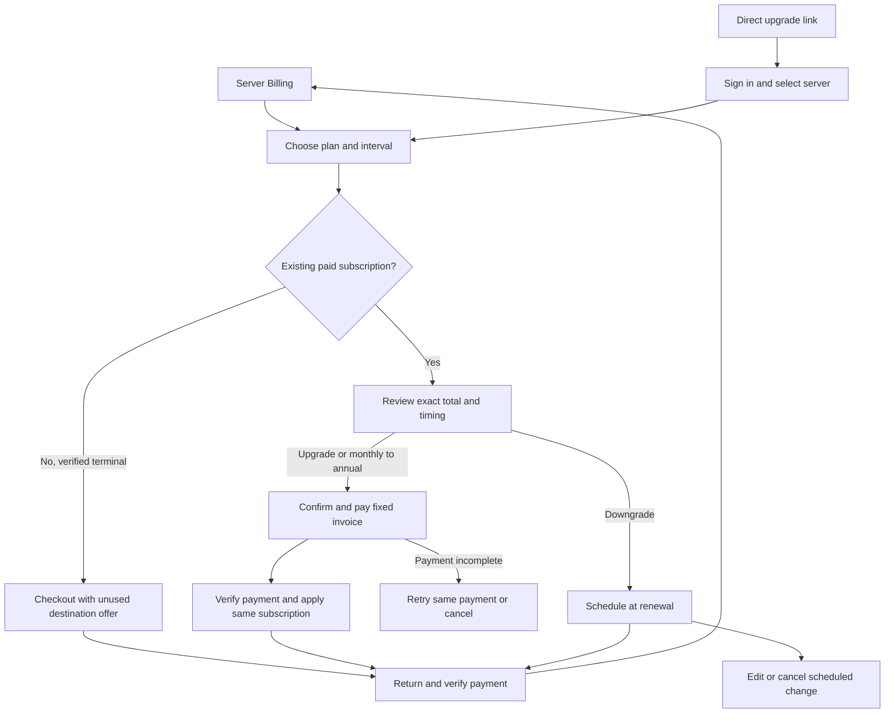

# Plan switching and introductory offers implementation plan

> **For agentic workers:** Use superpowers:executing-plans to implement this approved continuation task by task. Use test-first changes and one whole-branch review.

**Goal:** Connect real plan changes and both one-use Basic offers, then verify them in the existing Sandbox.

**Architecture:** Keep initial purchases in Checkout. For active subscriptions, persist one server-scoped operation, finalize a separate exact funding invoice before consent, collect it through Stripe, and apply the paid change to the existing subscription. Use native subscription schedules for renewal changes. Keep independent monthly and annual offer records and the existing verified historical coverage.

**Tech stack:** TypeScript, Stripe API 2026-07-29.dahlia, DynamoDB transactions, tRPC, React and Mantine.

**Spec:** Approved product decisions in chat and the private design at `D:/bench/chronote-ops/strategy/2026-10-13-plan-switching-design.md`. This plan replaces the older hosted-confirmation proposal in `docs/billing-subscription-transitions.md`.

## Outcome and decisions

The payer reviews the exact amount, unused paid-time credit, account balance, tax, effective date and renewal terms. Payment failure keeps the current plan. Returning from Stripe resumes the same operation. A downgrade keeps the already purchased period and can be edited or canceled.

Each server can use the $6 monthly offer for three months and the $60 first-year offer once each, in either order. Leaving an offer ends its remaining duration. Returning never restarts it. Pro uses its regular price. Enrollment has no invented deadline.

The user has approved implementation and owned Sandbox tests. Production activation is outside this continuation. The tested finalized-invoice adapter is the selected starting point. Owned Sandbox probes have verified nonzero inclusive automatic tax in both billing modes. Unsupported financial states must preserve the current plan and provide recovery.

## Global constraints

- Preserve Manage Server and original Stripe payer authorization.
- Never create subscription Checkout for a nonterminal existing subscription.
- Use unused actually paid time, after discount, for credit.
- Basic monthly to annual and Basic to Pro are immediate after confirmed payment. A cadence change starts a full new paid period.
- Pro to Basic, annual to monthly within a tier, and paid to Free take effect at renewal. Pro monthly to annual is an immediate cadence change.
- Offer use is finalized only after verified application and settlement. Reservations survive unknown outcomes, and cancellation releases them only after provider proof.
- Preserve provider billing mode and subscription identity. Immediate updates preserve the item; deferred phases verify Stripe's actual target item, which Stripe replaces during a price change. Preserve unrelated subscriptions, balance changes and pending items.
- Finalized funding and application are separate invoices. Do not collect an application invoice a second time. Recover residual debt without erasing later balance transactions.
- Keep acquisition metadata distinct from transition metadata. No new analytics identifiers or events in this phase.
- Keep production gates off. Deploy only to the existing Sandbox with its active-recording guard and rollback.

## User journey

## Review focus

1. A delayed or replayed paid event must never apply stale service after renewal or a competing provider change.
2. Payment covered by account credit still needs explicit consent and one-time offer settlement.
3. A source discount cannot reach Pro or regain unused duration after leaving Basic.
4. Scheduled phase application and invoice events may arrive in either order.
5. Account balance or pending-item changes cannot alter an already approved charge or be erased during compensation.

## Task 1: Change policy and public contracts

**Files:** `src/types/billingChange.ts`, `src/services/billingChangePolicy.ts`, `test/services/billingChangePolicy.test.ts`.

**Interfaces:** Produces `resolveChangeTiming({sourceTier, sourceInterval, targetTier, targetInterval})`, a same-plan no-op, and schema-derived operation, source, target and public quote types. Quote amounts use integer minor units.

- [x] Add table-driven timing tests for all tier/cadence pairs and unchanged selections.
- [x] Run focused Jest and observe the missing-policy failure.
- [x] Implement timing and validated operation/quote contracts. Reuse the existing review component's field meanings.
- [x] Run focused Jest. Expected: all policy cases pass.
- [x] Commit this task.

## Task 2: Durable operation and shared offer transactions

**Files:** `src/repositories/billingChangeRepository.ts`, `src/db.ts`, `src/repositories/mockStore.ts`, `src/types/offerUsage.ts`, repository tests.

**Interfaces:** Consumes Task 1 operation types. Produces `getControl`, `getOperation`, `claim`, and `compareAndWrite`. Claims bind the saved subscription revision and optional offer authority. Completion atomically finalizes or releases the reservation.

- [x] Add concurrency tests for competing tabs, renewal operations, changed source revision, independent offer identities and immutable used history.
- [x] Run focused Jest. Expected: missing repository behavior fails.
- [x] Implement actual DynamoDB transactions and equivalent mock-store behavior without manufacturing purchase attempts.
- [x] Run repository and existing offer/renewal tests. Expected: all pass.
- [x] Commit this task.

## Task 3: Fixed invoice adapter and recovery

**Files:** `src/services/billingChangeProvider.ts`, `billingChangeFunding.ts`, `billingChangeRecovery.ts`, service tests.

**Interfaces:** Consumes frozen source/target and operation IDs. Produces verified source fingerprint, preview, finalized funding invoice, application result and compensating result. Every write uses a deterministic operation idempotency key.

- [x] Add tests for discounted unused credit, both billing modes, balance drift, zero cash, source rollover, decline/authentication, canceled links, repeated compensation and nonzero inclusive tax.
- [x] Run focused tests and observe the required missing behavior.
- [x] Implement the previously tested native sequence, preserving discounts until application and excluding unrelated pending items from funding.
- [x] Verify native response/ownership/status before accepting financial results. Keep unknown operations recoverable.
- [x] Run focused adapter tests. Expected: exact consent, no duplicate collection and bounded compensation pass.
- [x] Probe any unresolved native contract using only new owned Sandbox fixtures and verify cleanup.
- [x] Commit this task.

## Task 4: Switching orchestration, schedules and reconciliation

**Files:** `src/services/billingChangeService.ts`, `billingChangeSchedule.ts`, `src/api/billing.ts`, `src/services/subscriptionReconciliation.ts`, `src/trpc/routers/billing.ts`, service/router/webhook tests.

**Interfaces:** Consumes Tasks 1 to 3. Produces `prepareBillingChange`, `confirmBillingChange`, `readBillingChange`, `cancelBillingChange` and authenticated tRPC procedures. Deferred operations reserve the offer and use a native future phase.

- [x] Add tests for original payer, Manage Server, disabled fresh operations, payment-event ordering, explicit zero-cash consent, both offer orders and schedule edit/cancel/application.
- [x] Observe failing tests, implement orchestration and native schedules, then pass the tests.
- [x] Keep owned recovery available after a gate is disabled. Remove the rejected hosted update adapter and customer-wide offer lock.
- [x] Commit this task.

## Task 5: Connect the existing review and recovery UI

**Files:** `src/frontend/pages/Billing.tsx`, existing `BillingChangeReview.tsx`, a billing change hook, Storybook fixtures, browser tests and billing documentation.

**Interfaces:** Consumes the Task 4 public view. Plan selection opens the existing review. Confirm opens the bound Stripe invoice, and refresh/return resumes persisted status. Scheduled changes show effective date and edit/cancel actions.

- [x] Add flow tests before wiring the UI. Keep narrow cards vertically stacked and retain the approved price/copy presentation.
- [x] Connect real APIs and preserve route server identity. Remove obsolete account-wide restriction copy and data.
- [x] Run Storybook capture, review screenshots and existing visual snapshots, and run browser assertions for the complete flow.
- [x] Update public billing documentation for changed behavior and run docs checks.
- [x] Commit this task.

## Task 6: Review, publish and Sandbox acceptance

- [ ] Run the complete unit suite, builds, lint, formatting, relevant browser/visual tests and source checks.
- [ ] Obtain a fresh whole-branch review, fix valid material findings with reproducing tests, and publish a PR.
- [ ] Inspect all PR feedback/checks for the exact head after the required 30-minute window. Do not equate an early green run with merge readiness.
- [ ] Configure only owned Sandbox introductory resources, register the normal writer and apply verified server history coverage.
- [ ] Review Terraform changes and deploy the exact tested source to Sandbox through its existing workflow.
- [ ] Verify actual image, Dev bot, test-mode provider, healthy API and rollback.
- [ ] Use the signed-in app to purchase both offers in sequence, upgrade with paid-time credit, schedule/edit/cancel a downgrade, and verify native invoice, operation, offer records and entitlements.
- [ ] Run owned test clocks for future phase and offer expiration/renewal behavior. Clean up owned active test resources and retain sanitized results with detailed private evidence.

## Evidence appendix

Starting source: current remote master `7ef341791db82aa04ceb0ba609c77f872d94d74b`. The previously deployed renewal implementation is preserved. Prior independent-invoice provider evidence includes 18 accepted owned Sandbox cases and verified cleanup. Native probes remain separate from integrated signed-in application acceptance.

## Implementation checkpoint

The core implementation for Tasks 1 through 5 is on PR #412. Failed-renewal cancellation remains open below. The latest complete functional run passed 3,074 tests across 358 suites. The connected UI previously passed 48 browser tests and six Storybook flows, including mobile scrolling and terminal-subscription recovery. Screenshots were reviewed. TypeScript, ESLint, pinned complexity checks, the API build and public docs build pass.

Review fixes keep expired preparation recoverable, reject credits from reversed invoices, and retain the server control until entitlement reconciliation succeeds. Schedule creation saves its native receipt before configuration. If that acknowledgement is lost, recovery verifies Stripe's exact creation idempotency key through its event record. Stripe retains those records for 30 days; an older unacknowledged creation requires operator reconciliation rather than adopting an unproven schedule. Canceling a scheduled change restores the cancellation captured from the original subscription.

Native Sandbox tests using the current services verified both offer orders in classic and flexible modes. They covered explicit confirmation of a zero-dollar annual switch and a scheduled monthly offer with an unrelated invoice item. The annual coupon is verified on the application invoice after Stripe consumes it. The first invoice after a scheduled phase change can be a subscription-update invoice; acceptance still requires the exact target line, offer, period and operation owner. Native recovery tests also verified card declines, required authentication, same-invoice retry, unpaid immediate cancellation, and compensation of cash-funded and customer-credit-funded changes. Refund requests omit zero amounts, as required by Stripe. Test clocks, attached test payment methods and coupons were cleaned up.

These native tests use an in-memory operation store and explicitly simulated eligibility authority. They do not prove the deployed writer, history import or signed-in application. Hosted acceptance still needs the guarded Sandbox deployment bootstrap and its separately reviewed deployment identity. Production activation remains outside scope. The latest pushed commit needs a fresh CI/review audit after the required 30-minute window.

### Provider references

- [Stripe credit notes and payment allocation](https://docs.stripe.com/api/credit_notes/create)
- [Stripe event request identity and retention](https://docs.stripe.com/api/events/object)
- [Schedule release and cancellation-date preservation](https://docs.stripe.com/api/subscription_schedules/release)

## Revised decision: two-day renewal grace

The user requested about two days of grace before a failed renewal downgrades the server. This replaces the earlier immediate return to Free when an unpaid renewal is canceled. The proposed details are in [Two-day grace for failed renewal payments](../specs/2026-10-16-renewal-payment-grace-design.md).

The recommendation retains the previous paid tier for a fixed 48 hours, permits retrying the same invoice, and preserves remaining grace after explicit cancellation. Automatic expiry must enforce access without a browser and reconcile only the plan charge, allocated credit and any money received. Ordinary renewals and scheduled plan changes follow the same rule. The current product has no bounded grace implementation.

The user approved the full grace behavior on October 16. Implement it through the [renewal grace implementation plan](2026-10-16-renewal-payment-grace.md), which covers ordinary renewals and scheduled changes. The existing open PR finding remains unresolved until implementation and verification pass. Hosted acceptance still depends on the separate guarded Sandbox bootstrap.
