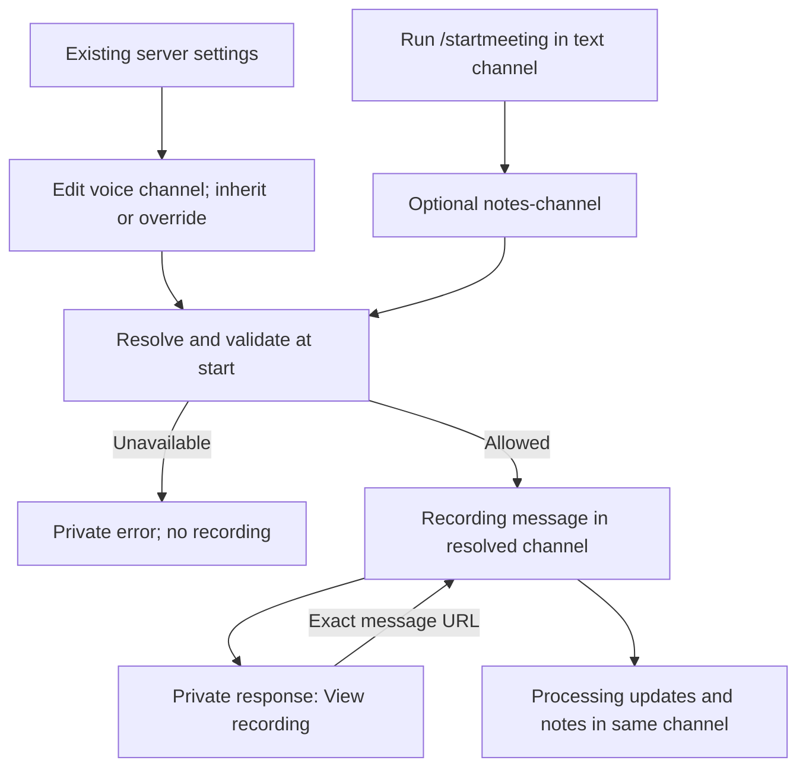

# Notes destination implementation plan

> **For agentic workers:** REQUIRED SUB-SKILL: Use superpowers:subagent-driven-development (recommended) or superpowers:executing-plans to implement this plan task-by-task. Steps use checkbox (`- [ ]`) syntax for tracking.

**Goal:** Start a meeting from a convenient Discord channel while keeping recording controls, processing updates and notes in the chosen destination.

**Architecture:** Resolve the existing channel/server `notes.channelId` setting at start, with a one-meeting slash override. Reuse the manual start lifecycle and deferred private reply, publish one recording message, and retain its actual URL. Keep routing independent of auto-recording in the existing settings editor.

**Tech stack:** Node.js 24.15.0, TypeScript, discord.js v14, React 19, Mantine, tRPC, Jest, Storybook and Playwright. No new dependencies or storage.

**Spec:** [Approved notes destination design](../specs/2026-10-16-notes-destination-design.md).

**Execution:** BASIC approved this plan and selected subagent execution on October 16, 2026. Each task has a fresh implementer and task review, followed by a fresh whole-branch review. Deployment remains separately scoped.

## Global constraints

- Destination order: explicit one-meeting choice, voice-channel override, server default, invocation text channel only when nothing is configured. Auto-recording and remote starts have no invocation-channel fallback.
- The recording message, End meeting control, processing updates and final notes stay in the resolved channel. Freeze that channel at start; later settings changes affect the next meeting.
- `/startmeeting` always defers privately, even when invocation and destination channels match. Show **View recording** only after publication, using the actual Discord message URL.
- Anyone already eligible to start may choose an accessible one-meeting destination where the bot can post. Saved settings retain their existing administrator authorization. Choosing a channel never grants access or enables recording.
- The new slash option is exactly `notes-channel`, optional, restricted to `ChannelType.GuildText`. Threads, forums and DMs are outside the new picker. Existing explicit API/MCP destination choices remain explicit and retain their existing validation contract.
- Deleted, inaccessible or unavailable configured/explicit destinations block the start. No silent fallback, channel-name disclosure, automatic restart or duplicate message on an uncertain publication result.
- Preserve admission, limits, ownership, cancellation, capture warnings, delivery acknowledgment, cleanup/recovery, context, tags and interaction deadlines. Personal uploads and exports are out of scope.
- No new lifecycle, tables, configuration keys, pricing, analytics collection, setup wizard or onboarding campaign. Keep the originating first-meeting design and plan under their existing ownership.
- Implementation starts in a clean worktree from then-current remote `master`. Reconcile this plan with that head; do not carry unrelated changes from the dirty planning checkout.

## Review focus

1. A missing configured destination or config read failure must not post to a broader invocation channel. Cover in Task 1.
2. Selecting a readable destination must not require administrator permission or widen end-meeting authority. Inaccessible destinations must remain unnamed. Cover in Tasks 1–2.
3. Publication failure after initialization and private acknowledgment failure after publication require different outcomes. Preserve capture ownership without duplicate starts or posts. Cover in Task 2.
4. An override equal to the current server default remains explicit. Auto-record toggle saves and reset must not erase other settings or change recording behavior. Cover in Task 3.
5. A channel with no stored override still needs an editable inherited row. Narrow layouts and save failures must retain reachable actions and unsaved choices. Cover in Tasks 3–4.

## User journey retained by this plan



The settings and exact-message choices are approved. Reuse the bounded Mobbin findings and their limits in the spec; no further reference research is needed for these settled choices.

## Task 1: resolve a destination without unsafe fallback

**Files:** Create `src/services/meetingNotesDestinationService.ts` and `test/services/meetingNotesDestinationService.test.ts`. Modify default resolution in `src/bot.ts` and `src/services/meetingControlBotService.ts`. Create `test/services/meetingControlBotService.test.ts`; extend `test/bot.voiceFailureBoundaries.test.ts` for the voice-join path.

**Interfaces:** Export these from the new service:

```ts
resolveMeetingNotesChannel(input: {
  guild: Guild;
  voiceChannelId: string;
  explicitChannelId?: string;
  invocationChannelId?: string;
}): Promise<TextChannel>;
assertMemberCanAccessNotesChannel(member: GuildMember, channel: TextChannel): void;
```

The resolver owns selection, channel fetching and ordinary-text-channel validation. The member assertion requires `ViewChannel` and `ReadMessageHistory` so the starter can follow the recording controls. It does not require administrator or destination `SendMessages`. Preserve any stronger existing remote-start eligibility check at its current caller. Existing `checkBotPermissions` remains responsible for the bot's voice and full meeting-text permissions before initialization.

- [ ] Add tests `explicit_destination_wins`, `voice_override_wins`, `server_default_wins`, `unconfigured_manual_uses_invocation`, `unconfigured_remote_or_auto_blocks`, `unavailable_destination_never_falls_through`, and `starter_access_does_not_require_admin`. Use real resolver precedence with mocked config/Discord reads. Pin these assertions:

  ```ts
  expect(resolved.id).toBe(expectedDestinationId);
  expect(fetchChannel).not.toHaveBeenCalledWith(invocationChannelId);
  expect(initializeMeeting).not.toHaveBeenCalled();
  expect(error.message).not.toContain(hiddenChannelName);
  ```

  The last two belong to the caller fixtures. Cover explicit/configured missing IDs, permission-provider/fetch failure, config-read failure, another guild, thread, forum, DM, bot permission denial, and a readable destination where the starter cannot send messages. An empty stored value follows existing trimmed-string semantics; a failed read is not an empty value.

- [ ] Run `yarn test --runInBand --coverage=false --runTestsByPath test/services/meetingNotesDestinationService.test.ts`. Expect failures from the absent service or new behavior, not fixture errors.
- [ ] Implement the resolver with `resolveConfigSnapshot({ guildId: guild.id, channelId: voiceChannelId }, { strict: true })`, `getSnapshotString(..., CONFIG_KEYS.notes.channelId, { trim: true })`, and `guild.channels.fetch`. Skip the config read for an explicit destination. Pass the chosen ID through one fetch/type check; never retry selection after a failed fetch. Return a generic destination error without the inaccessible name.
- [ ] In `bot.ts` voice-join auto-recording, resolve using the current voice channel, without a human permission requirement or invocation fallback. Keep existing enabled-rule selection, tags, trigger identity, permission notices and admission callback. This also lets a notes-only voice override apply when recording comes from the server-wide rule. Preserve TTS-only routing.
- [ ] In `meetingControlBotService.ts`, keep explicit `input.textChannelId` selection/validation intact. Only the omitted-destination path uses the new resolver with the already resolved voice channel. Retain `assertMemberCanUseTextChannel`, queue ownership, cancellation and limits. Remove the superseded server-only default helper after its caller is migrated.
- [ ] Add caller tests for channel-over-server auto routing with auto-record-all, no configured auto destination, unchanged explicit remote destination, omitted remote destination using voice settings, and denied remote access. Run the new resolver and remote tests plus `test/bot.voiceFailureBoundaries.test.ts` and `test/commands/recordingLimitStart.test.ts`. Expect all passing.
- [ ] Commit only Task 1 files with message `feat: resolve meeting notes destinations`.

## Task 2: publish one recording message and acknowledge privately

**Files:** Modify `src/commands/startMeeting.ts`, `src/commands/startMeetingContextMenu.ts` only if its call contract needs adjustment, `src/bot.ts`, and the manual publication call in `src/services/meetingControlBotService.ts`. Create `test/commands/startMeeting.test.ts`. Extend `test/bot.voiceFailureBoundaries.test.ts`, `test/commands/startMeetingContextMenu.test.ts`, `test/services/meetingControlBotService.test.ts`, `test/commands/recordingLimitStart.test.ts`, and `test/commands/endMeeting.test.ts` where the routed lifecycle needs coverage.

**Interfaces:** Keep `startManualMeetingFromChannels` and `buildManualMeetingStartedMessage` contracts. Pass the resolved destination as the existing `textChannel`. Export from `startMeeting.ts`:

```ts
publishManualMeetingStartedMessage(
  meeting: MeetingData,
  liveMeetingUrl: string | null,
): Promise<Message<true>>;
```

It posts the existing recording payload to `meeting.textChannel`, assigns the returned `message.id` to `meeting.startMessageId`, and returns that same message. Both Discord manual starts and remote manual publication use it. The private acknowledgment remains outside this function so its failure cannot trigger publication cleanup.

- [ ] Add tests `private_reply_in_same_and_different_channels`, `slash_and_context_menu_share_defaults`, `acknowledgment_links_to_published_message`, `publication_failure_preserves_owned_capture`, `ack_failure_keeps_published_recording`, and `running_destination_is_frozen`.

  ```ts
  expect(interaction.deferReply).toHaveBeenCalledWith({ ephemeral: true });
  expect(recordingChannel.send).toHaveBeenCalledTimes(1);
  expect(meeting.startMessageId).toBe(message.id);
  expect(acknowledgment.components[0].toJSON().components[0].url).toBe(
    message.url,
  );
  expect(initializeMeeting).toHaveBeenCalledTimes(1);
  ```

  Adapt payload access to the actual serialized builder type. Assert the acknowledgment contains the resolved voice/destination, **View recording**, and `allowedMentions: { parse: [] }`. On publication rejection, no success/link is sent and the interruption owner is called. On acknowledgment rejection, the interruption owner is not called, `startMessageId` remains set and no retry occurs. Simulate uncertain publication, not only a definite permission rejection.

- [ ] Run the new command test with `yarn test --runInBand --coverage=false --runTestsByPath test/commands/startMeeting.test.ts`; confirm the new assertions fail against current behavior.
- [ ] Register optional `notes-channel` with `.addChannelTypes(ChannelType.GuildText)` in `setupApplicationCommands`, preserving `context`, `tags` and command eligibility. Test the registered command JSON through the existing bot registration harness: correct name, optional flag, only `GuildText`, and unchanged other options. Do not extract command registration solely for this test.
- [ ] Have `handleRequestStartMeeting` defer privately before asynchronous lookups when the context-menu caller has not already deferred. Reuse its existing deferred branch for all manual interactions. Resolve the destination with Task 1's service, check the starter before any named bot-permission error, then call the unchanged start helper. The invocation channel is only the unconfigured fallback; it need not receive a public bot message when another destination is selected. Preserve deferred limit-notice delivery through `deliverRecordingLimitNotice`.
- [ ] Implement the publication helper and reuse it in the remote worker. If publication fails after initialization, invoke the existing `interruptOwnedMeeting(meeting, { reason: "processing_failure", deadline: Date.now() + 100_000 })` preservation path. Retain unresolved ownership/recovery when cleanup cannot be confirmed. Report start/publication failure, never fabricate success or retry the send. Keep initialization's existing unwind path for failures before a meeting is returned. Do not simply delete a live meeting or generate normal successful notes as cleanup.
- [ ] After confirmed publication, edit the private reply with the approved response and a link button using `message.url`. Handle an acknowledgment-only error as an acknowledgment failure: log it through the existing operator path, leave the recording and message intact, and do not throw it into publication cleanup. Keep existing recording embed controls, context, tags, live-transcript access and capture warnings.
- [ ] Complete routed lifecycle tests: change settings while recording, end using the published message, and confirm processing/final notes still use the original `meeting.textChannel`. Assert the initial history/lease text-channel pointer matches that destination so recovery retains it too. Test rejected recording admission and existing rolling limits before publication. Run all Task 2 tests plus `test/commands/saveMeetingDelivery.test.ts` and `test/services/recordingDeliveryService.test.ts`. Expect all passing.
- [ ] Commit only Task 2 files with message `feat: privately link to the recording message`.

## Task 3: make saved routing independent of auto-recording

**Files:** Modify `src/frontend/pages/Settings.tsx`, `src/frontend/features/settings/ChannelOverridesCard.tsx`, `src/frontend/utils/settingsChannels.ts`, `src/config/registry.ts`, `src/services/autorecordService.ts`, and `src/trpc/routers/autorecord.ts`. Update `src/frontend/components/ConfigValueField.tsx` only for the approved destination help/empty-state presentation the registry cannot express. Extend `src/frontend/pages/__tests__/Settings.test.tsx`, `test/frontend/pages.settings.test.tsx`, `src/frontend/utils/__tests__/settingsChannels.test.ts`, and `src/services/__tests__/channelContextService.test.ts`. Create `src/services/__tests__/autorecordService.test.ts` and `test/trpc/autorecordRouter.test.ts`.

**Interfaces:** Reuse `channelContexts.set({ serverId, channelId, defaultNotesChannelId })`: an ID sets the override, `null` clears it and `undefined` leaves it alone. In `saveAutoRecordSetting` retain its parameter shape but give the channel-scoped `textChannelId` the same omitted/present distinction. For channel-scoped removal, `removeAutoRecordSetting` disables/removes recording configuration without clearing the independently saved notes destination. Keep other existing tag/removal behavior. No new endpoint or boolean option.

Extend `ChannelOverridesCardProps` with the existing `ChannelOption[]` voice-channel list and the server default ID/label. Keep `overrides` as actual saved overrides. Render inherited voice-channel rows without inserting fake records into `buildChannelOverrides` or `usedChannelIds`. Opening an inherited row seeds an editable inherited draft; removal is available only for a stored override.

- [ ] Add tests `routing_without_auto_record`, `reset_only_clears_notes_override`, `equal_default_is_still_explicit`, `toggle_save_preserves_route`, `inherited_rows_remain_editable`, and `failed_save_retains_draft`.

  ```ts
  expect(notesPicker).toBeEnabled();
  expect(setChannelContext).toHaveBeenCalledWith(
    expect.objectContaining({
      defaultNotesChannelId: null,
    }),
  );
  expect(row).toHaveTextContent("Voice channel override");
  expect(row).toHaveTextContent("Server default");
  expect(clearConfigOverrideForScope).not.toHaveBeenCalledWith(
    channelScope,
    CONFIG_KEYS.notes.channelId,
  );
  ```

  The final assertion belongs to the auto-record removal fixture. For reset, assert that context, tags, live voice and TTS settings remain intact. Persist then refetch/reopen to prove inheritance; checking only the local selector is insufficient. Use mutation-specific assertions matching each test's mock shape.

- [ ] Run those component/service tests before implementation with `yarn test --runInBand --coverage=false --runTestsByPath` followed by the Task 3 test paths. Confirm failures describe the missing routing behavior.
- [ ] Make `channelContexts.set` the sole notes-destination writer for channel-editor saves. Always submit the selected ID or `null`, independently of recording/TTS toggles. Omit `textChannelId` from that editor's `autorecord.add` call. In the service, omitted channel-scoped `textChannelId` preserves the route, explicit `null` clears it, and an ID replaces it. Preserve `null` through the tRPC adapter rather than collapsing it into `undefined`. Leave server-scope behavior unchanged. Remove notes-key clearing from channel auto-record disable, while the existing whole-override delete still clears it through `clearChannelContextSettings`. Start and await mutations inside the save handler's `try` block so a rejected write remains handled and the draft stays open.
- [ ] Test actual router/service persistence for add with omitted destination, explicit replacement, reset, disable, and delete-all-settings. Existing `/autorecord enable` calls with an explicit destination still set it. `/autorecord disable` no longer removes an independently used route. Retain `manageGuildProcedure` on saved-settings writes and test an unauthorized caller. These are changes to ownership of an existing setting, not new storage or a new permission model.
- [ ] Render the approved notes picker regardless of auto-recording/TTS state. Offer **Use server default** even when no default exists and provide **Reset to server default**. Derive the source from override presence, never equality with the default. An unavailable saved ID stays unavailable until corrected; do not relabel it as inherited. Initialize new routing-only drafts with recording off. Preserve existing record-all and TTS validation, including the requirement for a destination before auto-recording is enabled.
- [ ] Update the active registry-driven server picker to **Default notes channel** with the approved explanation from the spec. Show the unconfigured manual-start explanation when no destination is selected. Preserve the current registry-driven save/reset behavior and collapsed advanced groups. Do not revive the unused `GlobalDefaultsCard` or add a second picker.
- [ ] Show each available voice channel's effective destination and **Server default**, **Voice channel override**, or an unconfigured/unavailable explanation. Use an accessible edit button; retain unrelated row controls and actual-override deletion. A server default change updates inherited rows and leaves explicit routes unchanged. Keep draft/error state on failed save; close the editor only after required writes succeed.
- [ ] Run all Task 3 tests and `test/e2e/settings.spec.ts` after Task 4's mock/fixture updates. Expect passing persistence, authorization and UI assertions.
- [ ] Commit only Task 3 files with message `feat: edit notes routing independently of recording`.

## Task 4: verify visuals, document the behavior and prepare acceptance

**Files:** Create `src/frontend/features/settings/NotesDestination.stories.tsx` for settings components and `src/frontend/components/NotesDestinationDiscord.stories.tsx` for a labeled fictional Discord payload preview. Extend `test/e2e/settings.spec.ts`, `test/e2e/visual.spec.ts`, `test/e2e/pages/SettingsPage.ts`, and `test/e2e/mockData.ts` as needed. Align existing mock mutation behavior in `src/trpc/routers/autorecord.ts`/`channelContexts.ts` only if the tests demonstrate a real mismatch, not to manufacture passing screenshots. Update `apps/docs-site/docs/admin/setup-and-access.md`, `apps/docs-site/docs/core-concepts/meeting-lifecycle.md`, `apps/docs-site/docs/getting-started/overview.md`, and `apps/docs-site/docs/whats-new/index.md`.

**Interfaces:** Exercise the real settings components/mutations from Task 3. Story fixtures cover inherited, explicit, equal-to-default, unconfigured and unavailable destinations, the editor with recording off, saving/error states, and same/different-channel private responses. Discord preview fixtures are checked against command payload tests; do not import the server lifecycle module into the browser bundle. A story proves rendering, not Discord acceptance.

- [ ] Add Playwright tests `notes_routing_persists_and_resets`, `notes_routing_does_not_enable_recording`, and `notes_routing_editor_scrolls`. Persist an override with recording off, reload, reset, reload, change the server default and assert the inherited result. Include an explicit-equals-default case. In a 390 × 844 viewport with an expanded editor, assert the actual modal scroll container has `scrollHeight > clientHeight` and that its `scrollTop` changes before reaching Save.
- [ ] Add stories and named `@visual` snapshots for the settings/voice editor at 1280, 768 and 390 pixels in light and dark themes. Inspect existing settings snapshots first. Test unavailable destination help, visible inheritance, readable long channel names, keyboard access and error recovery. Keep `typescript.reactDocgen: "react-docgen-typescript"` unchanged.
- [ ] Run `yarn storybook` on port 6006, then `yarn test-storybook` and review the affected screenshots with the VLM. Run `yarn test:e2e test/e2e/settings.spec.ts`. Run focused snapshots in PowerShell with `$env:PW_VISUAL='true'; yarn test:e2e test/e2e/visual.spec.ts --grep 'settings|notes routing'`. Review updated Playwright images with the VLM before accepting them. The `test:visual` wrapper ignores arbitrary grep arguments; use the focused command above. A real 390-pixel browser test is required because the design-preview browser clamped its narrow view to 500 pixels.
- [ ] Apply the docs-authoring skill to explain precedence, `notes-channel`, private **View recording**, administrator defaults, reset, unchanged auto-record enablement, failure without fallback, and start-time freezing. This docs delta ships with the behavior, not during planning. Reconcile the first-meeting guide's current command-channel promise when routing ships; inform BASIC of the integration change and leave the separately owned first-meeting spec/plan untouched. No extra outreach or cross-chat messages are authorized.
- [ ] Run focused Jest tests, then `yarn test --runInBand`, `yarn lint:check`, `yarn build:all`, `yarn build-storybook`, `yarn docs:check`, `yarn code:stats` and `yarn docker:build`. Run Prettier and markdownlint checks on changed files. Fix failures attributable to the change and report unrelated blockers precisely. Do not lower coverage thresholds or add complexity exclusions to hide the new work.
- [ ] Commit only Task 4 files with message `test: verify and document notes destinations`.
- [ ] Obtain the fresh whole-branch review required by the selected execution method. If later instructed to push/iterate a PR, use `pr-post-push-sop` and `pr-review-recycle`; the repository's 30-minute exact-head refresh gate governs a merge-ready claim. Planning approval alone authorizes no push, merge or deployment.

## Dev/Sandbox acceptance after implementation is authorized

Read the current environment identity, credentials route and owner note from the private operations repository before proposing runtime work. Do not embed private server/channel identifiers in this public-repo plan. Revalidate the applicable deployment authority; this plan itself authorizes no deployment.

Use the existing Chronote Sandbox with named test channels and a normal eligible test member. After command registration is confirmed, verify a defaulted start from a different channel, explicit override, same-channel private response, context-menu start, an inaccessible/deleted destination rejection, and a record-all start with a voice-channel notes override. Change a default during capture and confirm the active controls, processing updates and final notes remain in their original channel. Check the actual **View recording** URL and existing end-meeting permissions. Remote explicit-destination regression can use the existing authorized control surface.

Record separate evidence for source/tests, command registration, deployment, recording/capture, exact-message handoff, saved notes and acknowledged Discord delivery. Use unit tests for publication/acknowledgment failures; do not provoke a live service outage. Runtime acceptance remains pending until those checks actually occur. The private operations owner note holds detailed runtime evidence; public PR prose uses sanitized results.

## Evidence and handoff appendix

- Design approved by BASIC on October 16, 2026, including the fictional settings/Discord preview, `notes-channel` and ordinary text channels.
- Planning inspected local Git objects for remote `master` at `149b017ff72bb767e0940a4c1fff84602b7a4e66`. Sandbox Git lookup failed; one host-side `git ls-remote origin refs/heads/master` succeeded and matched that exact revision. Runtime state was not inspected.
- Current settings render `ServerConfigCard` and `ConfigValueField` rather than the unused `GlobalDefaultsCard`. `notes.channelId` is already stored at server/channel scope, so no migration is planned.
- Manual callers are Discord slash/context-menu handlers and `meetingControlBotService`. Auto-recording enters through `bot.ts`; status, processing and final notes already use `meeting.textChannel` and the start-message pointer.
- The shared checkout remains dirty with unrelated work. These design/plan documents are local planning artifacts, not a committed or pushed implementation. Carry only the approved artifacts into the isolated implementation branch.
- Plan self-review covers the approved spec, caller signatures, settings persistence, failure ownership, focused tests and visual/runtime evidence boundaries. No product code, tests, PR or deployment was performed while writing this plan.
