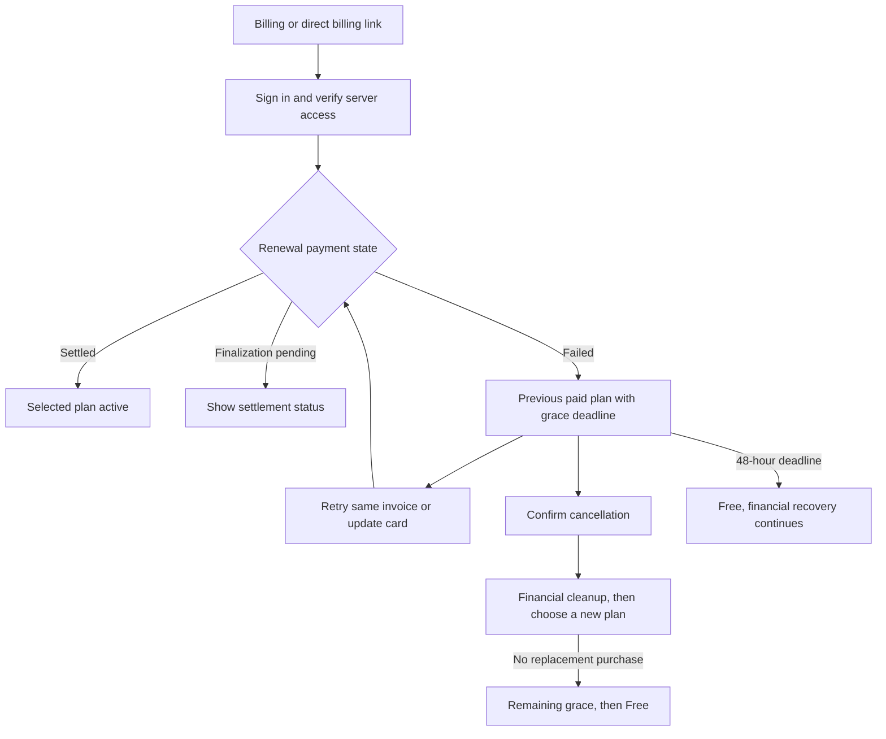

# Renewal payment grace implementation plan

> **For agentic workers:** REQUIRED SUB-SKILL: Use superpowers:executing-plans to implement this plan task by task. Preserve the existing native execution method, use test-first changes, and obtain one fresh whole-branch review before publication. Steps use checkboxes for tracking.

**Goal:** Give every existing paid server a fixed 48-hour grace period after failed renewal payment, with reliable retry, cancellation, automatic expiry and financial recovery.

**Architecture:** Persist verified paid-period evidence and renewal recovery in the existing subscription table. Webhooks, Billing and an indexed API worker use one recovery service; the shared entitlement resolver enforces the deadline independently of provider cleanup. Reuse the current plan-change controls, offer settlement and runtime admission patterns.

**Tech stack:** Existing Node.js 24, TypeScript, Zod, Stripe SDK 22.4.0 and pinned API version, DynamoDB, Terraform, React/Mantine, Jest, Playwright and Storybook. No new dependencies.

**Spec:** [Approved two-day renewal grace design](../specs/2026-10-16-renewal-payment-grace-design.md). The user approved the full behavior on October 16, including coverage beyond scheduled Pro-to-Basic changes.

## Outcome and scope

This completes the failed-renewal gap in plan switching. Basic and Pro, monthly and annual, ordinary renewals and scheduled changes all keep the previous paid tier during grace. The existing independent funding flow for immediate upgrades stays in place. Failed first purchases do not grant paid access.

The highest-risk work is financial cancellation racing with payment, and expiry during a worker or webhook outage. Tests below cover both. Rollout also needs a DynamoDB index and verified existing-subscription coverage. The separately guarded Sandbox deployment bootstrap remains a dependency for hosted acceptance. This plan does not authorize production activation or changes to shared Stripe retry settings.

## Global constraints

- Grace ends at `invoice.status_transitions.finalized_at + 172800` seconds. Retries, webhook arrival, cancellation and plan reselection never restart it. A draft invoice awaiting finalization is settlement pending.
- Keep the tier from the last verified paid period. Activate the target only after verified payment. Successful payment retains the invoice's original service period and introductory offer dates.
- Canceling the unpaid renewal preserves any remaining grace. Once cleanup is verified, permit a new purchase with its reviewed price and no credit for courtesy time.
- At the deadline, paid access ends even when Stripe, a worker or financial reconciliation is unavailable. Preserve valid independent grants and ongoing recordings.
- Preserve original payer plus Manage Server authorization. Background recovery verifies bound account, mode, customer, guild, subscription, invoice and service evidence rather than relying on a current browser session.
- Remove only the plan charge and its attributable tax. Restore allocated credit, reconcile money actually received, and preserve unrelated debt, balance transactions, invoices and subscriptions.
- Hold purchase controls and offer reservations through unknown financial outcomes. Used offers stay used; release unpaid reservations only after cleanup proof. The monthly and annual offer identities remain independent.
- Use conditional revisions and durable native receipts. Replays must never duplicate a credit/refund or overwrite a newer paid subscription.
- Do not use Stripe `cancel_at` or DynamoDB TTL as the grace timer. No account-wide plan restriction, new analytics event, new identifier, configurable grace duration, or extra email channel.
- Keep enforcement disabled until index, history coverage and deployed writer are verified. Existing delinquency keeps its original provider anchor, with no fresh grace for old debt.

## Journey: recover a failed renewal

## Review focus

1. A dropped payment webhook or worker restart must not extend paid access. Tasks 2, 4 and 5 test the saved paid-period boundary and exact expiry.
2. A stale index result, duplicate worker or old subscription event must not cancel or overwrite a newer purchase. Tasks 1, 3 and 5 test revisions, identity and serving admission.
3. Payment during cancellation must result in paid service or verified compensation, never both lost money and released control. Task 3 tests the race and lost acknowledgements.
4. Customer credit, partial cash payment, tax and unrelated charges must remain distinct. Task 3 tests allocations and unrelated automatic collection as well as balances.
5. A canceled renewal with remaining grace must permit repurchase without extending grace or restarting either offer. Tasks 3, 4 and 6 test this end to end.

## File map and shared contracts

Create `src/types/renewalRecovery.ts`, `src/repositories/renewalRecoveryRepository.ts`, `src/services/renewalRecoveryService.ts`, `src/services/renewalRecoveryProvider.ts` and `src/services/renewalRecoveryWorkerService.ts`. These own the record, persistence, orchestration, provider financial evidence and worker lifetime respectively. Keep the existing subscription resolver, reconciliation and plan-change modules as callers, without a second entitlement system.

`RenewalRecovery` is schema-derived. Its immutable cycle identity includes guild, provider mode, subscription, customer and the last verified paid service period. Its stages are `watching`, `grace`, `canceling`, `paid` and `canceled`. Bind the renewal invoice, finalization timestamp and deadline once discovered; retain original paid tier, optional scheduled operation identity, cancellation reason, provider receipts and a revision. A watch at a new paid period is a new cycle, not a reset of the old record. Save `enforcementAccepted: true` when an enabled, verified failure first adopts this policy. Disabling the rollout flag does not undo that durable acceptance.

Store cycle records under `RENEWAL_RECOVERY#<guild>#<subscription>#<paid-period-end>`, and a current pointer under `RENEWAL_RECOVERY_CURRENT#<guild>`. The pointer names the current record and whether it blocks new billing mutations. Keep canceled courtesy access available until its original deadline even after the blocking flag clears. A new paid subscription supersedes it. Retain old cycle records for replay evidence.

The sparse `RenewalRecoveryDueIndex` uses string partition `recoveryQueue` equal to provider mode, numeric sort `recoveryDueAt`, and keys-only projection. Read authoritative records after querying it. Pending watches and unfinished financial recovery remain indexed; settled records leave the index. All timestamps are integer epoch seconds and money is integer minor units.

## Task 1: Durable records, due index and billing fences

**Files:** Create the type and repository above, `test/repositories/renewalRecoveryRepository.test.ts` and `test/services/renewalRecoveryPolicy.test.ts`. Modify `src/db.ts`, `src/repositories/mockStore.ts`, `src/repositories/purchaseAttemptRepository.ts`, `src/repositories/renewalReactivationRepository.ts`, `src/repositories/billingChangeRepository.ts`, `_infra/main.tf`, `scripts/init-dynamodb.js` and the matching existing repository tests.

**Interfaces:** `getRenewalRecoveryRepository()` exposes `getCurrent(guildId): Promise<RenewalRecovery | undefined>`, `get(key): Promise<RenewalRecovery | undefined>`, `register({record, expectedSubscription}): Promise<boolean>`, `compareAndWrite({next, expectedRevision, expectedSubscription, blocking}): Promise<boolean>`, and `listDue({mode, now, limit, cursor?}): Promise<{keys: string[]; cursor?: string}>`. `expectedSubscription` uses the existing `GuildSubscription` identity and sync revision. Type module exports `RENEWAL_GRACE_SECONDS = 172800` and `renewalGraceDeadline(finalizedAt: number): number`.

- [ ] Add failing assertions that finalization at `1000000` yields deadline `1172800`, rebinding an invoice/deadline fails, duplicate registration does not reset a record, and a conflicting pointer revision cannot claim it. Test real DynamoDB command shape and mock parity.
- [ ] Run `yarn jest --runInBand test/repositories/renewalRecoveryRepository.test.ts test/services/renewalRecoveryPolicy.test.ts`. Expect new imports or behavior to fail before implementation.
- [ ] Implement strict schemas and transactional cycle/current-pointer writes. Add the sparse index, exact task-role index Query permission and local table definition. A missing index fails readiness for enforcement rather than silently scanning the whole table. The local initializer upgrades an existing local table with the index without deleting data; test that path as well as fresh creation.
- [ ] Extend native and mock purchase, reactivation and plan-change claims to reject a blocking recovery pointer. A matching scheduled operation may progress its own recovery; a nonblocking canceled grace record must allow a new purchase. A passive future renewal watch never blocks billing.
- [ ] Re-run the two new suites and the three existing repository suites. Verify index pagination, current-pointer replacement, stale index records, concurrent claim exclusion and preservation of used offer history. Run `terraform fmt -check` from `_infra` and the repository's Terraform tests for the changed index/permission contract.
- [ ] Commit the tested storage and fencing change.

## Task 2: Track paid periods and discover renewal failure

**Files:** Create `renewalRecoveryService.ts`, `test/services/renewalRecoveryService.test.ts`; modify `src/services/subscriptionReconciliation.ts`, `src/services/billingChangeSchedule.ts`, `src/services/billingChangeService.ts`, `src/api/billing.ts`, `test/api/billing.test.ts`, `test/services/billingChangeService.test.ts` and `test/services/billingChangeSchedule.test.ts`.

**Interfaces:** `trackPaidRenewalPeriod({stripe, guildId, subscriptionId, invoiceId, now}): Promise<void>` verifies paid service and registers the next watch. `refreshRenewalRecovery({stripe, guildId, now}): Promise<RenewalRecovery | undefined>` reads the bound provider state and records paid, settlement-pending or failed renewal evidence without financial cancellation. Both consume Task 1's repository. Current reconciliation remains the writer of the normal subscription projection.

- [ ] Add failing table cases for Basic/Pro and month/year, ordinary cycle and scheduled phase invoices, zero-cash paid invoices funded by credit, and repeated failure. Assert `endsAt === finalized_at + 172800` after every replay. Reject first-purchase failures, one-off funding invoices, void/reversed paid sources, wrong mode/customer/subscription, and ambiguous service lines.
- [ ] Run `yarn jest --runInBand test/services/renewalRecoveryService.test.ts test/api/billing.test.ts test/services/billingChangeService.test.ts test/services/billingChangeSchedule.test.ts`; confirm the new cases fail.
- [ ] Implement paid-source verification. Reuse frozen scheduled-change source evidence and existing invoice ownership helpers. Register watches from paid reconciliation and accepted schedules before acknowledging their durable transitions. At the paid-period boundary, discover the exact next invoice rather than assuming `latest_invoice` is the renewal. Finalization-pending work remains due for another read.
- [ ] Register failure durably before webhook success. On invoice paid/failed and subscription changes, refresh recovery before an unpaid target can replace the prior entitlement. Do not let the existing unsettled-change early return skip renewal discovery. Preserve first-purchase and independent funding handlers.
- [ ] Re-run the suites. Drop all renewal webhooks in a test, advance beyond the saved paid-period end, and assert discovery still finds the correct invoice. Deliver an older subscription event after replacement and assert the current pointer stays unchanged.
- [ ] Commit paid-period tracking and webhook integration.

## Task 3: Complete retry, cancellation and financial recovery

**Files:** Create `renewalRecoveryProvider.ts` and `test/services/renewalRecoveryProvider.test.ts`; extend `renewalRecoveryService.ts`, `billingChangeSchedule.ts`, `billingChangeService.ts`, `billingChangeTerms.ts`, `billingChangeHistory.ts` and their matching tests. Reuse `billingChangeRecovery.ts` for its existing independent funding responsibility rather than changing that flow.

**Interfaces:** Provider module exports `cancelUnpaidRenewal({stripe, recovery, now, onReceipt}): Promise<"paid" | "canceled" | "pending">`; `onReceipt(next: RenewalRecovery): Promise<void>` saves each receipt before the next write. Service exports `reconcileRenewalRecovery({stripe, guildId, now, signal?}): Promise<void>` and `cancelRenewalRecovery({stripe, guildId, payerId, now}): Promise<void>`. Reconciliation consumes Task 2 discovery; explicit cancel additionally verifies the payer. All callers use this one provider path.

- [ ] Add failing tests for successful same-invoice retry, cancel during grace, expiry while unpaid, payment winning before cleanup, payment racing a credit note, partial cash payment, customer credit, automatic tax, unrelated invoice items and two subscriptions on one customer. Assert no duplicate refund, no erased unrelated debt, and no released control while receipts are unknown.
- [ ] Run `yarn jest --runInBand test/services/renewalRecoveryProvider.test.ts test/services/renewalRecoveryService.test.ts test/services/billingChangeService.test.ts test/services/billingChangeHistory.test.ts` and observe the new failures.
- [ ] Re-read the bound invoice and subscription before each irreversible step. Release only the owned applied schedule. Use a plan-line credit note preview to derive pre-payment and post-payment allocations, including attributable tax; omit zero refund/credit parameters. Do not infer paid cash from `total - amount_remaining` or void an invoice containing unrelated charges.
- [ ] Persist exact credit-note/refund and cancellation receipts, with deterministic keys and operation metadata. On lost acknowledgement, find and validate the existing native result before creating anything else, including after idempotency expiry. A test with a 1,000-unit plan paid by 300 cash and 200 account credit must restore the 300 cash and 200 credit, remove only the remaining plan debt, and preserve an unrelated line. Verify the native allocation rather than hardcoding a preview formula. Cancel the subscription with `invoice_now: false` and `prorate: false` only after financial evidence permits it. Verify unrelated invoice automatic-collection settings because Stripe cancellation can affect them; restore only a proven cancellation side effect, preserving concurrent customer changes. If native proof cannot establish a safe result, retain the fence and report pending recovery.
- [ ] Finish the scheduled operation and its offer mutation atomically through the existing repository, then reconcile subscription/access before clearing its control. Ordinary renewal cleanup clears its recovery fence only after equivalent proof. A paid result activates service; a canceled result retains the original courtesy deadline. Stop exposing a payable URL after financial cancellation starts. A late paid event for canceled service must be reconciled or compensated, never resurrected blindly.
- [ ] Re-run tests with failures injected after every native write and after every persistence acknowledgement. Assert paid/newer subscriptions win, paid-time credit excludes courtesy time, used offers remain used, and canceled unpaid reservations release exactly once. Add the regression that closes PR #412's applied-schedule cancellation deadlock.
- [ ] Commit financial recovery and scheduled-change completion.

## Task 4: Enforce grace in shared access and billing status

**Files:** Modify `src/services/subscriptionService.ts`, `src/services/subscriptionCache.ts`, `src/services/subscriptionReconciliation.ts`, `src/services/billingService.ts`, `src/types/pricing.ts`, `src/types/billingChange.ts`, `src/trpc/routers/billing.ts`; add `test/services/subscriptionGrace.test.ts`; extend `test/services/billingService.test.ts`, `test/services/entitlementService.test.ts`, `test/commands/recordingLimitStart.test.ts` and `test/trpc/billingRouter.test.ts`.

**Interfaces:** Type module exports `RenewalRecoveryView` with status `none | settlement_pending | grace | reconciling | canceled`, prior tier, selected tier/interval when known, `endsAt`, amount/currency when verified, and `paymentUrl: string | null`. No provider identity is added to this view. Add `renewalRecovery` to `BillingSnapshot`. `getRenewalRecoveryView({stripe, guildId, payerId?, now}): Promise<RenewalRecoveryView>` returns an authorized view; financial actions remain payer-checked mutations.

- [ ] Add boundary assertions: prior Pro resolves as Pro at `endsAt - 1`, resolves as Free at `endsAt`, and a higher valid independent grant still wins. Cancel at hour 1 and assert the same deadline; buy a new plan and assert older recovery cannot override it. Warm the cache before expiry and assert it cannot serve grace afterward.
- [ ] Run `yarn jest --runInBand test/services/subscriptionGrace.test.ts test/services/billingService.test.ts test/services/entitlementService.test.ts test/commands/recordingLimitStart.test.ts test/trpc/billingRouter.test.ts` and observe new failures.
- [ ] Resolve paid access from the verified paid period or unexpired saved grace, rather than granting `past_due` unlimited access. Once enforcement is active, a stored past-due status without valid grace cannot establish paid access. Active rows whose verified paid period ended must consult the saved watch and refresh provider evidence before granting another period, so a dropped webhook cannot leave an old active projection indefinitely paid. If that refresh is unavailable, preserve only already proved access, not an invented renewal.
- [ ] Bound cache expiry to the earliest paid-period, grace or grant deadline and clear it on transitions. Preserve canceled courtesy access independently of native canceled status. Update snapshot/provider-status handling to distinguish current access from the plan awaiting payment. Existing recordings continue; shared admission/quota checks enforce the new tier for new actions.
- [ ] Add `cancelRenewalPayment` to the existing billing router, reusing its authenticated server procedure, payer check and rate limits. The existing snapshot provides retry state and the owned invoice URL; card update uses the existing portal. Prevent an alternate endpoint from bypassing a blocking financial recovery.
- [ ] Re-run the suites and verify bot and portal resolve the same tier, unauthorized callers get no actionable payment URL, and immediate upgrade/first-purchase rules remain unchanged.
- [ ] Commit shared entitlement and API integration.

## Task 5: Automatic recovery and safe activation coverage

**Files:** Create `renewalRecoveryWorkerService.ts`, `scripts/billing-renewal-recovery.ts`, `test/services/renewalRecoveryWorkerService.test.ts`, `test/scripts/billingRenewalRecovery.test.ts`; modify `src/apps/bootstrap.ts`, `src/services/runtimeShutdownService.ts`, `src/services/configService.ts`, `_infra/main.tf`, `_infra/tfvars.example`, `scripts/mock.env.example`, `test/services/runtimeShutdownService.test.ts`, `test/services/billingActivationConfig.test.ts` and `test/deployment/runtimeWorkAdmission.test.ts`. Extend the runtime work-admission module only if its existing generic claim/acknowledgement API cannot represent this durable worker; do not claim read-only completion after provider writes.

**Interfaces:** Worker exports `startRenewalRecoveryWorker(stripe: StripeClient): void`, `stopRenewalRecoveryWorker(): Promise<void>` and testable `runRenewalRecoveryPoll({stripe, now, signal}): Promise<void>`. Config adds `config.stripe.renewalGraceEnabled` from `STRIPE_RENEWAL_GRACE_ENABLED`, default false. The recovery CLI requires `--account`, `--mode`, `--report`, `--max-pages`; defaults to audit and requires `--apply` for DynamoDB coverage writes. The CLI never edits provider state or enables enforcement.

- [ ] Add failing tests for immediate startup polling, a fixed 60,000 ms interval, due-page traversal, two workers targeting one record, runtime admission denial, shutdown during provider I/O, stale index entries, and restart after a saved native receipt. Assert no new provider mutation starts after admission closes and unfinished work remains durably due.
- [ ] Run `yarn jest --runInBand test/services/renewalRecoveryWorkerService.test.ts test/scripts/billingRenewalRecovery.test.ts test/services/runtimeShutdownService.test.ts test/deployment/runtimeWorkAdmission.test.ts`; observe new failures.
- [ ] Implement one nonoverlapping API worker using Task 1's due index and Task 3's reconciliation. Start only in API/all mode with Stripe configured, after serving readiness. Use existing work admission, track provider effects, honor abort, and await local work on shutdown. Paginate bounded batches and isolate per-record failures so one bad record cannot starve later pages. Retry pending/failed work on the next poll rather than removing it from the index.
- [ ] Implement bounded coverage audit with a resumable cursor and private report. Inventory real subscription rows, excluding synthetic operation keys. Verify account/mode, paid-period evidence and current source revision. Register watches and original anchored delinquency deadlines without financial writes; log unresolved rows as incomplete coverage. Repeated apply must be idempotent. Require a completed traversal plus concurrent-writer catch-up, an ACTIVE index and exact deployed writer proof before enabling enforcement. An incomplete or capped scan is not coverage.
- [ ] Keep enforcement false while coverage is built. In that state, unaccepted watches perform read-only discovery and coverage writes only, without blocking billing, projecting courtesy access or canceling provider service. Readiness for activation verifies index and mode. New paid writes must register coverage in the same flow before they can be acknowledged; a crashed registration is retried. Disabling enforcement stops new grace adoption, but records with `enforcementAccepted: true` keep their deadline enforcement and resumable cleanup. Test both flag transitions and default-false configuration; never strand an accepted recovery behind the flag.
- [ ] Re-run suites, including failure on the final page and a paid subscription created during audit. Validate the reviewed Terraform plan includes only the intended index, exact Query permission and flag wiring. Apply through the normal saved-plan procedure, then deploy the backend so the service uses the updated task definition.
- [ ] Commit worker, coverage tooling and activation wiring.

## Task 6: Connected grace UI and public documentation

**Files:** Create `src/frontend/components/BillingRenewalGrace.tsx`, its `.stories.tsx`, and `src/frontend/hooks/useBillingRenewalRecovery.ts`. Modify `src/frontend/pages/Billing.tsx`, `BillingChangePanel.tsx`, `SubscriptionDetails.tsx`, `src/frontend/pages/billingChangeFixtures.ts`, `UpgradePlans.stories.tsx`, `test/e2e/billingMocks.ts`, `test/e2e/billing.spec.ts`, `test/e2e/visual.spec.ts`, `apps/docs-site/docs/troubleshooting/common-issues.md`, `apps/docs-site/docs/whats-new/index.md`. Add `test/frontend/billingRenewalGrace.test.tsx` and `test/frontend/useBillingRenewalRecovery.test.tsx`; update existing billing tests and affected snapshots.

**Interfaces:** `useBillingRenewalRecovery()` consumes the snapshot and `billing.cancelRenewalPayment`; it returns recovery view, pending/error state, refresh and cancel actions. `BillingRenewalGrace` consumes that result and the server name. Keep scheduled-change status and ordinary renewal notices mutually exclusive so they do not show conflicting actions.

- [ ] Add failing UI tests for ordinary Basic/Pro renewal, scheduled Pro-to-Basic failure, remaining grace after cancel, successful retry, exact expiry, payment processing and unknown compensation. Assert the correct current/selected tiers, timezone-rendered deadline, amount, and authorized actions. No card-update success may imply invoice settlement.
- [ ] Run `yarn jest --runInBand test/frontend/billingRenewalGrace.test.tsx test/frontend/useBillingRenewalRecovery.test.tsx test/frontend/billingChangeEntry.test.tsx` and observe new failures.
- [ ] Implement the approved distinct ordinary-renewal and scheduled-change copy, with **Retry payment**, **Update payment method** and **Cancel renewal**. Cancellation confirmation states that the unpaid plan charge is removed, access lasts until the original deadline, and another purchase becomes available after cleanup. Use the existing quiet settlement treatment for unknown/draft results. Poll pending recovery and invalidate status after actions and Stripe return.
- [ ] Add connected stories and browser fixtures for all states. Preserve vertical mobile cards and struck-through introductory prices. Assert the intended scroll container actually scrolls and its `scrollTop` changes. Update public docs with grace eligibility, fixed timing, retry, cancellation and Free expiry; do not add analytics disclosures for unchanged events.
- [ ] Run focused Jest, `yarn test:e2e test/e2e/billing.spec.ts`, Storybook on owned port 6106, and `yarn test-storybook --url http://localhost:6106`. Capture screenshots, inspect them and existing visual snapshots with the VLM, then run `yarn test:visual` and `yarn docs:check`. Update snapshots only after reviewing intended differences.
- [ ] Commit the tested UI, stories, snapshots and docs.

## Task 7: Whole-branch review and Sandbox acceptance

**Files:** Update this checklist and the existing PR description. Keep provider receipts, private account identifiers and detailed acceptance evidence in chronote-ops; public PR text contains sanitized results only. Use temporary owned probe scripts, promoting only a necessary reusable acceptance tool with its own tests.

- [ ] Run `yarn test --runInBand`, `yarn lint:check`, changed-file Prettier and Markdownlint, `yarn build`, `yarn build:web`, `yarn build-storybook`, `yarn docs:check`, billing browser/visual tests, pinned complexity checks and relevant deployment tests. Require all expected checks to pass; do not reuse old test totals as proof of these changes.
- [ ] Obtain one fresh review of the whole branch against the approved spec, focused on money, authorization, expiry, worker shutdown and offer reuse. Fix material findings with reproducing tests. Follow PR post-push and review-recycle skills when publishing.
- [ ] Run owned Stripe Sandbox clocks in classic and flexible modes for ordinary Basic/Pro renewal failure and a scheduled downgrade, including month/year coverage. Read provider clock time in the harness and pass it as `now`; do not assume wall-clock time advances with a Stripe clock. Assert retained prior tier just before the 48-hour boundary and Free at the boundary while provider cleanup is deliberately unavailable.
- [ ] Verify retry success, explicit cancel with remaining grace and repurchase, mixed cash/credit, nonzero tax using only approved test configuration, unrelated lines and automatic collection, duplicate workers, withheld webhooks, and late payment/cancellation races. Verify no courtesy-time credit, discount extension, or monthly/annual offer retrigger. Inspect native invoices/refunds/credit, saved records, offer usage and effective limits separately.
- [ ] Clean up owned test clocks, customers/subscriptions, coupons and payment methods. Preserve audit records and cleanup receipts. If a provider prerequisite requires a new shared setting, pause that case for its specific authorization rather than changing it incidentally.
- [ ] Through the separately guarded Sandbox bootstrap and normal Terraform/deploy workflow, verify exact image, API, Dev identity, test mode, ACTIVE due index, history coverage and rollback. Use the signed-in app to exercise grace retry/cancel/expiry and verify persisted entitlements. Align an owned provider fixture's verified deadline with the backend wall clock for hosted expiry; do not add a browser mock, public time parameter or production clock override. If that alignment cannot be established, report hosted expiry unverified rather than treating a native-clock probe as proof. Native service probes alone do not complete this hosted step.
- [ ] Push the latest tested source. After at least 30 minutes from its commit timestamp, inspect required and informational checks, ordinary comments, paginated inline threads, formal reviews and mutable AI summaries for that exact head. Resolve valid feedback and refresh again. Every new commit resets the window. Only then report merge readiness; do not merge or activate production.

## Completion and remaining authority

Completion requires bounded grace on both bot and portal, successful financial recovery without blocking future plan selection, both offer histories preserved, reviewed UI evidence, owned Sandbox cleanup, and exact-head PR readiness. Mark hosted acceptance blocked if its deployment identity is still awaiting approval. Keep that separate from local and provider-native results.

The approved design and existing native execution method are settled. This implementation plan is ready for review before coding. No product behavior, infrastructure or provider configuration is changed by writing it.

## Evidence appendix

Starting local documentation checkpoint: `b0ba2ffe00442f76b82a12f300453a1b15a00918`. PR #412's source baseline is `455d93db41ab01b885ea64e466c77392a722b88d`. Existing findings include indefinite `past_due` access and cancellation stalling after an unpaid scheduled phase applies. Earlier owned native tests establish provider mechanisms, not this implementation or deployed acceptance.

Provider contracts checked for this plan: [Stripe credit note allocations](https://docs.stripe.com/api/credit_notes/create), [cancellation and automatic collection effects](https://docs.stripe.com/api/subscriptions/cancel), and [DynamoDB GSI consistency and queries](https://docs.aws.amazon.com/amazondynamodb/latest/developerguide/GSI.html). GSI results are discovery hints; conditional authoritative reads decide writes.
