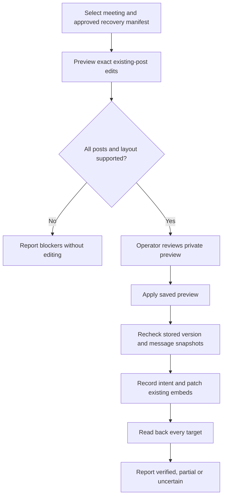

# Recovery Discord publication implementation plan

> **For agentic workers:** REQUIRED SUB-SKILL: Use superpowers:subagent-driven-development or superpowers:executing-plans to implement this plan task-by-task. Steps use checkbox (`- [ ]`) syntax for tracking.

**Goal:** Let an operator preview and publish an approved stored meeting version into existing Discord posts, without creating messages or announcing the recovery.

**Architecture:** A preview command reads the stored meeting and its recorded Discord posts, then saves the exact proposed embed edits in a private local file. Apply validates that preview again, records durable intent beside the recovery manifest, edits only existing messages and verifies them by readback. Existing portal editing, recording recovery and Notion behavior remain unchanged.

**Tech Stack:** Node.js 24.15.0 or later in the supported Node 24 range, TypeScript, existing Zod, Jest, AWS SDK v3 and Discord REST.

**Spec:** The operator-only preview/apply design approved in this chat on October 19, 2026, restated under [Approved behavior](#approved-behavior). This was a bounded in-chat design; there is no separate specification file.

## Review brief

Stored notes and Discord can currently disagree after a recovery. This command updates the existing posts to the reviewed stored content while preserving their links, controls and uncertainty notices. It does not recover audio, regenerate text or increment the notes version.

The approved first version is an operator CLI. A portal action, new-message fallback, recovery announcements and Notion synchronization are deferred. The tradeoff is deliberate: a missing post or incompatible layout requires another operator decision instead of an automatic replacement message.

The design, plan and subagent execution were approved. Tasks 1 through 3 are implemented and reviewed. Task 4 source is implemented and its required checks pass. Task 4 review and whole-change review remain pending. Hosted Sandbox acceptance remains pending without an authorized credential route and synthetic fixture. Running the command against a real server remains a separate operational action; implementation approval does not lift the current server-delivery hold.

## Global constraints

- Operators through a recovery command, with a preview before applying.
- Publish only an already-approved stored version. Do not modify notes, summaries, transcript pointers, notes versions, access controls, historical delivery outcomes or recording-recovery state.
- No Discord POST or DELETE, no new announcements, no Notion calls and no LLM calls.
- Patch only the reviewed embed array with `allowed_mentions: { parse: [] }`. Omit message content, components, attachments and flags from the PATCH.
- Preserve uncertainty text and partial-capture or partial-transcription notices. Retain the source language.
- A separate summary card is eligible only for approved stored summary/title changes. Do not derive a new summary from the notes. Skip it if the stored approved summary already matches. The current legacy manifest proves notes/transcript approval only, so this adapter blocks a differing separate summary or title and preserves an already-matching card unchanged.
- Reuse `buildMeetingNotesEmbeds`, `batchMeetingNotesEmbeds` and existing summary presentation rules. Do not invoke `editOrReplaceNotesEmbeds`, which can create or delete messages.
- Private previews, before-images and receipts contain meeting content. Keep them outside Git and out of console logs. Repository fixtures must be synthetic.
- Use existing AWS credential resolution and an explicitly selected account, region, table and bucket. Read the bot identity using the selected token. Do not discover or copy production secrets automatically.
- No new database table, background worker, public endpoint, analytics event or frontend change. The approved dependency exception adds only the official `@aws-sdk/client-sts` client, pinned to the existing AWS client family, so actual caller account identity can be verified.

## Approved behavior

### Operator flow



Proposed command interface, with `preview` as the default mode:

```text
yarn ts-node scripts/publish-recovered-meeting.ts preview --account-id ACCOUNT --region REGION --table TABLE --bucket BUCKET --guild-id GUILD --meeting-key KEY --recovery-manifest-key KEY --out PRIVATE_DIRECTORY
yarn ts-node scripts/publish-recovered-meeting.ts apply --preview PRIVATE_DIRECTORY/preview.json --expect-preview-sha256 SHA256
yarn ts-node scripts/publish-recovered-meeting.ts reconcile --preview PRIVATE_DIRECTORY/preview.json --expect-preview-sha256 SHA256
```

Apply and reconcile obtain their entire target set from the validated preview. Reject additional target overrides. The selected bot token comes from `DISCORD_BOT_TOKEN`; it must be the same authenticated bot identity captured at preview. Preview performs provider reads only and writes its private local review files. It prints identifiers, counts, blockers, paths and the preview digest, never message bodies or credentials.

Only reconcile accepts optional `--confirm-run-stopped RUN_ID`. This is an operator assertion about the exact prior process, not a timeout heuristic. It may close an abandoned claim only when no message remains submitted or uncertain. It never permits a Discord write or clears an uncertain PATCH. Without that assertion, reconciliation can record observed content but cannot release an abandoned running claim.

### Preview binding and layout

Bind the preview to the AWS account, table, bucket, region, guild, history key, meeting ID, notes version, transcript pointer and the digest of every stored field used to render the posts. Validate the manifest belongs to that meeting and its recovery prefix; do not assume a checkpoint-based recovery record exists for legacy completed meetings.

Fetch only the saved `notesChannelId`, `notesMessageIds` and optional `summaryMessageId`, never search a channel for similar-looking messages. Verify channel guild, message channel, message author and current bot identity. Reject webhooks, non-bot-owned posts and duplicate or ambiguous message IDs.

Support both existing layouts: one notes embed per recorded message, and a batch of notes embeds in a recorded message. Preserve the existing message slots and non-notes embeds. Require the candidate to fit exactly into the recognized slots; a different required slot count is blocked. A mixed summary/notes post or an unfamiliar arrangement is blocked in this first version. Classify using recorded role and expected renderer structure, never title matching alone.

Use the existing notes renderer with stored notes, meeting name and warning fields. Keep each target's existing color. Set the notes footer to `vN | Recovered notes`, with `N` equal to the stored notes version, while retaining the renderer's warning text. Block if limits would truncate any required version or uncertainty notice. Preserve unrelated embeds and supported writable fields, but omit Discord response-only embed properties from outgoing JSON.

Validate each complete proposed message against Discord limits, including unrelated embeds: at most 10 embeds, 6,000 aggregate embed-text characters and 4,096 characters per description. Reject unsupported component-v2 messages and any layout that cannot preserve existing controls through an embeds-only PATCH.

The private preview contains target links, before/after embed JSON, readable changes, unchanged-message indicators and blockers. Its SHA-256 covers stable serialized data, excluding only the digest field itself. Normalize object-key order and Discord response-only fields for content comparison; preserve array order and all text exactly. Timestamp or counter differences that do not alter editable content must not produce false mismatches. Include message content, controls, attachment identities, author and relevant flags in the before-snapshot fingerprint even though they will not be edited.

### Apply, receipts and interruption

Before the first PATCH, re-read the complete target set and the stored meeting consistently. Require the preview's stored-field digest, pointers, ownership and message fingerprints to match. If any target changed, stop before editing. Recheck the meeting and target immediately before each remaining edit. Already-matching messages are skipped.

Store the immutable preview under the selected manifest's containing recovery directory, at `discord-publication/<previewDigest>/preview.json`. Use an if-absent upload and verify existing bytes after a conflict. Store a compact receipt at the same prefix. Its identity includes the preview digest and exact target version, not a new notes version.

Serialize applies for the same meeting and notes version with one S3 claim beside those receipts. Create it with `IfNoneMatch: "*"`; take over only a known terminal claim using its current ETag and `IfMatch`. A conflict means no Discord writes. Each claim identifies its preview and run. No time-based stealing. A crashed or uncertain running claim stays blocked until read-only reconciliation and the operator establish the prior process has stopped. Do not present the claim as a lock against ordinary portal edits.

Derive the claim key from the validated meeting artifact folder as `recovery/discord-publication/claims/<notesVersion>.json`, independent of preview or recovery attempt, so different previews of the same version contend on the same key. Reject a supplied manifest whose containing recovery prefix is outside that meeting folder. A terminal claim containing any unresolved request remains ineligible for takeover.

Persist each message intent before PATCH and read back the intent if its storage acknowledgement is lost. States are `pending`, `submitted`, `verified`, `failed` and `uncertain`. Only a fresh intent owned by the current run permits a PATCH. Disable implicit SDK retries for claim/intent writes and reconcile ambiguous outcomes. After PATCH, fetch the post and compare the normalized approved embed content and preserved message fields before marking it verified.

On a timeout or lost PATCH acknowledgement, stop further edits and read back. Matching desired content is verified. A mismatch or unreadable result is uncertain, even if it resembles the before-image, because an earlier request might still complete. Never automatically resubmit an uncertain PATCH. A definite rejection is failed. Reconciliation may classify and report outcomes but never PATCH, POST or DELETE. A later fresh preview can retry definitively failed or never-submitted work after the prior run is terminal; uncertainty requires an explicit operator decision first.

A verified rerun is a read-only no-op. Report full synchronization only after all targets match and a final consistent history read still matches the preview. Otherwise report partial, uncertain or superseded, listing message IDs and reasons. Do not automatically undo verified edits, since rollback can overwrite a newer edit. Before-images make a separately reviewed rollback possible.

### Known consistency limit

Discord PATCH and DynamoDB reads cannot form one transaction. The command detects ordinary concurrent edits through before/after checks but cannot eliminate the last check-to-write race with another editor. On detecting a version change, stop and report the affected posts; do not overwrite again to force convergence. The receipt proves the specific reviewed version at verification time, not that Discord will remain synchronized forever.

## File map

| File                                                          | Responsibility                                                                                                       |
| ------------------------------------------------------------- | -------------------------------------------------------------------------------------------------------------------- |
| `src/services/discordMessageEditor.ts` (new)                  | Small token-injected read/edit client with validated bot, channel and message identities; no send/delete capability. |
| `src/services/discordMessageService.ts`                       | Delegate existing fetch/update wrappers to that client while preserving signatures and behavior for current callers. |
| `src/services/recoveryDiscordPublication.ts` (new)            | Compatible public re-export facade.                                                                                  |
| `src/services/recoveryDiscordPublicationTypes.ts` (new)       | Shared runtime schemas, binding and normalization helpers.                                                           |
| `src/services/recoveryDiscordPublicationPlan.ts` (new)        | Read-only exact embed planning.                                                                                      |
| `src/services/recoveryDiscordPublicationApply.ts` (new)       | Durable apply and read-only reconciliation.                                                                          |
| `src/services/recoveryDiscordPublicationStore.ts` (new)       | Exact meeting reads and S3 preview, claim and receipt operations using existing SDK packages.                        |
| `scripts/publish-recovered-meeting.ts` (new)                  | Argument validation, credential/client setup, private review output and exit status.                                 |
| `test/services/discordMessageEditor.test.ts` (new)            | Transport contracts and schema boundaries.                                                                           |
| `test/services/recoveryDiscordPublication.test.ts` (new)      | Planning with synthetic posts.                                                                                       |
| `test/services/recoveryDiscordPublicationApply.test.ts` (new) | Publication and reconciliation state transitions.                                                                    |
| `test/services/recoveryDiscordPublication.fixture.ts` (new)   | Shared synthetic history, manifest and message fixture.                                                              |
| `test/services/recoveryDiscordPublicationStore.test.ts` (new) | Conditional S3 claims, uncertain writes and exact DynamoDB reads.                                                    |
| `test/scripts/publishRecoveredMeeting.test.ts` (new)          | Operator command parsing and cross-module dry-run/apply tests.                                                       |
| `docs/operations/recovery-discord-publication.md` (new)       | Sanitized operator instructions. Live IDs, payloads and acceptance receipts stay in private operations evidence.     |

The approved module split keeps files within enforced size/complexity limits and avoids circular imports without changing public contracts. Leave portal callers, `notesCorrections.ts`, the recording recovery worker, package scripts and infrastructure unchanged. Inspect all existing client-wrapper callers before the transport extraction. If a source-layout change makes that extraction broader than described, stop and revise this task rather than changing unrelated callers.

## Review focus

1. Stored notes change during publication: stop and report superseded or partial, never claim current-version synchronization. Tests in Task 3.
2. A timed-out PATCH completes late: readback can verify success, but an uncertain mismatch must never trigger a blind retry. Tests in Task 3.
3. Existing posts batch embeds or carry unrelated controls: map recognized slots and preserve unrelated content; block changed pagination. Tests in Task 2.
4. Two operators or an ambiguous S3 claim: only the confirmed owner can write, and no expired-lease guess permits takeover. Tests in Task 3.
5. Russian text, mentions and partial-capture notices: preserve text and warnings, suppress mentions, and reject any required truncation. Tests in Tasks 2 and 4.

## Task 1: Extract the read/edit transport without changing callers

**Files:** Create `src/services/discordMessageEditor.ts` and `test/services/discordMessageEditor.test.ts`; modify `src/services/discordMessageService.ts` and its existing test.

**Interfaces:** Export `createDiscordMessageEditor({ token, fetchImpl? })`. It returns `getBotIdentity()`, `getChannel(channelId)`, `getMessage({ channelId, messageId })` and `editEmbeds({ channelId, messageId, embeds })`. Parse external responses with Zod and derive exported types from the schemas. The edit method returns `"acknowledged" | "missing"`; transport failures throw and are reconciled by Task 3. The client exposes no message creation or deletion.

- [x] Write failing tests for identity/channel/message validation, a missing post, 403/429 responses and a timeout. Assert the edit body has exactly `embeds` and `allowed_mentions: { parse: [] }`. Assert importing this client does not require OpenAI, OAuth or full application config.
- [x] Run `yarn jest --runInBand --coverage=false test/services/discordMessageEditor.test.ts test/services/discordMessageService.test.ts`; confirm the new tests fail before implementation.
- [x] Implement the token-injected client using the existing REST behavior. Delegate legacy fetch/update calls without changing their general payload support, return values or public signatures. Keep create/delete wrappers as they are. Do not force edit-only semantics on ordinary portal edits.
- [x] Run those tests again; expect all to pass. Commit the transport and tests as one scoped change.

## Task 2: Produce an exact, private publication preview

**Files:** Create `src/services/recoveryDiscordPublication.ts` and `test/services/recoveryDiscordPublication.test.ts`; reuse the existing notes renderers without editing their behavior.

**Interfaces:** Export schema-derived `RecoveryDiscordPreview`, `PublicationReceipt` and `PublicationDependencies`. Define `previewRecoveryDiscordPublication(input, deps): Promise<RecoveryDiscordPreview>`. Input contains the explicit provider scope and exact meeting/manifest keys. Dependencies supply the Task 1 client, consistent history and manifest reads, receipt operations and a clock. Preview returns a discriminated `ready` or `blocked` result with its stored-field digest, snapshot fingerprints, exact target edits, blockers and preview digest. Define the receipt states and dependency signatures here so Task 3 consumes the same contract.

- [x] Write failing tests named `previewIsReadOnly`, `rejectsWrongMeetingOrBot`, `preservesBatchedEmbedsAndControls`, `blocksChangedPagination`, `skipsUnchangedSummary`, and `preservesRussianUncertainty`. Assert zero message or provider-storage mutations, no title-only ownership inference, deterministic digest, unchanged stored notes/version and preservation of unrelated embed fields. Include missing IDs, aliases between summary and notes IDs, a webhook and an unknown layout.
- [x] Run `yarn jest --runInBand --coverage=false test/services/recoveryDiscordPublication.test.ts`; expect the missing implementation to fail.
- [x] Implement preview binding and layout rules above. Use existing types through `Pick` or schema derivation instead of parallel meeting models. Introduce no LLM summary generation or arbitrary replacement text input. Keep normalization limited to Discord's editable fields and documented response-only differences, never whitespace or language normalization.
- [x] Run the tests; expect all preview cases to pass. Commit the preview planner and tests.

## Task 3: Apply with durable intent and verify uncertain outcomes

**Files:** Extend `src/services/recoveryDiscordPublication.ts` and its test; create `src/services/recoveryDiscordPublicationStore.ts` and `test/services/recoveryDiscordPublicationStore.test.ts`.

**Interfaces:** Export `applyRecoveryDiscordPublication(preview, deps): Promise<PublicationReceipt>` and `reconcileRecoveryDiscordPublication(preview, deps, { confirmRunStopped? }): Promise<PublicationReceipt>`. Implement `createRecoveryDiscordPublicationStore({ dynamo, s3, sts, scope })` against Task 2's dependency contracts. Use consistent `GetItem`, S3 `GetObject` and conditional `PutObject`; expose no meeting-update, message-send or delete operation. A receipt records run/preview identity, target version/digests, per-message state, timestamps and normalized content hashes. Keep original delivery metadata untouched.

- [x] Write failing tests for all five review-focus conditions, plus verified no-op reruns, known rejections, receipt-save failure after a successful edit, preflight failure on the final target, and a changed post between two edits. Assert every target is preflighted before the first PATCH, each PATCH has persisted intent, each success requires readback, and uncertain results prevent further PATCH calls.
- [x] Write store tests for account/scope mismatch, consistent history reads, immutable preview conflicts with different bytes, competing claims, a lost claim response followed by readback, lost intent acknowledgement, and failed ETag preconditions. Confirm these cases issue no Discord writes unless ownership and intent are proven.
- [x] Run `yarn jest --runInBand --coverage=false test/services/recoveryDiscordPublication.test.ts test/services/recoveryDiscordPublicationStore.test.ts`; expect failures for the unimplemented apply/store behavior.
- [x] Implement the apply, claim and reconciliation rules above. Never release or steal a claim based on elapsed time. Reconciliation cannot silently clear a potentially active run; report that operator confirmation of process termination is required. Use existing AWS SDK clients with credential-chain resolution and no automatic write retries. Store content receipts only under the manifest-bound prefix.
- [x] Run both suites; expect all cases to pass. Commit apply, store and tests together.

## Task 4: Deliver the command and prove the complete operator flow

**Files:** Create `scripts/publish-recovered-meeting.ts`, `test/scripts/publishRecoveredMeeting.test.ts` and `docs/operations/recovery-discord-publication.md`.

Source validation passed: seven focused suites and 154 tests; full Jest passed 388 suites and 3,680 tests. Build, lint, formatting, Markdown and all three strict quality checks passed. The quality gate covered 1,179 source files. A test-only shared assertion extraction followed the full Jest run and its 41-test apply suite passed again. Task review and whole-change review remain pending. Hosted Sandbox acceptance remains pending because the authorized local credential route and synthetic fixture are unavailable.

**Interfaces:** Export `parseRecoveryDiscordPublicationArgs(args)` as a discriminated union for `preview`, `apply` and `reconcile`, plus `runRecoveryDiscordPublication(args, deps): Promise<0 | 1 | 2>`. Exit 0 means ready preview, verified apply or verified reconciliation; 1 means blocked, failed, partial, uncertain or superseded; 2 means invalid input. `main` alone constructs clients and reads environment variables. Do not import full application config into the CLI dependency path.

- [x] Write failing argument tests for the default preview mode, missing exact targets, conflicting mode flags, tampered preview digest, apply-time target overrides and `--confirm-run-stopped` on the wrong mode or run. Include a test that dry-run never obtains a claim or modifies provider storage.
- [x] Add a synthetic end-to-end test from private preview files through apply and reconcile. Use the real planner/renderers, in-memory history/receipt adapters and a fake HTTP Discord server. Assert exact PATCH targets/body, unchanged buttons/attachments/content, retained Russian warnings, unchanged database version, no POST/DELETE and no Notion/LLM imports or requests. Exercise one timeout and one already-verified rerun.
- [x] Run `yarn jest --runInBand --coverage=false test/scripts/publishRecoveredMeeting.test.ts`; expect failures before the command exists.
- [x] Implement the CLI and private `preview.json`, `preview.md` and receipt copies. Create local files exclusively with restrictive permissions appropriate to the host; do not overwrite unrelated output. Document required operator credentials, source validation, preview digest approval, blocked layouts, stopping a prior process before reconciliation and the separately reviewed rollback path. No real IDs or meeting text in the guide.
- [x] Run the focused suites, then `yarn build`, `yarn lint:check`, `yarn prettier:check`, `yarn markdownlint:check` and `yarn check:quality`. Run existing Discord-client and notes-renderer tests alongside the new suites. Fix regressions; do not lower quality gates or add complexity exemptions for this command.
- [ ] Perform an authorized Sandbox exercise with synthetic posts: one batched-notes case, one partial failure and one verified rerun. Capture actual before/after message readbacks, version and claim/receipt evidence privately. If Sandbox credentials or a live fixture are unavailable, mark hosted acceptance pending instead of substituting mocked success.
- [ ] Commit command, tests and operator guide. Obtain a whole-change review focused on wrong-server writes, lost acknowledgements and preserving existing editor behavior. Follow repository PR/readiness requirements if a PR is opened. Do not run production apply or publish this incident's posts without separate authorization.

## Completion evidence

The implementer reports source changes, focused test results, build/static checks, review findings and live Sandbox acceptance separately. A production dry-run can be proposed after source validation; a production apply requires review of its exact private preview. Successful tests or a merge do not prove Discord publication.

## Evidence appendix

Source inspected in the existing clean detached source worktree at `d80c8baae5562d8ba818f7a1cdd616a6f5204f2a`. Rebase the implementation design against current remote head and inspect applicable instructions before execution. The shared primary checkout has unrelated local changes; do not reset or absorb them. Create or select an isolated implementation worktree using the repository's worktree instructions.

Relevant source: `src/trpc/routers/meetings.ts` contains `tryEditNotesEmbedsInPlace`, `editOrReplaceNotesEmbeds` and `syncNotesEmbedsAfterWebEdit`; `src/commands/notesCorrections.ts` contains a second notes/summary update path. Both have broader behavior than this command. `src/services/meetingRecoveryService.ts` creates delivery posts and must not be used to republish an already-completed legacy meeting.

Provider contracts checked against [Discord's message resource](https://docs.discord.com/developers/resources/message#edit-message) and [S3 conditional writes](https://docs.aws.amazon.com/AmazonS3/latest/userguide/conditional-writes.html). Discord edit requests must explicitly set allowed mentions; S3 conditional failures require inspecting current state. Neither provider contract supplies an atomic transaction across Discord and meeting storage.

Plan self-review: the approved design is mapped across Tasks 1 through 4; each review-focus condition has an owning test; preview/apply/reconcile interfaces share Task 2's schemas; no production action is part of planning. The operator workflow has no page-navigation question, so Mobbin flow research is unnecessary. Unslop pass applied to the plan and review brief.
