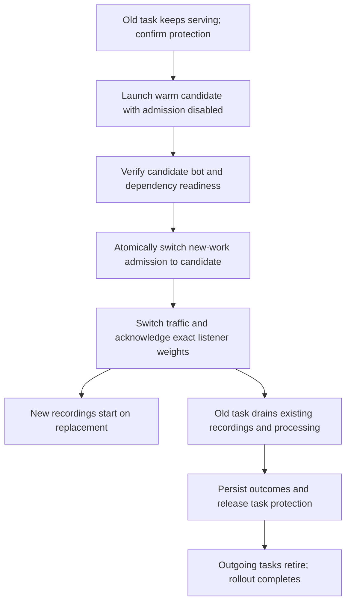
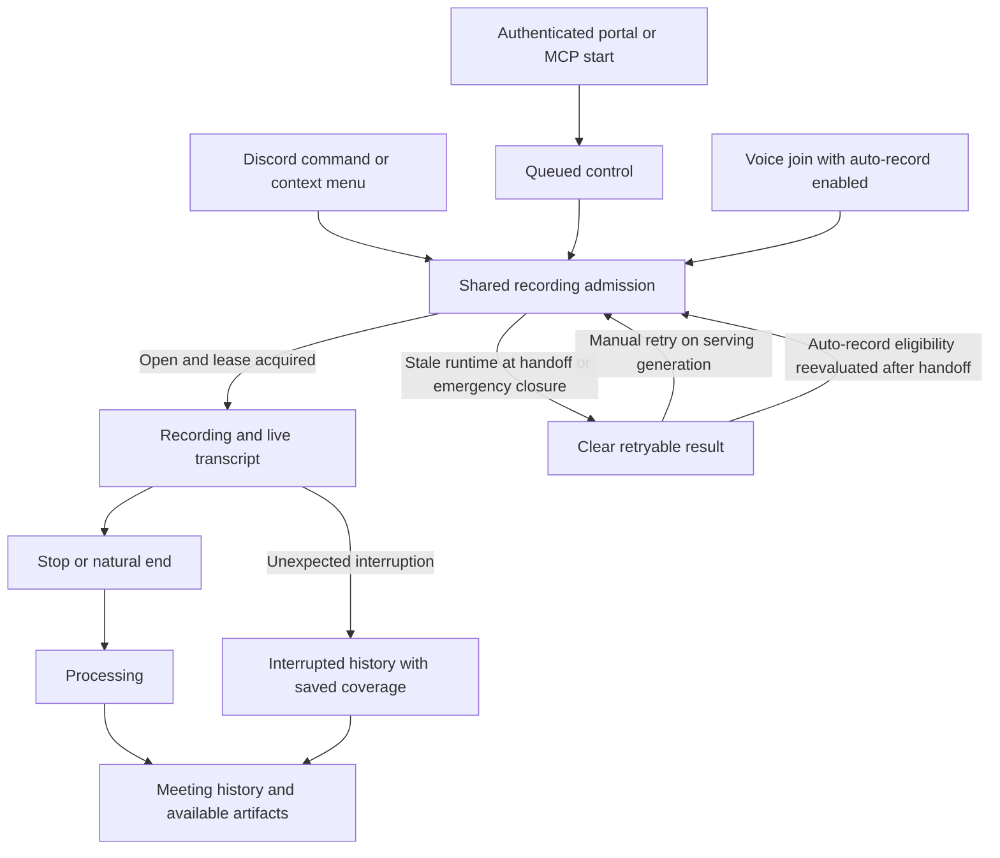

# Deployment drain and interrupted recordings

Design approved October 12, 2026. On October 13 the user authorized subagent-driven implementation and review in one PR through merge readiness. Deployment, production configuration/data changes, real meeting termination, historical repair and human messages remain outside scope.

## Selected design direction

The user confirmed a short admission handoff and asked to have a healthy replacement ready before draining the old task during routine changes. Prepare and verify a warm candidate while the old task continues serving. Atomically move new-work admission to the candidate, then let the protected outgoing task finish its owned recordings and processing before retirement. New starts do not wait for those recordings to end.

Admission, runtime eligibility and guild lease acquisition share a DynamoDB transaction. Runtime acknowledgments determine when an outgoing task can retire, not when its replacement can launch. Preserve existing recordings on protected tasks, and keep worker ownership explicit across the overlap.

Make interrupted recordings durable and truthful. Save closed audio segments during capture, save artifacts before expensive finalization, and reconcile abandoned work with conditional history updates. SIGTERM closes local admission and runs a bounded preservation path, rather than waiting for a meeting to end naturally.

The earlier environment-wide pause is rejected for routine deployment. Deployment completion may still wait roughly the longest remaining recording plus processing; admission availability does not. A fatal fault can require immediate admission closure or capture interruption before a replacement is ready, using the preservation/recovery path below. Routine deployment must not silently use that emergency behavior.

Immediate containment applies to concrete unsafe states such as lost recording ownership, the agreed durability retry deadline, or an actual process stop signal. A failed candidate deployment or slow candidate startup alone is not a reason to interrupt a healthy serving recording. This design adds no general automatic emergency-restart policy.

The user selected automatic generation and delivery of clearly partial notes from an interrupted recording's saved portion. Preserve the interruption and confirmed coverage in history and every notes delivery. Ordinary processing interrupted after a durably completed capture can also resume automatically. No automatic rejoin or stitching of separate Discord recordings is proposed.

The user selected stopping capture after bounded checkpoint-storage retries. The proposed threshold is 60 seconds without confirmed preservation, to be validated in Sandbox. The stop policy is agreed; its exact timing remains a provisional implementation target.

This is a lifecycle reliability change, not a new recording client, permission model or general job platform. Personal uploads and desktop recordings do not use the Discord recording start gate. Their upload intake continues through durable job records; new processing claims follow the serving runtime generation while already claimed work drains on its existing owner. Intake must not invoke inline processing outside that ownership protocol.

The final review reconciled early native health with ordinary HTTP availability by separating their target groups. This preserves the approved experience while adding explicit listener ownership and a conservative blocked state for unknown routing mutations. See the [routing contract](../../deployment-handoff.md#candidate-traffic-and-routing-ownership).

## Decision status and acceptance boundary

H1-H6 and R1-R6 have passed task review. H7 combines actual work ownership, deterministic acceptance, the dry-run runner and an unpublished private introduction packet. The final code/PR gate includes independent whole-branch review, terminal exact-head checks and the post-30-minute feedback audit. Sandbox acceptance and production activation are UNKNOWN and separately authorized. No new product decision is requested by this document reconciliation.

The [implementation reference](../../deployment-handoff.md) records the final membership/mode/bootstrap contracts, native ECS early-success behavior, compatible replacement, original completion policy, coarse uncertain-delivery no-replay and retention gap. Completed-object deletion still has no identified live route. The generated local descendant validator proves fixture coverage and refusal only.

## Warm replacement before draining

For routine deployment, confirm task protection on the outgoing service tasks before asking ECS to launch a replacement. Keep the old serving generation eligible for new starts and claims while the candidate boots. The candidate logs into Discord, fills required caches and proves readiness, but cannot acquire recording, TTS or processing work until promotion. It must not change shared commands or voice state as a side effect of warming.

The launch/readiness period does not pause admission. The switch is one transaction; a request that reaches an outgoing runtime at that boundary may receive a brief retryable handoff result. This is a readiness-gated handoff, not a promised zero-error switch. A server with an active recording remains busy under the existing per-guild rule. Other eligible servers can start immediately on the promoted runtime. Admission availability and deployment completion are reported separately.

Requirements for this direction:

- The shared admission transaction checks the open environment gate, serving generation and chosen runtime eligibility. Outgoing generation tokens remain sealed after the switch. Manual, auto-record, remote starts and new background claims cannot land on a retiring runtime. An explicit rollback can authorize a still-healthy prior runtime under a fresh generation; it cannot reuse a sealed token.
- Confirm protection for every outgoing task before requesting ECS replacement. Track pending starts/claims as well as recording/finalization. Protection remains until all owned work is durably settled; no per-meeting completion may unprotect a task that owns other work. Renew protection with enough margin and bound its recovery behavior. A protection error prevents planned replacement.
- Replacement readiness includes required caches, dependencies and a compatible admission/lease protocol. Bot/all mode also requires authenticated gateway readiness; API mode truthfully has no gateway. Promotion pins the replacement mode. HTTP health alone is insufficient. Keep candidate admission disabled until that proof succeeds; old admission stays available. Readiness proof is fresh and bound to the exact candidate task, image and runtime. Promotion rechecks it; a failed candidate causes an aborted candidate deployment rather than old-task drain.
- New tasks must not move the shared Discord bot out of a guild voice session owned by an outgoing task. Use the existing guild lease for both recording and TTS-only sessions, with an explicit session mode that defaults legacy rows to recording. TTS-only joins acquire and heartbeat the lease before joining, release it after orderly teardown, and create no recording history. Recording-specific list/control/read consumers filter TTS-only rows. The durable voice-operation record described below additionally prevents takeover while an old external join/leave remains unresolved.
- Auto-record reopening keeps the same permission, limit and persisted explicit-stop suppression checks. Partial-note recovery and checkpoint durability policy remain as selected above.
- Promotion happens before `services-stable` can necessarily succeed. The workflow needs separate candidate-ready, admission-switched and outgoing-retired stages. Serialize later deployments until the old revision retires in the first version, so successive rollouts do not accumulate protected tasks or exceed capacity.
- Rollback after promotion must protect and drain any candidate that has admitted work. Prefer reauthorizing a still-running, compatible, healthy prior runtime under a fresh generation. If another rollback task is necessary, prove capacity before launching it; two protected busy tasks can exhaust the initial two-task surge limit. Do not free capacity by stopping recordings. If no safe ready rollback target exists, close new admission and preserve owned work until an approved recovery can proceed.
- Unexpected death, explicit stops and uncertain storage still require the checkpoint/interruption protocol. Task protection is a deployment/scale-in safeguard, not a crash recovery mechanism. Legacy bootstrap remains separately unresolved.

My default is temporary surge capacity for a deployment, keeping the steady-state desired count unchanged. This adds cost during startup and while old recordings drain. A permanently ready second task is a separate availability/cost choice, not required for this deployment sequence. The user approved this specification and then authorized implementation and subagent review in one PR. Hosted activation remains separately authorized.

AWS rolling deployments permit overlap according to desired count and maximum percent, while task protection prevents deployment scale-in of outgoing work. Use minimum healthy percent 100 and maximum percent 200 for the initial one-task service. Protection plus application readiness still carries the recording guarantee; minimum healthy percent alone does not. Validate placement capacity and protection/readiness behavior in Sandbox. [AWS rolling deployment](https://docs.aws.amazon.com/AmazonECS/latest/developerguide/deployment-type-ecs.html), [AWS task protection](https://docs.aws.amazon.com/AmazonECS/latest/developerguide/task-scale-in-protection.html).

## Start or finish a recording

The legacy lease scan did not close admission before replacement. The implemented sequence makes admission transactional and preserves the original owner.

Authentication and existing permissions remain at their current boundaries. Signed-in direct acquisition paths use the same shared admission result. No new login, purchase or configuration step is added.

## Admission protocol

Use one small environment-scoped control table for a control row, runtime rows and durable guild voice-operation records. Avoid a sentinel in ActiveMeetingTable: existing consumers assume each row is a guild session lease. Separate deployment phase from admission availability. The control row carries the serving admission generation, monotonic epoch, coordinator owner/run token and heartbeat, candidate identity/readiness reference, and previous/target revision metadata. Runtime rows carry task/image identity, protocol version, current authorized generation, exact serving membership, runtime mode and role (candidate, serving, draining, releasing, retired or stale), heartbeat, confirmed protection expiry, pending admissions/claims, owned work and drain acknowledgment. Voice-operation records retain owner/attempt and pending, connected, closing or settled state independently of lease TTL. These records contain no meeting content.

Initialize the control row explicitly. A missing row, an unavailable database or an unknown protocol is an admission error, never implicit permission to record. TTL can clean old runtime rows but cannot reopen the control row.

All recording starts execute one transaction containing:

1. A condition check that the runtime identity is an exact selected serving member and its authorized generation matches the control generation.
2. A condition check that this runtime is eligible, has a fresh ready/protection record with safety margin, and matches the expected authorization generation.
3. Conditional guild lease acquisition, retaining existing same-owner/same-meeting idempotent retry behavior without resetting later lease state.
4. Conditional creation of initial recording history, including its stable key, execution owner/version and `starting` status. TTS-only starts use the same admission and lease checks without recording history.

Any start that will join voice also conditionally reserves a new voice-operation attempt in the control table in that transaction. A previous unresolved attempt blocks the guild even when its recording lease has expired or disappeared. Do not expire unresolved voice-operation records by TTL.

Compute a stable meeting identity and history key before the transaction. Record reservation time separately from actual capture start. Start returns distinct typed results for admitted, active-meeting conflict, draining, and dependency unavailable. Retry transaction conflicts with bounded backoff and a stable idempotency token. Never translate a service failure into success or an active-meeting conflict. Re-check ambiguous transaction outcomes before retrying voice initialization.

A start committed on the old generation before the switch remains admitted and protected. An old-generation start ordered after the switch cannot reserve or join voice; a ready new-generation start can. Emergency closure rejects both. Promotion updates the serving generation and candidate runtime eligibility in one transaction, conditioned on the coordinator epoch, expected current serving generation and fresh candidate readiness. This is the atomic boundary; a cached flag or a read followed by a put is insufficient. DynamoDB transactions provide serializable ordering against writes to their checked items. Scans do not provide snapshot isolation even with consistent reads. [AWS transaction isolation](https://docs.aws.amazon.com/amazondynamodb/latest/developerguide/transaction-apis.html), [AWS Scan consistency](https://docs.aws.amazon.com/amazondynamodb/latest/APIReference/API_Scan.html).

Track pending starts locally before the first asynchronous operation and heartbeat admitted reservations immediately, before voice initialization. A drain acknowledgment waits for all these operations. Local SIGTERM closes admission synchronously; a pending start that has not enabled capture must unwind or enter the same preservation path. Do not overlook the interval between lease creation and in-memory registration.

Initialization failure saves a conditional terminal failure before release and tears down any partially created voice/audio resources. Canonical lifecycle updates require the history execution version and legal previous status. Delayed initial writes cannot replace later rows.

## Deployment and abandoned coordinator handling

Use one shared coordinator script from both workflows. Build/register the candidate, discover running task/runtime bindings and verify compatible protocol support, then confirm protection before requesting ECS rollout. Serialize changes per environment and disable cancellation of an in-progress replacement. A fresh deployment cannot acquire another run's coordinator ownership. Serving runtimes maintain protection independently of the workflow, including after runner loss. Candidate promotion also requires confirmed protection before it can own work.

Keep the old serving generation open while the candidate starts. Warm candidates handle only side-effect-safe readiness and reads. In a combined API/bot service, early ALB health evaluates the candidate in its zero-traffic target group. Ordinary user traffic stays on the old application until protected application readiness, exact admission promotion and acknowledged listener switching. The [routing ownership and introduction contract](../../deployment-handoff.md#candidate-traffic-and-routing-ownership) replaces the earlier acceptance of warming-user requests. Warm bot gateway listeners may fill caches, but cannot claim interactions, modify global commands or react to shared bot voice events as an owner. Preserve compatibility between the two API/bot revisions for the overlap.

After fresh candidate readiness, atomically authorize the candidate under a new serving generation. The old generation can no longer acquire new recording, TTS, background-processing or recovery work. Those claims use the same control/runtime conditions as recording admission. Track in-flight claims locally before their transaction. Work committed before promotion keeps its original owner, renews and finishes or checkpoints retry state. API-only runtimes in the replaced service obey the same rule. Reconciliation can classify abandoned history without acquiring processing work; actual recovery processing runs on the serving generation.

Route existing recording stop/status/transcript controls to the lease owner during overlap, including Discord buttons and context-menu actions. A warm or new task must not claim an interaction receipt and reply "no active meeting" merely because it lacks that owner's local meeting. Owner checks precede shared receipt acquisition; already claimed start interactions that lose the admission race release or complete their receipt with a truthful retryable result. Queued starts remain safely claimable by the serving runtime only, and never silently record later after a completed maintenance rejection. Publish shared command changes from the serving runtime after promotion, without candidate startup races.

Existing recordings, attendance, live reads and stop requests keep working on the outgoing runtime. Its existing TTS-only sessions end orderly after the switch, and it cannot start another voice session. New eligible work continues on the replacement. Persist explicit-stop suppression throughout the overlap, not just as a one-time snapshot, so a late old-owner stop is visible to the new task before auto-record reevaluation.

Retire each outgoing task only after its runtime acknowledgment for this retirement epoch is fresh and has no pending admissions/claims, recordings, finalization, owned processing or unresolved durable disposition. Cross-check lease/claim metadata and task binding. An expired lease alone is not proof of idle. Only the runtime releases its own protection through a local lifecycle barrier, not a coordinator that can race reauthorization. Release first conditionally marks its runtime row as releasing and not eligible for promotion, then performs the ECS call and records the result. Reauthorization requires a fresh protection confirmation after any pending release settles. A stale retirement token cannot act on a reauthorized generation. Missing acknowledgment or uncertain task state leaves retirement incomplete.

Before promotion, candidate failure leaves old admission unchanged. Exact prior-member rollback is permitted only before any retirement request, with matching durable deployment phase and fresh readiness/protection. Stop or roll back an unpromoted candidate only after verifying it owns no work. After promotion, roll back admission to a ready compatible prior runtime under a fresh generation when possible, keeping candidate-owned work protected until it drains. If no ready safe target exists, explicitly close admission for recovery. Do not terminate candidate recordings to make rollback faster or to free surge capacity.

Cancellation, runner loss and ambiguous ECS responses do not automatically close a healthy serving generation or unprotect old work. Read the control row and ECS state to determine whether promotion committed. An `always()` step must neither blindly change admission nor release protection. Coordinator expiry permits investigation, not automatic promotion, reopening or retirement. Takeover first proves the earlier run is terminal and reconciles outstanding ECS update ambiguity; stale tokens cannot change newer generations. DynamoDB cannot transactionally fence ECS API calls, so serialization and refusing uncertain takeover remain required.

Separate time budgets for candidate readiness and outgoing retirement. Propose a 15-minute candidate-readiness abort target and retain 7,500 seconds as the initial retirement reporting deadline, both subject to Sandbox validation. Crossing retirement's deadline reports incomplete rollout and leaves protected work running; it is not a forced stop. Normal admission on the healthy replacement continues. Serving and retiring runtimes renew protection until their verified lifecycle permits release. If protection renewal becomes uncertain, stop new admission before the confirmed protection window expires and preserve/fence owned work before ECS can retire it. Alert on stalled readiness, protection renewal or retirement; do not install monitoring automation in this design task.

## Ownership and finalization

Keep the existing per-guild lease through reservation, recording and finalization in this first version. The guild remains busy until artifacts and terminal history are persisted. Do not introduce a separate finalization queue merely to release the guild early.

Remote stop dispatches finalization without stopping lease renewal. Avoid tying renewal scheduling to awaiting the entire finalization callback. Stop and finish are idempotent and share one promise. Repeated stop, SIGTERM and timeout cannot start multiple finalizers or release another owner's lease.

Bind the same per-meeting execution version into history and the guild lease. Renew requires the matching meeting, owner, version and an unexpired lease, so an old owner cannot resurrect an expired lease. Release checks meeting, owner and version. Every canonical processing transition, artifact-manifest publication and terminal history write checks that version. Ownership loss immediately ends local capture and stops canonical publication; any late preservation writes use immutable attempt-specific objects and cannot change the new owner's history or Discord delivery.

A runtime that cannot confirm renewal self-fences before its last confirmed expiry, allowing clock/error margin. It disconnects recording and checkpoints what it can. It never continues recording indefinitely because renewal errors were merely logged. Local runtime acknowledgment includes unresolved preservation/persistence work, even if the guild lease has expired.

Lease fencing does not fence Discord's external voice changes. Track every voice join/leave operation in the durable voice-operation record and the local lifecycle barrier. Close local voice-operation admission before teardown; cancel or settle all in-flight initialization, join, reconnect and cleanup callbacks before marking the attempt settled. A late old callback cannot issue another join/leave after settlement. For an attempted connection, mark settled only after the connection is closed, pending transport operations resolve and a matching Discord gateway session and increasing sequence acknowledge the submitted leave. Seal callbacks before waiting. A prepared operation that never dispatched can settle without inventing a gateway event. A new recording/TTS owner may acquire the guild only after this settlement, never merely after the thirty-second lease expires.

If ownership loss leaves an uncertain join/leave, keep that guild's voice-operation record unresolved. Recovery may clear it only after proving the previous runtime cannot issue further operations and reconciling its pending Discord session/voice state. Process termination or task-record absence alone does not prove a previously issued Discord operation settled. If settlement cannot be established, block new voice ownership in that guild and require operator reconciliation; other guilds remain available. Offline artifact/notes recovery can proceed without joining voice and must not clear this record as a side effect. Acceptance tests must delay an old join/cleanup completion beyond lease expiry and prove no replacement voice join is admitted under uncertainty.

Persist required outcomes before resolving successful completion, releasing the lease or deleting local artifacts. A history failure is a real incomplete finalization, with retry and eventual recovery, not a logged success. Wrap processing preparation, voice teardown and cleanup in the same error-aware lifecycle. Keep ancillary notices separate only when they cannot affect durability; drain any task-local ancillary delivery before retiring the task or explicitly persist it for later.

## Capture durability and SIGTERM

Use existing audio capture and S3 storage, without EFS or a new dependency. Persist immutable closed PCM segments plus metadata sufficient to assemble their chronological coverage. Include user and bot recording sources already supported by the capture pipeline. A small versioned manifest records committed segments, offsets, durations, checksums, capture coverage and any completed transcription checkpoints. This is application storage under existing access, retention and encryption rules, not analytics content.

The initial implementation target is at most 30 seconds between segment closure/checkpoints. Do not assume transcription snippets always close that often; bound durable segment rotation independently when necessary. Bound queued bytes and oldest unconfirmed segment age. Stop capture after bounded retries, mark a storage-preservation interruption and notify the recording channel. The initial test target is 60 seconds without confirmed preservation. A transient storage outage may therefore end a recording. Keep any unsaved local tail for bounded recovery attempts after capture stops; never describe it as preserved until upload is confirmed. These timings require representative-load validation and are not a proven loss guarantee.

Upload the segment before publishing its manifest entry. Deterministic segment keys and checksum validation make retry safe. A crash between upload and manifest publication can leave an unreferenced object. Without a first canonical checkpoint, automatic recovery cannot claim that object and preservation remains unknown; publishing a missing object is never allowed. Preserve completed transcription separately from later correction/final-pass work. Final artifacts remain in the existing format and delivery path, so normal consumers do not need to decode checkpoint segments.

At ordinary end, close capture, save the durable capture manifest and artifact pointers, then do final-pass transcription, notes and delivery. Record outcomes after each required stage. An AI request must not be a prerequisite for preserving already captured audio.

Set explicit `stopTimeout: 120` in Terraform and preserve it through deploy task-definition rendering. Verify that the actual Node process receives signals through the image's current npx/yarn launch chain; change to direct Node execution or an existing init mechanism if the test fails. AWS defaults omitted Fargate `stopTimeout` to 30 seconds and permits at most 120. That budget cannot finish a two-hour recording. [AWS stop timeout](https://docs.aws.amazon.com/AmazonECS/latest/developerguide/task_definition_parameters.html).

On SIGTERM: synchronously seal local starts, settle pending starts, stop capture and voice output, flush closed segments and the current tail, persist capture interruption and confirmed coverage, and checkpoint ongoing finalization. Use one process-wide deadline, initially 100 seconds for preservation plus remaining time for teardown/telemetry. Prioritize preservation across concurrent meetings. Encoder completion, storage and database calls need deadlines and cancellation where supported; a timeout race must not leave a late writer publishing success after interruption.

Do not call the full AI finalization pipeline and hope it fits. If completed capture and processing already finish within the budget, record their real outcomes. Otherwise persist interrupted work for reconciliation. Database or storage outage may prevent the SIGTERM handler from making a final write; periodic durable state and later reconciliation cover that case. Hard kill can lose the current uncommitted tail. Local retention is supplementary, never proof of task-independent recovery.

## Recovery and truthful history

Add `starting`, `interrupted` and `failed` lifecycle handling alongside the existing states. Separate capture completeness, processing outcome, artifact preservation and delivery outcome. Known pipeline failure is not user cancellation. Interruption can coexist with a saved recording portion or generated partial notes; neither implies a complete recording.

Use a bounded, paginated periodic reconciler plus startup reconciliation, not a history-read mutation. Discover from projected lifecycle and recovery-work metadata independently of capture status. Eligible rows include abandoned starting/recording/processing work and interrupted recordings with verified saved artifacts plus pending transcription, notes or known-unsent delivery. Include rows whose active lease has already been removed by TTL. Explicitly persist recovery eligibility and stage disposition so orderly SIGTERM interruption is discoverable. Terminal interrupted capture remains eligible until its requested recovery stages succeed, are skipped for a known reason, exhaust bounded attempts into a durable failure, or need explicit reconciliation. Unknown delivery acknowledgment clears automatic resend eligibility and records operator-required reconciliation; legacy unknown-owner rows remain excluded.

Start with a low-frequency cursor scan at current scale; an index can replace it if scan cost becomes material. Persist each candidate's owner/version, expected last progress and recovery claim. Claim recovery by advancing the history execution version and fencing the matching expired lease in one transaction. When that old lease still exists, conditionally delete it in that transaction using its meeting, owner, version and expiry. When the lease is absent or belongs to a newer meeting, condition-check that observation and leave the newer lease untouched. A live matching owner or renewed lease makes the transaction fail; stale observations cannot mark it interrupted. Never issue a ConditionCheck and a delete/update on the same item in one DynamoDB transaction. Voice-operation settlement is an independent boundary and is never inferred from this history/lease transaction.

New runtimes bind their instance identity to ECS task metadata. A missing historical ECS task record is not an exit timestamp. If the owner is still running but cannot acknowledge, deployment stays blocked; recovery fences the candidate only after its confirmed ownership deadline has passed and the history claim succeeds. History version fencing prevents a delayed old finalizer from undoing recovery. One reconciler wins, others retry later.

Persist detection time separately from last confirmed capture time. Without an orderly stop, exact end time is unknown. Report confirmed saved duration/coverage, not detection time minus start. Preserve any already saved pointers and outcomes. A completed capture whose processing stopped can resume through the existing processing services with a claimed attempt. Starting that attempt requires open admission, serving-runtime eligibility and acquisition of a discriminated offline recovery lease in the existing guild lease table with the new execution version, so recovery processing does not preempt a newer recording or create work on an acknowledged retiring runtime. It waits if the guild is busy. Partial capture remains interrupted even when its notes are generated and delivered successfully.

Automatically process verified saved segments from an interrupted capture when the original recording requested transcription and notes. Respect those original settings and existing access controls. Do not feed an uncertain local tail or a missing/corrupt segment to generation as if it were confirmed recording. Reuse transcription quality gates and generate notes only when recovered speech is usable. With no usable speech, record notes as skipped with the reason and deliver an interruption notice instead of inventing a summary. Preserve original requested flags, frozen context/models/prompts and durable cancellation/proceed intent. Do not let ordinary short-auto-record cancellation erase a real interruption. Complete short-auto capture with unknown original policy requires reconciliation.

Use a claimed recovery attempt and acknowledged stage outcomes. Saved text does not suppress verified PCM without exact processing coverage, so each verified interval may require another transcription request. Preserve gaps and accept possible duplicate wording rather than discard speech. Unknown delivery is never automatically replayed. Both notes and summary generation receive the verified recovered transcript, explicit incomplete-capture metadata and the evidenced interruption cause. Their prompts state that the available transcript may end abruptly or have gaps and must not invent missing discussion, decisions or outcomes. A confirmed shutdown or evidenced service interruption may be labelled as a service interruption; lease expiry or missing task metadata alone leaves the cause unknown. Verified durable transcription can support recovery even when no audio artifact survived; successful transcription log markers alone cannot. Every generated notes and summary message includes a deterministic visible notice outside the model-generated text, for example: "Partial notes: recording was interrupted. These notes cover only the saved recording." Show confirmed coverage when known and label unknown gaps honestly. Persist that notice/coverage metadata in history and propagate it through portal, MCP, shared views, exports and Notion. Normal access and export rules continue to apply; this change grants no new reader or integration access.

Discord delivery is not transactionally atomic with DynamoDB. Persist coarse delivery intent before the first final summary or notes mutation. Unknown intent acknowledgment prevents dispatch. Save acknowledged message pointers without treating partial or unknown sends as complete. Do not automatically resend when a send might have succeeded but its acknowledgment was lost; mark delivery unknown for explicit reconciliation. Avoid promising exactly-once messages.

Frontend library/detail, live streams, portal responses and MCP must agree on terminal status. A missing live owner must not silently render complete. Show available artifacts and saved coverage under existing permission checks; show an interrupted banner instead of an endless recording spinner. Successful partial-note delivery retains that banner and interruption status. Reuse existing processing outcome types wherever sufficient. Preserve backward-compatible reads for old complete rows, but do not infer completion for known orphan nonterminal rows.

The reported legacy orphan needs a separate approved repair decision. This design does not mark it failed, delete its lease or attempt to recover its contents. Historical rows lack reliable owner/version information, so do not automatically bulk classify them using the new protocol.

## User experience during drain

Normal manual starts remain available during candidate warmup and outgoing drain. At the admission-switch boundary, a stale outgoing handler returns a prompt ephemeral retryable response, for example: "Chronote is switching tasks. Please try starting again." If no healthy serving target exists during emergency recovery, say new recordings are temporarily unavailable and that existing recording status is shown separately. Do not tell people to wait for the whole deployment to finish. The portal and MCP use the same result codes through queued execution. A rejected manual request does not silently start a recording later.

Auto-record sends at most one handoff/unavailability notice per eligible channel per admission epoch when an actual start is rejected. Existing join/leave tracking and explicit-stop suppression continue. After promotion, the new serving runtime reevaluates eligible occupied channels rather than waiting for another join event. Re-check permissions, limits, suppression and the admission transaction. A channel already eligible but skipped at handoff records only from actual restart, with a clear start notice; the gap is not backfilled. A leased old-owner session is not an eligible new recording.

The legacy suppression was task-local. The implemented protocol persists it so promotion cannot unexpectedly restart recording. Persist the minimum suppression state before promotion and update it continuously through overlapping runtime ownership, including a stop on the old runtime after promotion. Reconcile suppression with current occupants/empty-channel history before auto-record reevaluation. An atomic admission condition on the persisted suppression version prevents a previously checked suppressed channel from starting during a concurrent explicit stop. Channels not affected by handoff retain current behavior. Do not generate join events or invent old audio.

## Options and tradeoffs

| Option                                                                                                | What it solves                                                                                    | Cost or limitation                                                                                                                    | Recommendation                  |
| ----------------------------------------------------------------------------------------------------- | ------------------------------------------------------------------------------------------------- | ------------------------------------------------------------------------------------------------------------------------------------- | ------------------------------- |
| Longer timeout or a polled global flag                                                                | Gives emergency cleanup more time                                                                 | Does not close the admission transaction or preserve crash data                                                                       | Insufficient on its own         |
| Environment-wide drain, runtime acknowledgment and durable checkpoints                                | Preserves existing work during controlled replacements and gives truthful crash recovery          | Blocks all new starts for the remaining recording and processing time                                                                 | Rejected for routine deployment |
| Warm ready replacement, atomic runtime admission handoff, ECS task protection and durable checkpoints | Old task serves throughout candidate startup; new task accepts starts while old recordings finish | Temporary surge cost, overlapping Discord ownership, protection renewal and rollback logic; deployment can remain unsettled for hours | Selected direction              |
| Separate capture workers and durable finalization jobs                                                | Independent API deployments, earlier guild release, stronger processing retry                     | New queues/worker lifecycle, deduplicated delivery, more infrastructure and migration                                                 | Defer                           |

ECS task protection protects against deployment/scale-in selection and can keep older tasks running during a rolling deployment. It is useful for continuous-admission architecture, but it is not durable storage or a general crash guarantee. [AWS task protection](https://docs.aws.amazon.com/AmazonECS/latest/developerguide/task-scale-in-protection.html).

## Introduction and rollback boundary

After separate operational authorization, create control storage and permissions, establish the proved introduction bridge, then enable the coordinated workflow only when every running bot advertises compatible protocol support. Deploy the behavior to Sandbox and exercise its real task replacement before proposing a production rollout.

There is a bootstrap problem: a protocol-unaware outgoing binary does not read a drain gate or acknowledge it. Installing a new workflow cannot retroactively seal its admission. Do not advertise the first transition as race-free. A production introduction needs a separately reviewed legacy-maintenance procedure or a proven legacy admission bridge. External task protection can keep legacy tasks alive while they finish, but does not close their admission and may prevent the rollout from converging. A zero-lease snapshot or a quiet window alone is not the steady-state guarantee.

Likewise, rollback to a protocol-unaware image invalidates admission and drain guarantees. Keep a compatible rollback runtime/image after introduction; otherwise treat rollback as legacy maintenance and require a separately approved procedure. Keep the last verified safe serving target where one exists; close admission only when it cannot safely continue. No such bootstrap, protection write or production rollout is authorized here.

## Acceptance evidence to collect

These are the approved acceptance obligations. Scoped task reports record completed generated tests; the current-head audit and separately authorized hosted sequence determine their respective final acceptance.

1. Deterministic race tests with barriers, not sleeps: pause an old-runtime start immediately before its admission transaction; commit promotion; resume it; assert no old-owner lease/history reservation, voice join or recording. Assert a ready new-runtime start succeeds in that ordering. Reverse the order: commit old admission first, promote while initialization/finalization is paused; the admitted work stays protected and blocks old-task retirement, while unrelated guild starts succeed on the new runtime. A warm candidate cannot start before promotion. Run the orderings for command, context menu, auto-channel, auto-all and queued remote start. Use DynamoDB Local integration tests for actual conditions, then the same concurrency test in Sandbox because local emulation is not proof of AWS isolation.
2. Pause between lease creation and meeting registration. Advance beyond the former 30-second lease; assert reservation heartbeat, pending-start accounting and retirement blocking. Fail voice initialization at each allocation step; assert cleanup and durable failure. Race TTS-only and recording joins across tasks; exactly one owns the guild and neither can move the other's voice session.
3. Remote stop with finalization lasting longer than a lease; verify heartbeat continues. Test repeated stop, timeout and SIGTERM sharing one finalizer, two tasks competing for a guild, renewal failure cutoff, owner replacement and stale-owner writes/releases rejected. Delay an old voice join/leave and its cleanup past lease expiry and owner loss; the durable voice-operation record blocks new voice ownership until settlement is proved. Missing task metadata alone never clears it.
4. Delay the old initial save beyond processing/terminal updates; assert history never regresses. Inject history write failures before and after artifact upload; assert no successful acknowledgment or destructive local cleanup before durable disposition. Inject preparation/Discord/encoder errors outside the old `finally` region.
5. Send real SIGTERM to the built container with generated audio, pending starts and slow AI work. Verify Node signal delivery, bounded exit, durable capture checkpoints, terminal/interrupted truth and no dependence on finishing AI. Kill the container without SIGTERM at each checkpoint boundary; verify only confirmed segments are reported, including upload-before-manifest recovery and no false complete status.
6. Simulate S3/Dynamo outages, delayed writes after cancellation, bounded backlog cutoff, corrupt/missing segments and concurrent recovery claims. Assert capture stops and a truthful notice is attempted at the chosen retry deadline; failed notification cannot block preservation. A renewed owner wins over stale recovery. A vanished lease still leaves discoverable history. Legacy unknown-owner rows remain unchanged. Recover verified partial speech and automatically generate/deliver notes once through the claimed attempt, retaining interrupted status and deterministic partial warnings in all read/export views. Cover terminal interrupted capture with pending recovery, eligibility clearing after completed/skipped/exhausted stages, no usable speech, corrupt segments, generation failure, uncertain delivery acknowledgment, original notes disabled and ordinary auto-cancellation bypass.
7. Cancel or lose the runner before candidate launch, during warmup, before/after ambiguous ECS updates and promotion, during retirement and during rollback. Verify the last safe serving generation persists and protection renews without the runner; uncertain promotion is read back instead of guessed. Test candidate health without bot readiness, stale readiness, health failure immediately after promotion, task-set changes, unsupported protocol and insufficient rollback capacity. Race upload/recovery claims against promotion in both orderings; retiring runtimes never pick up later work. Race protection release against rollback reauthorization; fresh protection must precede promotion, and stale retirement cannot unprotect serving work. No timeout terminates a recording merely to finish deployment.
8. Verify one actual handoff-rejection notice per epoch, promoted occupied-channel reevaluation, manual rejection without delayed start, continuous explicit-stop suppression across overlapping owners, TTS-only teardown and continued stop/read controls. Test interaction receipt ownership on old buttons/context menus and warm duplicate gateway events. Hold candidate protection and application boot across successful early health checks and prove ordinary HTTP requests still select the old application. Prove exact traffic switching, typed retryable correction rejection during the admission-to-routing interval, and no new traffic to retained old tasks after the switch. Unknown routing mutations block opposite writes, retirement and slot reuse. Interrupted library and stream stories require Storybook screenshots and VLM review; cover live-to-interrupted navigation with Playwright.
9. Sandbox hosted acceptance with a generated, authorized real voice fixture: start on the old task, prove starts continue while the candidate warms, fail one candidate and confirm old admission remains open, launch a ready candidate, promote, prove unrelated guild starts run on the new task while old recording continues, then end and verify old artifacts/status and retirement. Separately inject unexpected task stop and a rollback after the candidate owns work. Collect metadata, checksums, stage outcomes and task identity bindings without putting fixture or customer content in reports.

## Changeset boundary

| Area                      | Expected reach                                                                                                                                                                                                                                                                                                                      |
| ------------------------- | ----------------------------------------------------------------------------------------------------------------------------------------------------------------------------------------------------------------------------------------------------------------------------------------------------------------------------------- |
| Infrastructure            | New control table, scoped task/workflow protection permissions, surge capacity/minimum-health settings, explicit stop timeout and runtime metadata access; preserve task-definition rendering. Circuit breaker and any early-success cleanup policy must be reviewed against protected recording/rollback behavior before enabling. |
| Shared admission and data | `activeMeetingLeaseService`, `db`, history repository/service, start/save commands, lifecycle and DB types, matching mock repositories and fixtures.                                                                                                                                                                                |
| Runtime lifecycle         | `bot`, `meetings`, command worker/bot service, personal upload workers and inline processing callers, end commands, TTS-only starts, shutdown ownership and auto-record suppression/reopen evaluation.                                                                                                                              |
| Durability and recovery   | `audio`, `uploadService`, `storageService`, `tempFileService`, bounded recovery worker using existing processing services and permission-safe artifact consumers.                                                                                                                                                                   |
| Both deployment workflows | Shared coordinator, environment serialization, protection confirmation, warm candidate readiness, atomic admission promotion, retirement acknowledgment, ambiguous-update recovery and work-preserving rollback.                                                                                                                    |
| User reads and docs       | Library/detail/status helpers, live meeting services/types/streams, tRPC/MCP status responses, shared views, Markdown export and Notion partial notices, interrupted stories/fixtures and public behavior documentation. No analytics widening without its separate privacy notice work.                                            |
| Tests                     | Existing start/lease/end/history/control suites, transaction/worker integration tests, workflow tests, container signal checks, generated fault fixtures and UI visual cases.                                                                                                                                                       |

Implementation can be split into reviewed commits, but the steady-state drain guarantee requires all admission paths, runtime accounting and both workflows. Checkpoint durability and truthful recovery are distinct acceptance claims. Implementation and generated local/native testing have occurred in the authorized feature worktree. Whole-branch review and published exact-head checks remain separate from UNKNOWN hosted acceptance. This task performs no deployment, production mutation or historical repair.

## Evidence appendix: original investigation

The incident handoff supplies the historical timeline: the deployment's zero-lease guard completed before a real auto-recording began on an outgoing task; later the same stream logged SIGTERM and waiting for meetings. That recording still had an initial history row and no current lease or S3 artifacts at the reported follow-up. Successful fast-transcription markers establish real captured audio and nonempty transcription. They do not establish durable artifacts.

Those log, history and S3 observations are inherited investigation evidence, not repeated live reads in this task. Exact historical process exit, exit code, task revision and local audio recovery remain UNKNOWN. A rollout stop-selection event is not process exit. Missing multiline marker matches are not proof that a step did not run. Detailed identifiers and incident receipts remain in the private investigation context.

The original design investigation checked source at then-deployed commit `c46df7a8d5aacadc65a4b413e56fd259c2f0105d` and compared the affected lifecycle files with predecessor `bf7a79b6a09efbaaf9edf09e71cca3423d7839c0`. The primary checkout is an older feature branch with unrelated edits, so it is not the deployed-source baseline.

At the original investigation date, read-only connected AWS checks succeeded for identity, the intended service and task-definition metadata. Both relevant definitions omit `stopTimeout` and have no mounted volumes. That dated service snapshot used rolling deployment, one desired task, maximum percent 200, minimum healthy percent 50, and no enabled deployment circuit breaker. GitHub metadata confirms the reported backend job and guard/update/stability steps succeeded; the connector did not return step timestamps, so the detailed times remain inherited evidence.

Source-confirmed gaps:

| Location at the deployed commit                                              | Finding                                                                                                                                                                                                                                       |
| ---------------------------------------------------------------------------- | --------------------------------------------------------------------------------------------------------------------------------------------------------------------------------------------------------------------------------------------- |
| `.github/workflows/deploy.yml`, `deploy-staging.yml`                         | Paginated consistent lease scan, but no closure of admission before scanning. Both workflows cancel earlier runs. Rollback initiates another update without waiting for its completion.                                                       |
| `src/bot.ts`                                                                 | SIGTERM blocks interaction dispatch, waits for `isFinished`, and never initiates recording preservation or finalization. Auto-record and queued controls remain independent. Blocking all interactions also prevents local stop controls.     |
| `src/commands/startMeeting.ts`, `src/meetings.ts`                            | Manual and auto-record reserve a guild lease, join/initialize voice, then start heartbeat and launch initial history persistence without awaiting it. Initialization itself can outlast the reservation.                                      |
| `src/services/meetingControlBotService.ts`, `meetingControlWorkerService.ts` | Remote starts use the manual shared path. Command claims renew separately; stopping polling does not cancel work already claimed.                                                                                                             |
| `src/services/activeMeetingLeaseService.ts`                                  | Thirty-second lease, ten-second heartbeat, two-minute TTL grace. Remote end stops heartbeat before finalization. Ownership-loss paths also stop heartbeat. Ordinary heartbeat errors log and continue without a confirmed-ownership deadline. |
| `src/commands/endMeeting.ts`                                                 | Artifacts upload after final transcription and notes. Some preparation occurs outside its release/cleanup `finally`. Failure handlers clear in-memory work and emit analytics without reliably saving terminal failed/interrupted history.    |
| `src/commands/saveMeetingHistory.ts`, `src/db.ts`                            | History saves catch errors. Initial and final rows use unconditional puts, allowing delayed initial persistence to overwrite later lifecycle progress.                                                                                        |
| `src/audio.ts`, `uploadService.ts`, `tempFileService.ts`                     | Speaker snippets are written locally; combined MP3 is built through ffmpeg. End-only uploads and local retention do not provide task-independent recovery. `closeOutputFile` has no rejection/deadline for an encoder that never emits `end`. |
| `src/bot.ts`, `src/commands/say.ts`                                          | TTS-only sessions bypass recording leases and share voice identity and in-memory shutdown work. They need drain handling even though they are not recordings.                                                                                 |

Working diagnosis: deployment admitted work after its guard, then retired its owner before durable completion. This explains the observations best. A coincident process crash, finalization/persistence failure or an unconditional late initial-row overwrite could contribute. None is independently established as the historical cause. The source gaps warrant fixing even without the unavailable exit evidence.
