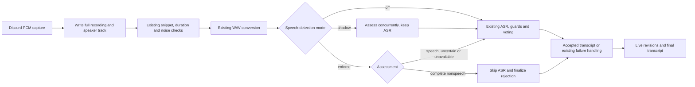
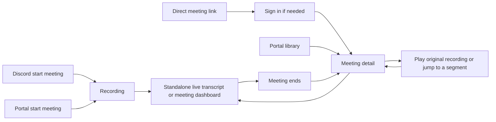

# Speech detection before Discord transcription

Status: the user approved the design and subagent-driven implementation on October 13, 2026. Runtime, dependency, configuration and admission checkpoints are implemented and reviewed locally. Final rejection authority is being validated; later packaging and evaluation acceptance work remains. Default mode is off. Nothing has been deployed or activated in production.

## Purpose and scope

Reduce hallucinated transcripts and provider requests by detecting obvious nonspeech in Discord voice snippets. Preserve quiet speech, short acknowledgments, names from the dictionary, and the complete original recording. A detector failure must not prevent transcription or masquerade as silence.

The first version is a whole-snippet admission gate for the existing fast and slow transcription paths. It does not trim audio, change snippet boundaries, identify who is speaking, filter languages, alter the dictionary prompt, or replace transcription guardrails. Personal uploads, desktop capture, and the finalized full-recording verification pass are separate paths and remain outside this first integration.

This document records the approved architecture and acceptance criteria. The implementation plan and task ledger track local execution and review; implementation progress does not replace evaluation or rollout approval.

## Research and evidence

### Local code findings

At design time, `codex/live-meeting-ui-quality` was based on `c46df7a` with UI and eval changes uncommitted. The required eval and live-removal foundations have since been committed and reviewed. Separate dashboard presentation changes remain pending and are excluded from the detector implementation checkpoints.

| Finding                                                                                                                   | Evidence                                                                    | Consequence                                                                                                                                                   |
| ------------------------------------------------------------------------------------------------------------------------- | --------------------------------------------------------------------------- | ------------------------------------------------------------------------------------------------------------------------------------------------------------- |
| Capture writes decoded PCM to the recording before transcription decisions.                                               | `src/audio.ts`, decoded-stream handler and speaker-track persistence        | Keep this order. A gate rejection removes no recorded audio.                                                                                                  |
| Discord capture is s16le, 48 kHz, stereo. Existing conversion creates 16 kHz PCM WAV.                                     | `src/constants.ts`, `transcriptionAudioService.ts`                          | Reuse conversion and its output. Do not introduce a second resampler in the first version.                                                                    |
| Both fast and slow paths call `transcribeSnippet`, after the existing duration/noise checks.                              | `src/audio.ts`, `transcriptionService.ts`                                   | Put the model gate at this shared boundary before any OpenAI request.                                                                                         |
| Fast-only finalization can bypass the slow path.                                                                          | `startProcessingSnippet`                                                    | Reuse a fast result only when its speech assessment covers the exact same audio and policy. Otherwise assess the complete snippet before taking the shortcut. |
| An empty slow transcript can fall back to an earlier fast result.                                                         | `src/utils/audioTranscript.ts`, `resolveAudioFileText`                      | A final detector rejection needs an explicit authoritative state. Returning only an empty string is insufficient.                                             |
| The live timeline reads transcript fields directly, while compilation and final-pass baselines use the resolver.          | `meetingTimelineService.ts`, `audio.ts`, `transcriptionFinalPassService.ts` | Make rejection consistent across all consumers. A rejected segment must disappear from live and final text.                                                   |
| Forced transcription currently serves pending live voice commands. Normal meeting-end flush does not force transcription. | `userStopTalking`, `commands/endMeeting.ts`                                 | Preserve this bypass through an explicit option. Do not infer it from disabling an unrelated guard.                                                           |
| The final audio verification pass returns early when there are no baseline segments.                                      | `transcriptionFinalPassService.ts`                                          | It cannot rescue every false rejection. Keep the raw recording, but require evidence before enabling rejection.                                               |
| The revised image uses Node 24.22.1 on Debian Bookworm slim. Source Terraform declares 512 CPU units and 1024 MiB memory. | `Dockerfile`, `_infra/main.tf`                                              | Verify the exact container and constrained performance. These are repository settings, not live ECS proof.                                                    |
| `.dockerignore` does not exclude `.cache`.                                                                                | `.dockerignore`                                                             | Exclude eval caches from Docker context before building this feature. Git ignore rules do not exclude Docker build context.                                   |

### Existing experiment

The [October 13 eval report](../../analysis/2026-10-13-transcription-quality-evals.md) records 32 synthetic clips, three repetitions per configuration. Raw prompted transcription returned text on all 24 nonspeech attempts. The fast pipeline retained text on six and dropped nine genuine dictionary-phrase attempts. The slow pipeline retained text on five nonspeech attempts and recovered the dictionary phrase through retries.

Silero at native input volume rejected three quiet positive controls. A bounded normalization variant accepted all 24 speech clips and rejected all eight negative clips. Combining that detector with prompt echo disabled produced no observed speech loss or unwanted text and used 72 requests versus 100 for the slow pipeline.

This is not an independent release holdout. Both nominal splits were inspected during tuning. The combined experiment changed two factors, so it does not isolate the effect of changing the echo policy. Keep echo behavior fixed in the first production VAD evaluation; investigate the dictionary-phrase problem separately.

### Primary-source research

- [Silero v6.2.1 wrapper](https://github.com/snakers4/silero-vad/blob/v6.2.1/src/silero_vad/utils_vad.py) uses 512-sample frames at 16 kHz, a 64-sample context, and recurrent state reset between recordings. The model has an [MIT license](https://github.com/snakers4/silero-vad/blob/v6.2.1/LICENSE).
- [ONNX Runtime Web documentation](https://onnxruntime.ai/docs/get-started/with-javascript/web.html) lists Node support for single-threaded WebAssembly execution. [Deployment documentation](https://onnxruntime.ai/docs/tutorials/web/deploy.html) requires the matching runtime assets to be available. Package availability does not prove this model runs in our image.
- The [ONNX proxy implementation](https://github.com/microsoft/onnxruntime/blob/main/js/web/lib/wasm/proxy-wrapper.ts) conditions browser proxy execution on a browser document. Use an explicit Node worker; setting the browser proxy flag is insufficient. [Node's worker documentation](https://nodejs.org/docs/latest-v24.x/api/worker_threads.html) supports that isolation mechanism.
- Native ONNX has [reported Alpine issues](https://github.com/microsoft/onnxruntime/issues/9483). An [October 2026 package proposal](https://github.com/microsoft/onnxruntime/issues/33236) still describes existing Linux binaries as glibc payloads. These sources establish a compatibility risk, not the outcome of a fresh build in our exact image.
- [WebRTC VAD's Node wrapper](https://github.com/serenadeai/webrtcvad) operates on mono PCM frames and offers aggressiveness levels that trade false accepts against missed speech. We have not measured it on this corpus.

Read-only npm metadata on October 13 reported version 1.30.0 for both JavaScript ONNX packages. Unpacked package sizes were approximately 145 MB for Web and 301 MB for native. Those are package sizes, not process memory or measured final image growth. The Python experiment used ONNX Runtime 1.31.0; equivalence with the JavaScript engine must be tested rather than assumed.

## Options and recommendation

| Approach                                      | Advantages                                                                                   | Costs and limits                                                                                               | Decision                                                             |
| --------------------------------------------- | -------------------------------------------------------------------------------------------- | -------------------------------------------------------------------------------------------------------------- | -------------------------------------------------------------------- |
| Silero with ONNX Runtime Web in a Node worker | Retains Alpine, reuses the tested model, isolates model CPU work from the capture event loop | WASM/model compatibility and resource use need an executable container check; sizable package                  | Recommended first compatibility candidate                            |
| Silero with native ONNX and a glibc image     | Native CPU inference is a supported ONNX path                                                | Replaces the base image or requires a maintained custom musl build; affects Opus and other native dependencies | Reconsider only if the WASM candidate fails its measured budgets     |
| WebRTC VAD                                    | Small frame-based classifier with no neural model artifact                                   | Different detector, no measured quality advantage here, native addon compatibility still needs proof           | Useful comparator if Silero is unsuitable, not an automatic fallback |

First prove the recommended runtime with the pinned model in the actual Alpine image. If it cannot meet compatibility or resource requirements, report that evidence and revise the design. Do not silently switch detectors or rebase the container.

October 28 revision: the WASM candidate failed the unchanged memory gate despite
process isolation and runtime probes. A same-model native adapter passed the
original benchmark on glibc, with a narrow memory margin. Implement native ONNX
Runtime 1.30.0 and a pinned Debian image, then repeat all final image and resource
checks. The decision, numerical differences, compatibility cost and acceptance
limits are recorded in `docs/adr-20261027-speech-detector-process.md`.

## Proposed architecture

### Shared admission boundary

`transcribeSnippet` retains conversion, provider error handling, and cleanup. After conversion, it passes the existing WAV to a small speech-detection service. This occurs before prompt construction, provider retries, voting, and audio attachments tied to transcription requests.

This first version avoids provider calls but still pays the local conversion cost. That tradeoff keeps the detector's input identical to the evaluated WAV and avoids a new signal-processing path. Streaming detection before conversion is a later design, justified only by measurement.

Use a typed assessment with four results:

- `speech`: sufficient speech evidence was detected.
- `non_speech`: the whole input was evaluated without sufficient speech evidence.
- `uncertain`: there is possible speech evidence without a stable speech decision. Preserve transcription for short or borderline sounds.
- `unavailable`: assessment was bypassed, not ready, overloaded, timed out, or failed. Include a fixed reason enum.

Do not identify nonspeech from missing decoder data, an empty provider response, an exception, or a timeout. Keep existing capture and provider failure reporting intact.

### Model worker

October 27 runtime revision moved the worker to a local child process, containing
process-level failures. The initial `--no-liftoff` WASM approach still exceeded
memory limits. The October 28 native revision retains process isolation, the
queue, policy thresholds, deadlines, restart cooldown and default-off admission
contract. Its compiled child has bounded V8 heap and allocator arenas. The
benchmark counts the parent and all descendants against the same resource
targets. See `docs/adr-20261027-speech-detector-process.md` for the controls,
numerical differences and final acceptance requirements.

Use one long-lived Node child worker per bot process, with one loaded model/session and sequential single-thread CPU inference. The API-only runtime does not load the model. The worker owns WAV parsing, downmixing, normalization, inference, and recurrent state. Every clip starts with fresh recurrent state, including interleaved speakers and repeated fast snapshots.

Read and copy the detector input before sending it through child-process IPC. Never detach a buffer used by the recorder, a snippet, or provider submission. Do not hand the worker a temporary file path that transcription cleanup might delete. Send only the typed result and numeric metrics back to the parent.

The worker may return `speech` once sufficient evidence exists. It may return `non_speech` only after completing all frames. Borderline evidence remains `uncertain`; invalid input, invalid model output, or an incomplete scan returns `unavailable`.

The initial positive criterion matches the experiment: 16 kHz mono input, a 0.5 probability threshold, two consecutive 32 ms frames, a -20 dBFS peak target, and a maximum gain of 100. Add a conservative uncertainty band: if any frame reaches 0.35 but the positive criterion is not met, transcribe anyway. This lower boundary follows Silero's default hysteresis separation as a starting candidate; our whole-snippet policy still needs evaluation. Only a completed scan whose peak remains below 0.35 can reject the snippet. These are candidate settings, not approved release thresholds, and model scores are not calibrated guarantees. The original WAV remains unchanged. Include impulses before quiet speech, stereo cancellation, silence followed by a short word, and varying background levels in evaluation. If downmixing destroys signal that exists in either channel, report unavailable rather than confidently rejecting it.

Implementation discovery, October 13, 2026: synthetic tests demonstrated that peak normalization can hide quiet speech after one impulse, an impulse spanning a frame boundary, or two separated clicks. Add the fingerprinted `brief-peak-v1` safeguard only after a valid complete negative scan. Count samples whose absolute amplitude is strictly greater than whole-clip peak divided by `impulsePeakRatio` (10). If that count is between 1 and `frameSamples` (512) inclusive, and at least `minSpeechFrames` (2) consecutive nonzero frames exist outside every frame containing a high sample, return `uncertain`. Positive thresholds, normalization and original bytes are unchanged. The occupancy bound is 32 ms in aggregate, not elapsed transient duration. Pure clicks and sustained-tone controls still reject. The guard may preserve impulse plus residual noise, and it does not cover greater occupancy, peaks in every residual frame or too little residual signal. These synthetic results do not validate enforcement. Default remains `off`, with reviewed real-speech evaluation and the existing acceptance gates required before activation.

### Bounded work and failure behavior

Start the worker lazily when the mode needs it and warm it asynchronously. Until ready, transcribe normally. Keep at most one active request and four waiting requests. Overflow returns unavailable immediately.

Proposed total deadlines, including queue delay, are 500 ms for fast assessments and 1500 ms for slow assessments. Measure and confirm those budgets in the resource-constrained image. An expired queued request is removed. If an active request stalls, terminate the worker, settle all pending assessments as unavailable, and restart after a 30-second cooldown. Late replies never mutate a completed snippet. Disabled mode schedules no new work; shutdown settles pending work and releases the worker.

Unavailable results always continue through the existing transcription path. Repeated model failure must cause an observable loss of request savings, never a silent loss of speech or a model-load retry storm.

### Modes and configuration

Add one typed registry setting, `transcription.speechDetection.mode`, with `off`, `shadow`, and `enforce`. Default is `off`. Use the existing global superadmin configuration and meeting runtime snapshot, in the Experimental group. Do not add a second environment-only permission/configuration model or expose tuning knobs broadly.

Implementation-plan tracing confirmed that runtime configuration is resolved at meeting start. Preserve that behavior: changing the mode affects newly started meetings; active meetings retain their snapshot. An immediate in-progress kill switch would require a separate config-refresh design. Do not present a mode change as instant rollback for an active recording.

`shadow` evaluates but never suppresses transcription. Schedule the assessment alongside provider work so shadow mode does not introduce model latency before ASR. Aggregate disagreements are signals for review, not ground-truth false rejections: a nonempty ASR result may itself be a hallucination.

`enforce` skips provider submission only for a completed `non_speech` assessment. `speech`, `uncertain`, and `unavailable` proceed normally. Forced live-command transcription explicitly bypasses this gate. Keep the existing duration and amplitude gate behavior unchanged in this first scope, and measure their contribution separately.

Model and policy parameters are fixed, versioned code defaults for the initial release. A fingerprint records model hash, normalization policy, engine version, and decision parameters for assessment reuse and offline comparisons.

## State and transcript consistency

Add an explicit skipped/nonspeech variant to the snippet result. A detector rejection is not a provider or conversion failure. Successful provider transcription, skipped nonspeech, and failed processing remain distinct.

Fast assessment applies only to its snapshot. Do not mark the complete snippet finally rejected from a partial result. Record a successful speech assessment's exact audio coverage and policy fingerprint so the existing fast-finalization shortcut can reuse it safely.

For finalization in enforce mode, if an accepted fast assessment covers the unchanged complete snippet under the same policy, the shortcut remains valid. If it does not, assess the full converted snippet before taking the shortcut. A changed or appended snippet is assessed anew. An uncertain or unavailable final assessment proceeds normally and may still reuse existing successful transcription according to current rules. Off and shadow modes retain the current shortcut behavior.

Use one shared preparation/admission operation for this finalization check and `transcribeSnippet`. Its owner converts once, decides admission, and owns temporary-file cleanup. If the shortcut is taken after assessment, release those files without calling ASR. Otherwise pass the prepared WAV forward to transcription. Do not classify through a second independent converter or convert the same snippet twice.

A final enforced nonspeech result marks the file authoritatively rejected. The common transcript resolver returns empty regardless of older fast, coalesced, or final-pass text. The live timeline must use that same result. Do not merely clear `file.transcript` while leaving fallback fields able to restore it.

Existing successful-empty provider responses keep their existing policy in this focused change. Provider failure may retain a previously usable fast result and must remain marked as failure for partial-processing reporting. A shared authoritative-rejection mechanism can later address reject-both voting too, but do not change all empty-result semantics incidentally.

The current local SSE/UI work supports removal events. Verify an enforced final rejection removes an already-visible fast guess from the standalone live view and the meeting dashboard. At meeting end, compilation, notes input, history transcript, and final-pass baseline agree on exclusion. Preserve timing offsets and audio playback because the recording is not trimmed.

Implementation-plan tracing also found direct transcript reads in `uploadService` and `autoRecordCancellationService`. Apply the same authoritative rejection check there, while preserving their existing text-selection rules for non-rejected files. In particular, do not accidentally replace the uploader's nullish fallback with the compiler's usable-text fallback and change successful-empty behavior when the detector is off.

## Capture and user flow

Current flow: Discord capture writes the recording, amplitude/duration checks decide whether to request ASR, and the portal receives fast guesses and final revisions.

Proposed processing:

User navigation remains unchanged:

No new authentication, purchase, navigation, or participant-permission step is proposed. Later streaming VAD would require a separate design because it changes snippet boundaries and timing.

## Packaging and telemetry

Pin `onnxruntime-node@1.30.0` after the compatibility check. Bundle Silero v6.2.1, its license, and provenance with SHA-256 `1a153a22f4509e292a94e67d6f9b85e8deb25b4988682b7e174c65279d8788e3`. The saved model is 2,327,524 bytes. Verify the model, engine version, JavaScript execution assets and matching platform CPU binaries during packaging and worker initialization. Do not fetch model/runtime files from a CDN when a meeting starts. Skip optional CUDA installation.

Backend build output must include the compiled worker and model assets. Container smoke tests must perform inference, not just check that `dist/index.js` exists. Add `.cache` to Docker exclusions so private or synthetic eval artifacts are never copied by `COPY . .`.

Use existing Prometheus counters/histograms for assessment counts, reason enums, phase, mode, duration, queue saturation, worker restarts, skipped primary requests, and skipped audio seconds. Emit no audio, transcript, dictionary text, participant IDs, or new fine-grained identifiers. Do not add or widen PostHog events. Skipped seconds and calls are observed counters; translate to dollars only with verified pricing and traffic evidence.

User clarification on October 13: feature toggling and measurable improvement are required. Keep baseline measurement active when the detector is off. Compare off/shadow/enforce with mode-tagged snippet outcomes, provider SDK submissions including voting/application retries, and submitted audio seconds normalized by independently counted decoded recording time. SDK submissions are not evidence of internal transport retries or billed usage. Produce one matched off/enforce evaluation report for false transcripts, speech loss, WER, workload and latency/resource costs. Human-reviewed references establish quality; live shadow disagreements and request savings alone do not prove improvement. The implementation plan makes that report and its counter tests required before promotion.

## Acceptance and rollout proposal

The implementation plan must start with runtime feasibility and then progress through independently reviewable checkpoints. Failure at the compatibility checkpoint stops production integration.

1. Prove model inference in Node 24.22.1 on the actual production image, with bundled assets and no runtime network dependency. Match the saved synthetic gate decisions against the Python reference, including repeated and interleaved clip order. Test compiled worker startup, missing/corrupt assets, and shutdown.
2. Verify public behavior at the detector service, snippet admission/result, final transcript resolver, live timeline, and corpus runner. Include overload, deadlines, worker crash/recovery, forced live commands, fast/final races, unchanged/changed shortcut coverage, and earlier fast text followed by final rejection. Confirm recorder bytes and offsets remain intact.
3. Extend evals to call the actual production detector, not an externally generated decision table. Compare VAD on/off with the prompt/echo policy held constant. Separate any later echo-policy experiment factorially. Grade every repetition and stage; include failures and unavailable assessments.
4. Build a reviewed real Discord corpus in private ops. Reserve a fresh holdout by recording family. Proposed minimum is 100 distinct speech clips and 50 verified nonspeech clips across at least five speaker/device profiles. Include at least 20 quiet and 20 short speech clips, plus dictionary names, clipped edges, stereo effects, supported languages, overlapping voices, clicks, breathing, instrumental music, and background speech. Tags may overlap. Do not label ASR outputs as ground truth.
5. Proposed quality gate: zero observed added speech rejections on that holdout, including quiet/short groups, and reject at least half the verified nonspeech clips that the current amplitude gate admits. End-to-end transcript quality must not regress against the matched baseline. Zero observed errors is a sample result, not a claimed population error rate.
6. Benchmark cold/warm behavior and contention at the repository's 0.5 vCPU/1 GiB budget. Proposed limits are warm p95 assessment completion within the phase deadline, at least 95% assessment availability under the documented test load, detector memory overhead below 128 MiB, and less than 20 ms added p95 event-loop delay. Document the load and compare it with observed Sandbox capture. If the budget fails, revise the design rather than silently increasing ECS resources.
7. Keep production mode off through merge. Verify shadow mode in Sandbox first; then evaluate rejection there with reviewed clips. Production shadow/enforcement and production-recording replay retain their separate ops authorization. Rollback changes the mode to off; no recordings or historical notes are rewritten.

The corpus size, quality target, deadline, queue and resource limits above are proposed acceptance criteria for review. They are not measurements or deployment commitments.

## Expected changes after approval

Product scope includes a detector service and worker, pinned model assets, `transcriptionService`, finalization handling in `audio.ts`, typed audio results and transcript resolution, timeline projection, config registry/keys/types/runtime resolution, metrics, packaging and container smoke checks. Eval scope reuses the current corpus runner with the production detector. Documentation explains the mode, skipped-transcription behavior, and retained audio. Existing configuration UI changes require the repository's Storybook capture and visual-review checks.

No table migration, new cloud service, Docker base-image replacement, UI redesign, automatic recording deletion, or retrospective transcript rewrite is included. Dependency/eval changes must be isolated from the earlier UI work in reviewable commits.

## Approved direction and next stage

The user approved the recommended WASM/worker architecture, default-off shadow-first rollout, shared whole-snippet boundary after existing conversion, and the proposed acceptance criteria. Use the Superpowers writing-plans skill to produce exact files, tests, commands, checkpoint order, and failure stop conditions. Review that plan and select its execution method before product implementation.

### Task 6 implementation clarification, October 13, 2026

Exact original-PCM and policy reuse returns a `SpeechAdmission` variant of `{ kind: "reused", coverage }`. This carries prior accepted speech proof without inventing a new model assessment or its metrics. Only the current fast revision with assessed speech and usable text records reusable coverage. Force bypass prevents reuse; changed bytes or policy use the shared preparation and assessment path. A direct finalization shortcut records one reused outcome, zero new SDK submissions and no additional captured-audio denominator.

Task 6 strict-reuse ruling, October 13, 2026: this version reuses only exact original PCM plus policy proof. Missing, stale or changed proof goes through one full preparation and assessment, skips only completed nonspeech, and otherwise calls ASR. A new speech assessment does not introduce a second reuse path. Enforce can therefore add final SDK calls after uncertain or unavailable fast evidence or a policy change; the matched scorecard must measure this cost rather than assume savings. Off and shadow retain their existing shortcuts.
