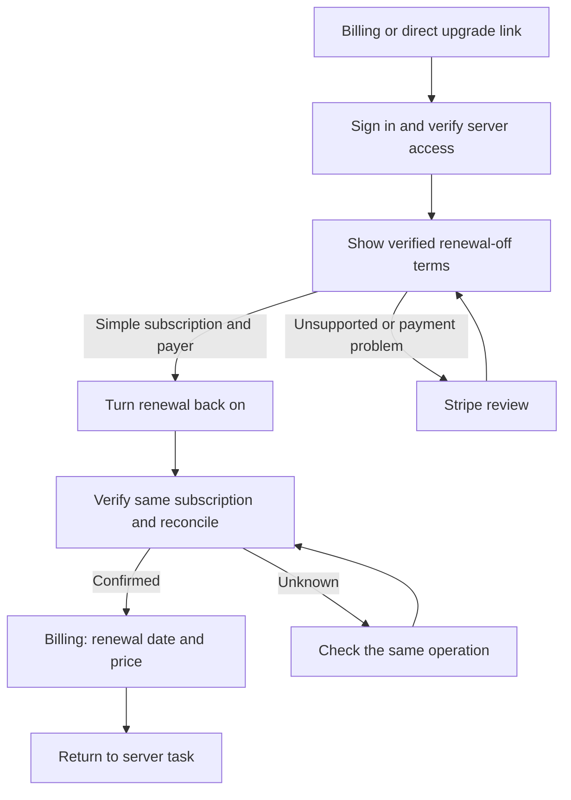
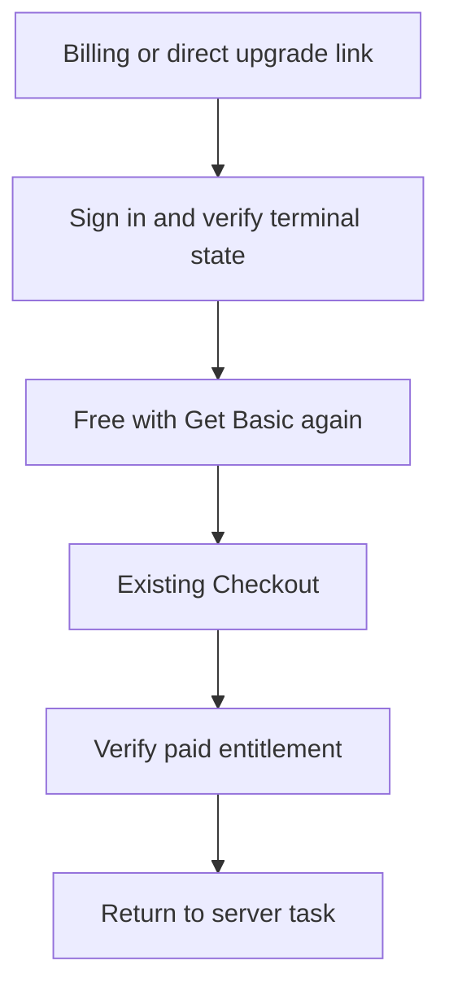

# Turn subscription renewal back on

## Review brief

A server that has paid time remaining should keep its Basic or Pro plan and clearly show **Renewal off**. Its Billing card should explain when access ends and offer one direct way to keep the subscription. The current ACTIVE badge, repeated cancellation date and first-year invoice details obscure that choice.

BASIC approved this implementation and separately authorized owned Stripe Sandbox tests on October 14. Local code, tests and the native provider proof are complete. Both new feature gates remain false. Deployment, activation, signed-in deployed-app acceptance and received lifecycle-event acceptance remain separate.

**Recommendation:** use an in-app action backed by a narrowly scoped Stripe subscription update for a verified, simple active subscription. Keep Stripe management as the alternative for unsupported schedules, payment problems or uncertain terms. This preserves the existing subscription and avoids sending ordinary renewals through plan selection or Checkout.

The tradeoff is additional consent and recovery code. The exact classic and flexible updates passed owned Sandbox proof; a read-only portal check confirmed the advertised controls. External Stripe edits cannot be made atomic with a Chronote preflight check. Detect changed terms before the write and verify them afterward; never present an uncertain result as success.

## The Billing experience

### Paid access with renewal off

The Engineering HQ annual example reads:

> **Basic · Renewal off**  
> Your Basic plan ends October 12, 2027.  
> Turn renewal back on to continue at $100/year before tax.  
> **Turn renewal back on** · Manage billing

Show the server name once. The primary button is explicit consent to the verified renewal terms displayed immediately beside it. A normal reactivation needs no additional tier-selection page or confirmation modal. This is a recommendation within the approved direction, not a new purchase flow.

Place usage and included features after the renewal action. Preserve the current responsive card layout, centered Monthly/Annual pill and Upgrade comparison. The existing plan selectors continue to control plan comparisons, not the cadence of this renewal action.

Use **Renewal off** as a neutral status. Paid access remains available through the displayed end date. Avoid an ACTIVE badge beside a second cancellation statement.

### After confirmation

While the provider result is unresolved, show **Checking renewal** and keep the known access-end date visible. Disable repeat submission and keep a way to check status. Do not promise renewal from a button click, redirect or successful HTTP response alone.

After provider verification and authoritative reconciliation, show **Renews October 12, 2027** and the verified renewal price. The next renewal may still use a valid remaining discount. Turning renewal on neither restarts a used offer nor removes a valid current offer.

### Payment history

Move first-year paid amount, subtotal, tax wording and coverage dates into a separate **Payment history** section below the current-plan card. Keep these values distinct: the example paid $64.20 for a $60 first-year subtotal, while renewal is $100/year before tax.

Retain an explicit **View invoices and receipts** action through the existing payer-checked Stripe portal. Do not invent an invoice URL, build an invoice browser, or expose another server's payment history. Server managers retain their existing summary visibility; only the original payer can enter that billing account's portal.

### Other states

| State                                                                     | Current plan and action                                                                                                                                                                   |
| ------------------------------------------------------------------------- | ----------------------------------------------------------------------------------------------------------------------------------------------------------------------------------------- |
| Renewal already on                                                        | Show the verified renewal date and rate. A repeated confirmation does not toggle it off.                                                                                                  |
| Scheduled cancellation, original payer with verified terms                | Paid Basic/Pro, **Renewal off**, date and rate, **Turn renewal back on** primary.                                                                                                         |
| Another server manager                                                    | Show known plan and renewal-off date. Explain that the original payer must manage renewal; do not offer a writable billing action.                                                        |
| Payment requires attention                                                | Preserve access under the existing entitlement policy. Route to **Manage billing** to resolve payment before direct reactivation. Do not collect an outstanding payment as a side effect. |
| Unknown renewal terms or provider read failure                            | Keep a known end date visible. Offer **Try again** and, for the payer, **Manage billing**. Do not guess a price.                                                                          |
| Custom cancellation, schedule, pending change or unsupported subscription | Show renewal off when known. Offer **Review renewal in Stripe** to the payer. Do not edit or release a schedule automatically.                                                            |
| Terminal canceled or expired, no other entitlement                        | Current plan is Free. **Get Basic again** uses the existing provider-verified terminal Checkout path and current Monthly/Annual selection.                                                |
| Complimentary or forced access                                            | Preserve the existing effective plan and its badge. Any separate Stripe renewal status must not relabel that grant or revoke it.                                                          |

A terminal subscription cannot be reactivated. A new purchase must retain the server's prior monthly and annual offer-use records. It keeps existing Checkout authorization, which may allow a new payer who manages the server. That does not grant access to the former payer's receipts. [Stripe cancellation guidance](https://docs.stripe.com/billing/subscriptions/cancel#stop-a-pending-cancellation)

## User task: keep the current paid plan

### User task: buy again after the subscription ended

Current behavior offers only general Stripe management. The proposed in-app action covers simple renewals. Broader plan switching and editable schedules remain owned by the existing billing initiative and are not prerequisites for this narrow action.

## Provider route and boundaries

### Selected candidate

Use the pinned `2026-07-29.dahlia` API and preserve the subscription's billing mode. For the classic boolean representation, the candidate update clears `cancel_at_period_end`. For the flexible dated representation, it clears `cancel_at`. Request no prorations. Do not supply prices, items, quantities, discounts, a new anchor or a payment request.

Stripe documents portal reactivation before the paid period ends and distinguishes flexible `cancel_at` from classic `cancel_at_period_end`. The installed SDK also permits clearing the dated field. This establishes an available candidate, not native acceptance for Chronote. [Stripe portal integration](https://docs.stripe.com/customer-management/integrate-customer-portal#webhooks)

The subscription `/resume` endpoint is for paused subscriptions and is not this action. Hosted deep links offer cancellation and plan-update flows, but no documented focused renewal-reactivation flow. A general portal session remains the fallback; do not disguise a plan update or new Checkout as renewal. [Paused-subscription resume](https://docs.stripe.com/api/subscriptions/resume), [portal flows](https://docs.stripe.com/customer-management/portal-deep-links)

### Direct-action eligibility

Require all of the following before issuing a consent quote and again before confirmation:

- Manage Server permission and exact original-payer metadata match. Retain server/customer/subscription association and environment checks.
- A Stripe-backed active paid subscription with one supported licensed monthly or annual item and quantity one.
- A future cancellation matching the independently verified paid-service boundary. Comparing `cancel_at` only to current item period end is insufficient, because custom cancellation can shorten that period.
- No schedule, pending update, pause, trial, unresolved payment, unsupported price or uncertain cancellation ownership.
- A read-only Stripe preview with cancellation removed that verifies the same renewal boundary, recurring rate, discount lifecycle and tax basis. Reject unexpected pending or proration lines. No preview request may persist an invoice or attempt payment.

Use the existing verified invoice/service-period evidence to check the paid boundary. If independently funded service from future switching cannot yet be interpreted, route that subscription to Stripe review rather than treating its zero-cash application invoice as its service value.

The direct action has a separate default-false `STRIPE_RENEWAL_REACTIVATION_ENABLED` gate. Do not enable all plan transitions merely to expose renewal. Turning this gate off prevents update calls, including retries, while allowing reads and reconciliation of an already submitted operation. Uncertain operations remain available for review; the toggle never treats them as failed or releases their control by expiry.

### Renewal terms

The quote binds the next service date, tier, cadence, currency, quantity, recurring service rate, discount identity/end, regular rate after the discount, tax behavior and source subscription state. Bind the server and payer too. Quotes last five minutes, a proposed engineering default.

The example's `$100/year before tax` is valid only for a verified exclusive-tax rate. For inclusive pricing, say tax is included. An unspecified or unverifiable tax basis routes to provider review. Do not relabel an inclusive catalog price as before tax to match the sample copy.

Display recurring service terms, not an unsupported prediction of next year's final cash amount. Existing account credit or debt can affect a later invoice; neither is charged, refunded or reset by reactivation. Valid remaining monthly discount terms must include their actual end and subsequent regular rate. No quote grants or reserves another introductory offer.

### Consent, duplicates and recovery

Use a signed, purpose-bound five-minute quote and a durable operation keyed by its nonce. Reuse the existing consent-token codec with a renewal-specific schema and a domain-separated key derived from the configured session secret. A signature alone does not make a quote single use.

Store renewal operations and a per-server control record under distinct namespaced keys in the existing GuildSubscription table, following the purchase repository's conditional-write pattern. Do not overwrite its subscription, purchase-control or offer-ledger records. The operation records the exact request body, immutable Stripe idempotency key, approved terms and source fingerprint.

Before calling Stripe, atomically claim the server control against the saved subscription ID/revision, recheck permissions and read the native source again. A changed date, price, discount, schedule, payment state or subscription identity requires fresh review. Serialize Chronote reactivation requests; do not introduce a customer-wide lock.

After the update, independently re-read the native subscription and run existing authoritative reconciliation. Success requires cancellation removed, identical subscription/item/customer/mode, unchanged price/quantity/discount/anchor/paid period, matching approved renewal terms, and persisted current state. Offer-use records remain untouched. A lost response or failed persistence remains **Checking renewal**, with the same operation available for recovery.

Retry a submitted request only with its original body and idempotency key, for at most 23 hours after the first attempt. This conservative limit stays within Stripe's documented API v1 retention of at least 24 hours. Beyond it, use readback and review without another update. [Stripe idempotency](https://docs.stripe.com/api/idempotent_requests) Never reissue a completed operation after the user later cancels again. Do not expire an unresolved operation merely because its consent quote expires. The same quote cannot start a new operation.

Chronote cannot compare-and-swap an external Stripe edit with this update. Fresh preflight plus readback narrows that race but does not eliminate it. If post-write terms or ownership drift, show **Renewal needs review**, display only freshly verified facts and route to Stripe/support. Do not claim the approved renewal succeeded, silently create a purchase, change the price back or recancel another actor's decision. Native race proof is a release condition; an unbounded or charge-producing case blocks the direct route.

## PostHog measurement

This revision adds measurement to the scope. The three lifecycle funnels are onboarding, purchase, and cancellation/loss, with renewal restoration and win-back as recovery branches. Their canonical definitions and existing/proposed event coverage are in [Product lifecycle analytics](../../purchase-analytics.md#three-lifecycle-funnels). This feature fills the loss/recovery gap; it does not rebuild onboarding or purchase tracking.

The loss journey follows confirmed renewal off to either renewal restored or the end of the paid relationship. A click is intent, a saved provider transition is an outcome, and a paid renewal is evidence of retained payment. Annual subscribers remain at risk until their actual paid boundary; they are not already churned. Payment-failure recovery is a separate branch, and downgrades are contraction rather than total paid loss.

Add the proposed visibility, action and confirmed-outcome events defined in the canonical document. A settled-renewal event includes credit-covered renewal, preserving the old positive-payment event contract. Shared reconciliation publishes confirmed state changes; the renewal service publishes first accepted requests and persisted final results. Match failed and recovered invoices privately. Deduplicate replayed events and first-observation baselines. Do not infer a cancellation timestamp for a subscription already off at rollout.

Measure business outcomes by guild, because the organizer, payer and cancellation actor may differ. Use a real acting user only when the app knows one. Retain the existing two-identifier limit, DNT and stored opt-out behavior. Use fixed categories plus the bounded maturity duration described below. New events must not include prices, amounts, provider/operation IDs, cancellation text or raw errors. A bounded remaining_seconds_to_scheduled_end duration and boundary_known flag make cohort maturity measurable without another identifier. Use the server observation as the standard event timestamp, update a changed scheduled end without counting another cancellation, and report unknown boundaries separately.

Add meaningful analytics tests and Sandbox event-row acceptance to feature completion. Source events, received rows and saved funnel configuration are separate evidence. Inspect existing saved definitions before publishing anything, then integrate the verified views into existing Chronote reporting. The capture implementation is now local and disabled by default. No PostHog dashboard or production setting was changed.

A separate default-false BILLING_LIFECYCLE_ANALYTICS_ENABLED gate controls new capture. Publish the privacy-policy detail/provider table/date and What's New notice before enabling it. Keep this independent of the renewal action's rollout so disabling that action does not hide already-approved losses or payment recovery.

## Proof and release conditions

The local and provider checks below have run. Signed-in deployed-app and received-event checks remain release acceptance gates. See the implementation plan for exact evidence.

1. Local service/repository/API tests prove authorization, quote expiry/tampering, both cancellation representations, unrelated server isolation, stale terms, duplicate submission, lost responses and current-state reconciliation.
2. Storybook and Playwright cover renewal off, confirmed renewal, processing, provider failure, nonpayer, payment problem, unsupported schedule and terminal Free. Capture and visually review desktop 1280px, intermediate 768px and mobile 390px. Assert the actual modal or page scroll container moves when overflow exists. Preserve the approved plan selectors/comparison.
3. Separately authorized Sandbox fixtures prove the exact API update for classic and flexible modes. Preserve the same subscription/item, paid-service boundary, anchor, rate, discount, customer balance and offer use, with no new invoice, payment intent, charge or proration caused by the undo. Advance a test clock to the legitimate renewal and verify normal billing.
4. Include annual introductory history renewing at regular price, a valid remaining monthly discount, repeated requests, cancel-again after success, provider timeout, concurrent native edits, payment problems and custom/schedule exclusion. Record request and effective response API versions. Use new owned fake-money fixtures, never the already cleaned parent test subscription, and reconcile cleanup.
5. Read-only native portal/configuration review must confirm the advertised fallback is actually available. An unsupported schedule may require support; the UI must not promise that Stripe can edit every schedule.
6. Verify lifecycle-event semantics, replay handling, actor identity, DNT/opt-outs and environment filters with tests and actual Sandbox event rows. Public docs, focused checks, screenshots and review must pass before merge readiness. Deployment and activation remain separate decisions. Disabling the new direct-action gate must not abandon in-flight recovery.

## Decisions and review status

Approved: renewal-off hierarchy, direct primary action with authoritative terms, payment history separation, same-subscription restoration, terminal Free/repurchase, and existing offer rules.

Recommended engineering choices: direct minimal update for simple active subscriptions; inline consent; five-minute signed quote; narrow durable operation; separate default-false gate; provider review for unsupported states. These keep the approved UX small while making uncertain outcomes visible. The builder may choose internal helper layout but may not relax these behavioral constraints.

Requested in this revision: incorporate all three lifecycle funnels and loss/recovery measurement. The approved default windows are seven days for onboarding and purchase, and 30 days for win-back. Annual cancellation maturity follows its actual paid boundary; immature cohorts stay separate. No saved view changes are authorized. No additional pricing or eligibility decision is requested. The provider proof can invalidate the direct candidate. If it does, return with the observed mismatch rather than substituting a different billing flow or weakening consent.

## Evidence appendix

- Source inspected: `src/frontend/pages/Billing.tsx`, `src/frontend/components/SubscriptionDetails.tsx`, `src/frontend/pages/UpgradePlans.stories.tsx`, `src/frontend/pages/basicIntroFixtures.ts`, `src/frontend/utils/billingManagement.ts`, `src/trpc/routers/billing.ts`, `src/services/billingService.ts`, `src/services/subscriptionReconciliation.ts`, `src/services/subscriptionPaymentProgress.ts`, `src/utils/stripeCancellation.ts`, `src/utils/consentToken.ts`, `src/repositories/purchaseAttemptRepository.ts`, `src/services/stripeClient.ts`.
- Current local source: `20b038b8d6d40fe0a198ff06ca61c9e7b842fff4`, branch `codex/plan-switching`, based on merged `3e3981968955a82e06f2d4544b3c3dec6a8b76a2`. Follow-up source commits are local, not deployed claims.
- Current synthetic story: `pages-upgradeplans--intro-subscriber-canceled`. The date is `2027-10-12T12:00:00Z`; the fixture has USD 10000 yearly regular rate, USD 6000 initial subtotal and USD 6420 initial payment. Its DTO boolean does not establish a native Stripe cancellation representation.
- Installed SDK declarations: `node_modules/stripe/cjs/resources/Subscriptions.d.ts` and `Invoices.d.ts` accept an empty dated cancellation in update/preview parameters. Native compatibility must still be proven.
- The supplied screenshot is a synthetic Engineering HQ reference, not an active production customer or permission to modify billing. No private provider/account identities belong in this product document.
