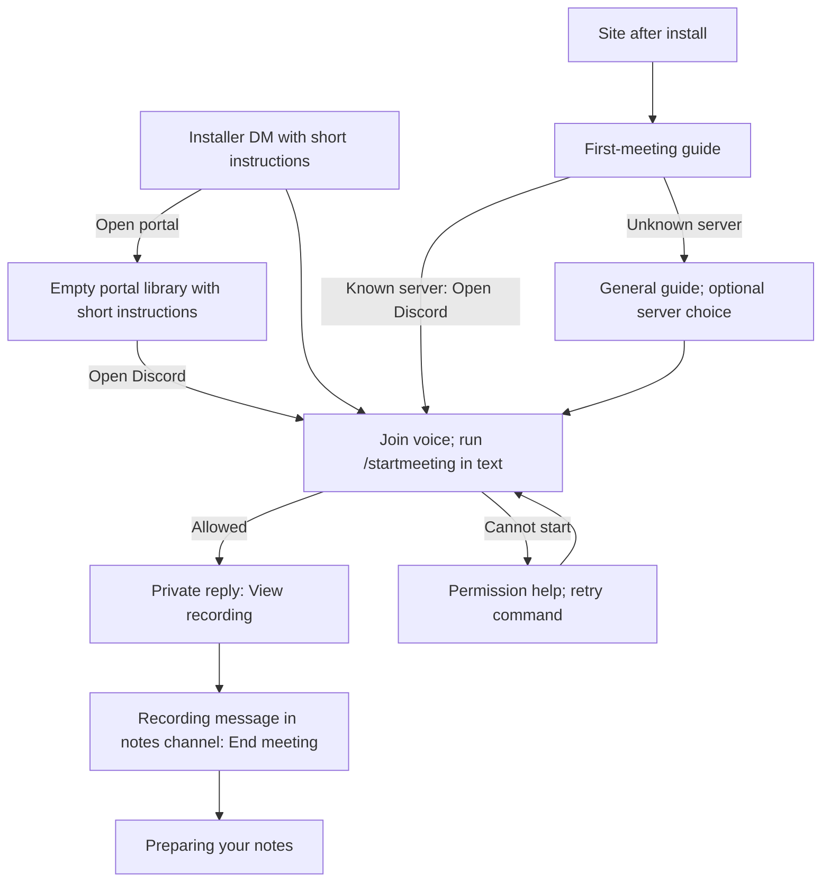
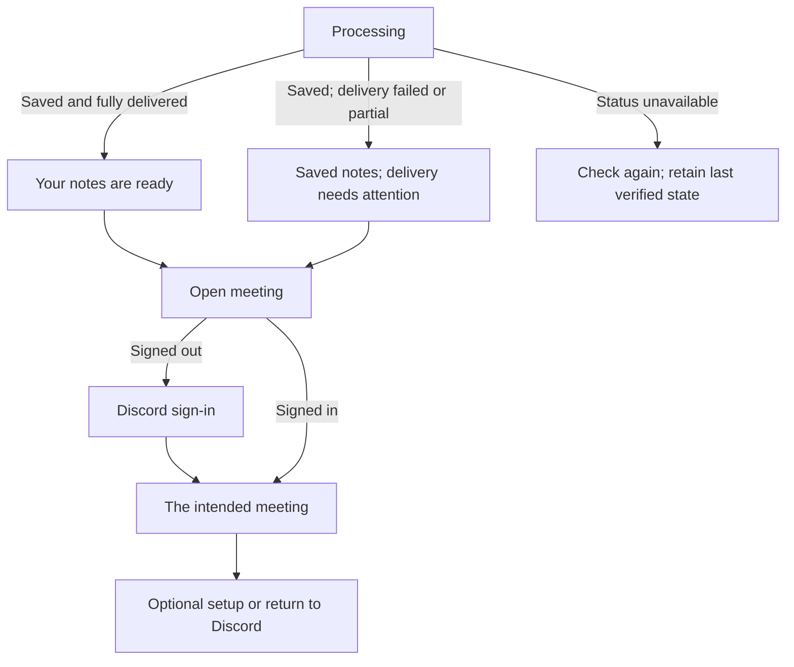

# Get your first meeting notes

## Outcome and decision

Help a new server finish one recording and find its notes. The site and Discord
describe the same three actions: join voice, run `/startmeeting` in a text channel,
then end the recording. Context and auto-recording are optional. Recording does
not require a website visit, a setup checklist or a purchase.

BASIC approved the prototype and requested implementation planning on October 16, 2026. On October 19, BASIC selected **B, Steps + example**, for the empty library
and accepted the accompanying installer DM. The standalone guide command was rejected. The revised
flow removes `/onboard` and puts help in context. All four source tasks and their
scoped reviews are complete in the isolated worktree. Local evidence and its
remaining visual-runner limit are recorded in the
[implementation evidence](#implementation-evidence-october-20).
CI, deployment and native Sandbox acceptance remain unverified. Related notes-routing changes have merged separately, but
their deployed state was not verified during this design refresh.

Keep the first interaction where the person already is. The site opens Discord;
the installer DM explains the task inside Discord. The saved
meeting becomes the destination after recording. No additional sales pitch or
reminder campaign belongs in this work.

## Before recording

The site heading is **Record your first meeting.** Its primary action is
**Open Discord**, followed by these instructions:

1. Join a voice channel.
2. Run `/startmeeting` in a text channel.
3. End the recording to get your notes.

Under the instructions, explain: "Chronote replies privately with a link to your
recording. Follow it to find the controls and notes." The recording's actual notes
channel may come from a meeting-specific choice, voice-channel override or server
default. Do not promise that it is the channel where the command was run.

Keep the homepage's `SampleSummary` component, including its Discord styling and
fictional-example label. **Optional setup** explains `/context` and `/autorecord`
without enabling either. Remove the recording-reminder sentence from this guide;
do not replace it with another heads-up instruction.

The guide is readable without sign-in. Real server progress requires sign-in and
existing server and meeting access checks. Without a verified server, show general
instructions and optional **Choose a server**. Never pick the first server as a
default. An empty meeting library shows **Your first meeting goes here**, the
same short recording instructions and **Open Discord** for the selected server.
People do not have to leave the portal for another instructions page. A search
with no matches keeps the existing search-empty state.

The installer DM explains the three actions and links directly to its server and
its portal library. Preserve installer
identification, owner fallback and DM-failure handling. Retire the existing
`/onboard` wizard rather than replace it with a command that only displays a guide.
Settings remain available through the portal and existing settings commands, with
their normal permissions. Do not create public welcome posts or another DM.

Include **Open portal** in the installer DM, targeting that server's
meeting library. The website guide offers **Open portal** alongside **Open Discord**.
Sign-in returns to the intended server. After recording, **Open meeting** targets
the actual saved notes. The portal remains useful before the first recording
through its first-meeting empty state.

## Selected library layout and installer copy

Use layout B in the existing server-library shell. Show **Your first meeting goes
here.** and "Record a conversation in Discord. Your notes will be saved here."
The instructions and **Open Discord** sit on the left; a visibly labeled
**Example notes · Fictional meeting** sits on the right. Render the example with
the existing homepage `SampleSummary`, including its Discord palette in both
portal themes. Do not duplicate its markup or replace it with plain Markdown.

The library instructions are:

1. **Join a voice channel.** Head to your server and join the conversation.
2. **Start recording.** Run `/startmeeting` in a text channel.
3. **End the recording.** Use **End meeting** when you're done. Chronote takes care
   of the notes.

Below **Open Discord**, say "Chronote's private reply links to your recording
controls and notes channel." Keep **Optional setup** collapsed below the content.
The heading and steps come before the example in reading and keyboard order.

Stack the example below the instructions when the library content area is narrower
than 800 CSS pixels. Below 600 CSS pixels of content width, stack the three steps
as well. Base this on the space left after the portal sidebar, not just the browser
width. Let copy wrap naturally, retain visible list spacing and keep **Open Discord**
reachable without passing the example. Do not ship the prototype's layout selector,
scenario controls, fake server or simulated recording actions.

Only show this view after a successful active-library response with zero accessible
rows before client filtering and with no user-applied search, tags, channel or date
filter. The initial 30-day default is not a user-applied date filter, but a row
outside that default must still prevent first-meeting guidance. Loading, request
errors, archived views and filtered-empty results retain their normal UI. Hide the
empty filter/count/sort chrome while this first-meeting view is shown. Do not hide
existing navigation or enabled integration status. This is an invitation to record,
not proof that the server has never recorded. Personal My Meetings is unchanged.

The installer DM uses the following short message, with the real server name:

> Thanks for adding Chronote to **{serverName}**.
>
> Here's how to get your first notes:
>
> 1. Join a voice channel.
> 2. Run `/startmeeting` in a text channel.
> 3. Follow the private link to your recording. Press **End meeting** when you're done.
>
> Your notes will be posted with the recording and saved in your meeting library.

Its link buttons are **Open portal**, targeting that server's library, and
**Open {serverName}**, targeting the installed Discord server. This updates the
existing installer DM; it does not send another message. A blocked DM keeps the
existing failure handling. The library remains a separate entry path.

## Guidance without another command

Use the installer DM, the portal's empty meeting library and the existing recording
responses to explain the next action. The public `/join` page remains available
after installation and for linked help. There is no new Discord guide command or
replacement slash-command name to remember.

Remove `/onboard` from command registration. Previously sent wizard buttons, open
modals, channel selectors and any temporarily cached slash invocation must receive
a short private retirement notice with **Open portal**, without applying settings
or restarting a tutorial. Leave historical wizard state alone; no migration or
replacement completion tracker is needed.

`/startmeeting`, `/context` and `/autorecord` keep their own permission checks.
Reading instructions grants no recording, configuration or meeting-data access.
Real progress is shown only after existing meeting-access checks succeed.

## Record and find the result

The site's recording state opens the existing Discord recording message, or its
authorized text channel when no message pointer exists. It adds no recording
controls. Use **Preparing your notes** while processing is verified. Do not invent
percentages, completion times or progress from guide clicks. Processing continues
if the guide closes.

The command's **View recording** action targets the exact recording message, as
implemented by the notes-routing feature. The site's channel-link fallback is
only for historical progress lacking a message pointer; it must not weaken that
command behavior. Notes appear in the recording's resolved notes channel.

## Open saved notes and return to Discord

Discord's notes embed includes **Open meeting** and secondary **Optional setup**.
The site opens that same saved meeting. Sign-in preserves the destination and
access is checked again. Existing corrections, feedback, tags and eligible upgrade
notices keep working. Do not add another success message just for onboarding.

Saved notes plus acknowledged complete delivery justify **Your notes are ready**.
Legacy records without delivery evidence say **Notes saved**. Partial delivery
says **Notes saved. Some notes could not be posted to Discord.** Failed delivery
says **Notes saved. Discord delivery failed.** Offer the saved meeting and existing
permission help, not an unimplemented resend action.

Interrupted or recovered recordings retain their existing warnings even when
notes are available. Empty audio, disabled notes, cancellation and processing
failure do not become a first-notes success. A timeout alone is not a failure.
Inaccessible meetings, channel names and progress must never appear in the guide.

## Engineering boundaries and acceptance

Read state from existing meeting history, processing outcomes, delivery results and
active leases. Do not create an onboarding progress table, completion flags, new
recording controls, a resend endpoint or a historical first-ever-meeting claim.
The guide follows a permitted recent meeting and keeps that target once observed.

Cover both surfaces with payload/permission tests, site interaction tests and
Storybook screenshots reviewed visually. Verify mobile and intermediate widths,
light and dark themes, real scrolling, error recovery and sign-in return. A
Storybook Discord preview proves rendering of our payload, not Discord acceptance;
record one separate Dev/Sandbox check before claiming the live flow works.

Use existing install, meeting-start and completion observations for measurement.
`meeting_completed` or `notes_generated` alone does not prove saved, delivered,
useful notes. Tutorial steps remain separate from real outcomes. No new or widened
PostHog collection is authorized by this design; channel and meeting IDs stay out
of event properties. Existing operational reports can reconcile delivery evidence.

## Reference evidence

Read-only Mobbin preview research on October 15 supports keeping optional setup
outside the main task and providing one action in an empty library:

- [Uxcel checklist](https://mobbin.com/flows/7aa8271a-671d-4491-a92c-2d218c5a796a),
  preview positions 1–3: completed items, a remaining first task and expandable
  details. This does not establish persistence, error behavior or effectiveness.
- [Basecamp to-dos](https://mobbin.com/flows/1fbf4592-6eb8-437e-bdee-916a1e9e8417),
  preview positions 1–3: project tools, purposeful empty state and populated list.
  This is a reference pattern, not evidence of conversion improvement.

The original fictional prototype was inspected at 1280, 768 and 390 pixels in the
in-app browser, including both surfaces, permissions failure, delivery failure,
unknown server and simulated sign-in return. No native Discord or product
acceptance was performed. Local prototype:
`C:/Users/steve/.codex/visualizations/2026/10/02/01a0fb37-1464-73e0-afc0-94727c575dcc/first-meeting/prototype.html`.
The implementation does not depend on this local file.

The October 19 entry prototype supersedes that original prototype for the empty
library and installer DM. BASIC selected B after reviewing it. Local artifact:
`C:/Users/steve/.codex/visualizations/2026/10/02/01a0fb37-1464-73e0-afc0-94727c575dcc/first-meeting-entry/content/empty-library-installer-v1.html`.
Its sibling `README.md` records the simulated handoff and visual checks. The HTML
reproduces the example's appearance; the product must reuse `SampleSummary`.
No real Discord messages, recordings, sign-in or deployed behavior were tested in
this entry prototype. Earlier prototype checks do not establish those outcomes.

## Source appendix

October 19 design refresh inspected remote `master` at
`d80c8baae5562d8ba818f7a1cdd616a6f5204f2a`. Notes routing merged in PR #420.
`src/commands/startMeeting.ts` now resolves the destination and privately links
to the published recording message. `src/commands/onboard.ts` still contains the
manager/installer-gated wizard, and `src/frontend/pages/Join.tsx` still contains the
reminder the user asked to remove. Source inspection is not deployment acceptance.
The original prototype predates this routing integration, the explicit
**Open portal** additions and retirement of the guide command. Its earlier visual
review does not cover those changes.

Implementation planning inspected remote `master` at
`00813f875433299c5fa2feae544e94b8d7fc6fe1` on October 16, 2026. The earlier
prototype used `16270f66f07280e12a2644ad96f91f4ae6dbf45c`. Runtime configuration
and deployed behavior were not checked for this planning pass.

### Implementation evidence, October 20

The source implements the selected library layout, installer guidance, retired
wizard handling and permission-checked meeting progress. Final review restored
manual library refresh, added focus refresh to its existing query without
polling, explained a successful guide-only result and removed Discord destination
identifiers from analytics copies. Navigation keeps the real links. The final
review's four findings and four quality duplication findings are addressed; the
scoped independent review found no new blocking issue.

Storybook passed 274 tests, and VLM review covered the changed guide and library
captures. All 136 visual tests passed with three workers. The standard runner's
final retry passed 135 of 136, with one existing library case reaching its
30-second total limit. Its baselines and timeout were not changed. This remains
a local runner limitation, not a green standard-runner result.

Final Jest passed 3,646 tests across 386 suites without collecting coverage again;
the preceding complete run passed 3,639 tests with normal coverage. Builds,
documentation, lint, formatting and Markdown checks passed. The final quality
scan covered 1,182 eligible files with zero duplication, complexity or file-size
findings. The broader frontend typecheck retains 58 unchanged baseline diagnostics.

Task 4 and source implementation are complete. Native Discord rendering, an
approved Sandbox recording, CI and deployment remain unverified. Commit and
publication belong to the controller. These source and capture results do not
establish live acceptance.
