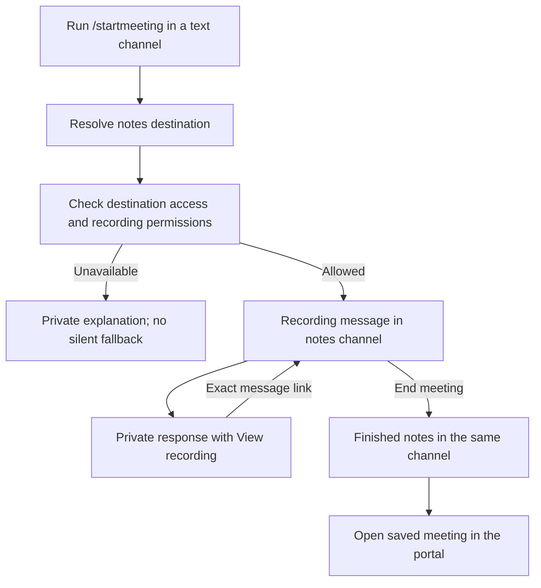
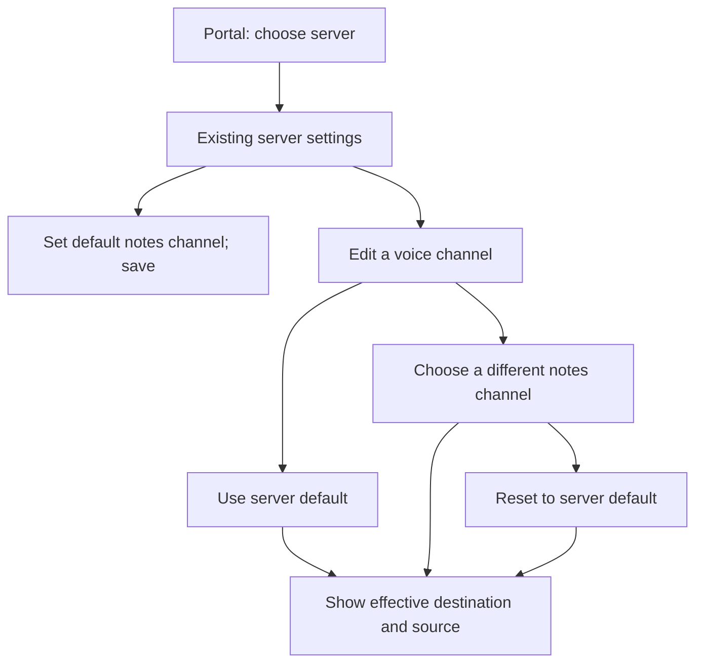

# Choose where meeting notes go

## Outcome and status

Let someone start a meeting from a convenient text channel while keeping its
recording controls and finished notes in the intended notes channel. Reuse the
existing server and voice-channel notes settings and add a one-meeting override.

BASIC approved this design and its fictional preview on October 16, 2026,
including the `notes-channel` command option and ordinary text channels only.
The destination order, shared location for controls and notes, private
exact-message response, permission rules and settings presentation are approved.
The implementation plan and subagent execution were subsequently approved.
Deployment remains separately scoped.

## Design ownership

On October 16, BASIC moved design finalization and implementation planning to
the separate **Chronote notes destinations: finish design** chat, local thread
`01a143a2-811d-7383-a020-e437779f7442`. It owns the settings/Discord mockup, final
design review and notes-routing implementation plan. The current document is its
handoff source. The fictional mockup was built and accepted in that chat.

The originating conversion chat retains the first-meeting site/Discord initiative
and revenue work. Its onboarding copy must describe current behavior until the
notes-routing change ships. Keep implementation and production approval gates
separate from this design handoff.

## Agreed recording experience

Choose a destination in this order:

1. An explicit destination for this `/startmeeting` invocation.
2. The current voice channel's configured notes destination.
3. The server's configured default notes destination.
4. The text channel where the command was run, if no destination is configured.

The one-meeting override does not edit saved settings. Auto-recording uses its
existing voice-channel and server configuration; it has no command-specific
override or invocation channel to use as a fallback.

Anyone already allowed to start a meeting may choose a one-meeting destination
they can access and where Chronote can post. Existing administrative permissions
govern saved server defaults and voice-channel overrides. The one-meeting choice
does not grant access to a channel or change who can control the recording.

The recording message, its **End meeting** control and finished notes stay in the
resolved destination. Do not add a second setting for recording-status messages.

The `/startmeeting` response is ephemeral, including when its invocation and notes
channels are the same. After the recording message is successfully posted, the
response includes a **View recording** link to that exact message. Prefer the
message URL returned by Discord. A channel link is not sufficient for this action.

Illustrative response, with channel names resolved from the real server:

> Recording started in Voice Lounge. Controls and notes are in #meeting-notes.
>
> View recording

Only report success and expose the message link once the actual start and message
publication are confirmed. Acknowledging or deferring the interaction must still
meet Discord's response deadline. No public success reply is added to the channel
where the command was run.

## User task: start here and follow the recording elsewhere

## Failure and access requirements

- A configured or explicitly selected destination that is deleted or inaccessible
  produces a private explanation before starting. Do not silently fall through to
  a broader channel and risk disclosing a private meeting.
- The starter must be able to access the destination and recording controls.
  Selecting it must not grant access or widen existing meeting permissions.
- A failure after start or during message publication must use the existing
  recording cleanup/recovery behavior. Never invent a successful message link or
  leave the person believing a recording has controls when publication failed.
- Preserve meeting-access rules, delivery acknowledgments, capture warnings,
  recording admission, limits and command timing. Route existing behavior rather
  than creating another recording lifecycle.

## Approved administrator experience

Keep this in the existing server settings and voice-channel editor. No separate
routing page or setup wizard is needed.

The existing **Default notes channel** picker selects the server-wide destination.
Its explanation is: "Recording controls and notes appear here unless you choose
another channel for a voice channel or meeting." With no selection, explain that
manually started meetings use the channel where the command was run. Existing
auto-recording validation must still require a configured destination.

Every voice-channel row shows its effective notes destination and where it comes
from. For example, **#meeting-notes · Server default** or
**#staff-notes · Voice channel override**. The notes-channel selector is available
even when auto-recording is off. Changing notes routing never enables recording.

The voice-channel editor offers **Use server default** or a specific accessible
text channel. Choosing a channel creates an override. **Reset to server default**
removes it. Changing the server default updates inherited destinations; explicit
overrides stay put, even if they currently equal the server default. Keep controls
editable, with the inherited/overridden indicator visible.

## User task: set a default and make one exception

## Approved command and lifecycle details

Use the optional slash-command argument `notes-channel`, presented by Discord's
channel picker. Start with ordinary server text channels, matching the existing
recording destination type. Threads, forums and direct messages are outside this
change. Preserve other supported command arguments and command eligibility.

Manual starts without that argument resolve the voice-channel override and server
default before using the invocation channel. Manual context-menu starts should
use those same defaults. Existing API/MCP requests that explicitly supply a text
destination retain that explicit choice. Personal uploads and exports are outside
this feature. This scope is part of the approved design.

Resolve and validate the destination once at recording start. Changing a default
or override while a meeting is running affects the next meeting; it does not move
controls, processing updates or notes for the current recording.

Validate the starter's access and the bot's required posting/control permissions
against the resolved destination, not just the invocation channel. Do not expose
an inaccessible channel's name in an error. Auto-recording retains its existing
authorization model; it does not require inventing a human command initiator.

If recording-message publication fails after recording begins, run the existing
safe cleanup path and report the actual result. If only the private acknowledgment
fails after the recording message exists, do not restart the meeting or publish a
duplicate recording message. Existing controls remain available in the notes
channel. Do not classify an acknowledgment failure as a successful private reply.

## Approval and next step

BASIC accepted the settings presentation, inherited and overridden destinations,
channel editor, private recording response, `notes-channel` option and initial
text-channel scope. The next artifact is the implementation plan. Review of that
plan and selection of an execution method precede product implementation.

This feature should precede revised onboarding wording that promises notes can go
to a configured channel. Until it ships, the first-meeting guide must accurately
describe current behavior.

## Evidence appendix

### Fictional design preview

The October 16 prototype is outside the product checkout:
`C:/Users/steve/.codex/visualizations/2026/10/16/01a143a2-811d-7383-a020-e437779f7442/notes-destination/content/routing.html`.
It uses fictional server, channel and meeting data. It changes no saved product
configuration and performs no Discord actions. The preview's View recording link
jumps to its local example message; the product must use the actual Discord message
URL as agreed above. The command picker is illustrative, not a native Discord capture.

Browser inspection checked inherited and overridden rows, reset to server default,
the enabled notes picker with auto-recording off, a one-meeting destination,
blocking an unavailable destination without fallback, and final notes in the same
channel. Changing the server default left the current preview recording in its
original destination. Five in-page assertions cover routing precedence and the
unavailable configured destination. No browser errors or warnings were reported
in the inspected session. Screenshots were reviewed at the default browser size
and at a narrow layout whose measured width was 500 CSS pixels. The browser clamped
the requested 390-pixel width, so this does not establish 390-pixel acceptance.

These checks cover the fictional design only. Product Storybook, regression tests,
native Discord permissions, publication, timing, cleanup and recovery remain for
implementation and runtime acceptance. The related first-meeting design and plan
were read for compatibility and were not edited. Their command-channel guidance
must remain until this routing behavior ships.

### Source observations

Planning refreshed the source against remote `master` at
`149b017ff72bb767e0940a4c1fff84602b7a4e66`, verified with a host-side
`git ls-remote` on October 16. The active settings page uses `ServerConfigCard`
and the registry-driven `NotesChannelSelect` in `ConfigValueField.tsx`.
`GlobalDefaultsCard` still exists but is not rendered by the settings page.
Implement the approved default-picker experience in the active components.
The channel editor and auto-record service both write `notes.channelId`; the plan
must prevent recording-toggle saves from clearing the independently saved route.

Earlier design inspection used remote `master` at
`00813f875433299c5fa2feae544e94b8d7fc6fe1`.

- `src/config/registry.ts` already defines `notes.channelId` at server and channel
  scopes, labeled "Notes channel".
- `src/services/autorecordService.ts` resolves that configured destination.
- `src/commands/startMeeting.ts` currently chooses the interaction's text channel.
  Its deferred-response branch posts a recording message, saves `startMessageId`
  and edits the interaction response. The new experience should reuse that flow.
- `src/frontend/features/settings/GlobalDefaultsCard.tsx` already has the default
  notes-channel picker. The voice-channel editor in `src/frontend/pages/Settings.tsx`
  currently shows its destination selector only when auto-recording or TTS needs it.

These are source observations. No live configuration, Discord permissions or
runtime behavior was verified in this design pass. The exact-message handoff is
settled by the user; reference-flow research is unnecessary for that decision.

### Settings reference research

Read-only Mobbin research on October 16 used web flows with output destination
`doc`. The first query was `workspace settings with organization defaults and a
per-project override that can be reset to inherit the default`. One refinement
was `project notification settings choosing a destination channel and inheriting
workspace defaults`. Native search worked; account identity and live behavior were
not verified. No images were exported.

| Reference                                                                                   | Inspected preview positions | Finding and design implication                                                                                                                                                 | Limits                                                                                                        |
| ------------------------------------------------------------------------------------------- | --------------------------- | ------------------------------------------------------------------------------------------------------------------------------------------------------------------------------ | ------------------------------------------------------------------------------------------------------------- |
| [Render workspace settings](https://mobbin.com/flows/89504217-e201-498a-9cad-f7240d7726fb)  | 1, 3, 5 of 5                | Existing settings navigation leads to grouped settings. Reuse Chronote's current settings entry.                                                                               | Positions 2 and 4 were not inspected; no inheritance behavior was established.                                |
| [ClickUp workspace settings](https://mobbin.com/flows/0d7590c8-ddf4-4bed-b581-715554a79696) | 1, 4, 7, 10, 13 of 13       | Workspace settings and integration controls are visible. This adds no useful evidence about inherited destinations.                                                            | Other positions uninspected; do not infer override/reset behavior.                                            |
| [Render notifications](https://mobbin.com/flows/b87c6772-51cf-457d-8848-84c7e9fafaab)       | 1, 2 of 2                   | The delivery page puts notification destination beside a default service preference and explains that services can override it. Make scope explicit beside Chronote's default. | Only preview images were inspected. Persistence, service-level override UI and reset behavior remain unknown. |
| [Dovetail notifications](https://mobbin.com/flows/c0773f60-48b0-47b7-a6e8-bbdc16bd2c6c)     | 1, 4, 6 of 6                | Project-local notification controls are shown in context. Keep a voice-channel override in that channel's editor.                                                              | Positions 2, 3 and 5 uninspected; inheritance and reset behavior were not established.                        |

The explicit inherited/overridden indicator and reset action come from Chronote's
configuration UX rules. They are recommendations grounded in the current product,
not observed Mobbin behavior or evidence of improved conversion.
