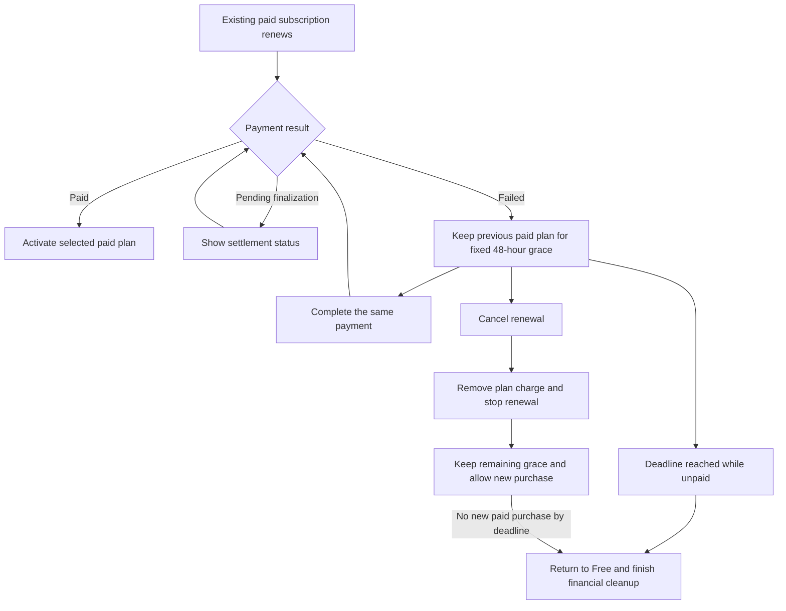

# Two-day grace for failed renewal payments

Keep a server's previous paid plan available for 48 hours when its renewal payment fails. Show the payment problem and the deadline in Billing, let the payer retry, and return the server to Free if payment remains unresolved. A scheduled plan change follows the same rule. It does not grant the new plan before payment.

The user approved the behavior below on October 16. It replaces the previous proposal to return a server to Free immediately when an unpaid scheduled renewal is canceled. The existing plan switching and introductory offer decisions remain in force.

## Agreed behavior

| Question                             | Recommendation                                                                                                          | Reason and tradeoff                                                                                                                                                                       |
| ------------------------------------ | ----------------------------------------------------------------------------------------------------------------------- | ----------------------------------------------------------------------------------------------------------------------------------------------------------------------------------------- |
| Which payments get grace?            | Renewals of an existing paid subscription, including renewals with a scheduled change.                                  | A card problem should not interrupt an existing customer's service. New purchases and immediate upgrades retain their existing payment rules.                                             |
| Which plan stays available?          | The plan from the last paid period.                                                                                     | A Pro server keeps Pro during grace even if its scheduled Basic renewal fails. The two courtesy days can therefore exceed the plan being purchased.                                       |
| When does grace end?                 | 48 hours after the renewal invoice was finalized for collection.                                                        | This is a stable provider timestamp. Delayed webhooks and retries cannot extend it. Draft invoices awaiting finalization are a separate settlement state.                                 |
| What does canceling do during grace? | Stop the unpaid renewal and its collection, keep the remaining grace, and allow a new purchase after financial cleanup. | Canceling cannot grant another grace period. A new purchase charges its reviewed price without credit for courtesy access.                                                                |
| What happens at the deadline?        | End paid access and cancel the unpaid renewal automatically.                                                            | There is no charge for grace itself. The unused plan charge is removed, allocated account credit is restored, and unrelated charges remain. A canceled subscription needs a new purchase. |

## What the payer sees

Billing shows the plan the server can currently use, the plan awaiting payment, the exact outstanding amount, and a date and time in the payer's local timezone. The message must distinguish a failed ordinary renewal from a failed scheduled plan change.

For a server whose scheduled Pro-to-Basic change reaches renewal and payment fails:

> We couldn't collect payment for your scheduled change to Basic. You can keep using Pro until October 18 at 10:00 AM. Without payment, your server will move to Free.

For a server staying on Basic whose renewal payment fails:

> We couldn't collect your Basic renewal payment. You can keep using Basic until October 18 at 10:00 AM. Without payment, your server will move to Free.

Use the actual plan names and deadline. Actions are **Retry payment**, **Update payment method**, and **Cancel renewal**. The payment action resumes the same verified invoice. Updating a card alone does not count as payment. The existing payer and Manage Server checks still apply. Payment methods remain available through the existing managed billing portal.

Canceling opens a confirmation that states the retained-access deadline and explains that the unpaid plan charge will be removed. After successful cleanup, show **Renewal canceled. Your server keeps Pro until October 18 at 10:00 AM.** The payer can choose a new plan immediately. Once grace ends, show Free and the usual plan selection. No horizontal plan scrolling or account-wide plan lock is introduced.

A draft invoice or unknown provider result uses the existing settlement message, not an assertion that payment failed. Partial payment or uncertain compensation shows that billing is being reconciled and keeps the recovery record. It does not silently discard money or release the purchase control.

### How does a payer recover a failed renewal?

## Payment, expiry, and offer rules

- A successful, verified renewal payment activates the selected plan for the invoice's original service period. Grace does not move billing dates or extend an introductory discount. The server is never credited for grace as if it had paid for those days.
- Retry and webhook replay use the same invoice and deadline. Another failed attempt, canceling and selecting a plan again, or an application restart cannot create a new grace window. A later fully paid service period can have its own failed-renewal grace.
- Only the subscription's plan charge is removed on cancellation or expiry. Preserve unrelated invoice items, tax allocation, existing debt, and unrelated customer balance. Use Stripe's credit note preview and verified allocations rather than treating account credit as cash.
- Read the provider again before cleanup. If the bound renewal has settled before cleanup commits, complete the paid renewal instead of canceling paid service. If money settles during a cancellation race, reconcile or refund it before releasing control. A canceled subscription cannot be restored by a late webhook or old payment URL.
- Grace stops at its deadline even if Stripe or financial cleanup is unavailable. Hold the financial recovery record until cancellation, compensation, offer usage, and the saved subscription agree. A valid independent entitlement grant still applies normally.
- An unpaid reserved offer is released only after verified cleanup. Offers already used stay used. Neither retry nor grace restarts an offer. Monthly and annual offers retain their separate once-per-server records.
- An explicit existing cancellation with no renewal charge ends as scheduled. Grace applies to payment failure, not every subscription ending. New purchases do not receive paid access on a failed first payment.
- Do not stop an ongoing recording solely because grace expires. New paid actions and quota checks use the current shared entitlement result.

## Engineering reference

### Persist the deadline and entitlement separately from Stripe billing dates

Store the bound renewal invoice, subscription and customer, mode, previous paid tier, provider finalization timestamp, immutable grace deadline, and recovery status. For a scheduled change, use its frozen paid source and operation identity. For an ordinary renewal, verify the prior paid service invoice before granting grace. The public view exposes the deadline, current access, selected plan and an owned invoice payment URL, without provider IDs.

The same record retains the original deadline after explicit cancellation so that remaining courtesy access survives financial cleanup. A successful new purchase supersedes that courtesy access without changing its history. Persisting or replaying an older grace record must never overwrite a newer paid subscription.

The shared subscription resolver used by the bot and portal enforces the deadline. Bound its cache lifetime to that deadline as it already does for expiring grants. The scheduled-operation fence must still allow this explicit grace projection while preventing an unpaid target tier from being adopted. Do not leave `past_due` in the set of statuses that grant unlimited paid access.

### Recover automatically without a browser

Add a sparse due-work index to the existing subscription table for unsettled renewal recovery records. An API worker queries due records on startup and at most once per minute, then invokes the same idempotent recovery used by webhooks and Billing. It integrates with runtime work admission and shutdown, uses conditional revisions, and tolerates overlapping workers. Keep unfinished work due until it reconciles.

Entitlement checks enforce the timestamp independently of this worker. A worker outage can delay provider cleanup, but cannot lengthen courtesy access. Webhook processing must durably register the recovery before acknowledging the failure. Scheduled changes also register a due check at their known renewal boundary, so a missed invoice event cannot strand them indefinitely. Ordinary renewal discovery needs a due check registered from each verified paid period, with paginated recovery of existing rows before activation.

This needs a reviewed Terraform index change and the normal deployment procedure. Do not change Stripe's account-wide retry settings. Do not use DynamoDB TTL as an exact timer. Do not put the grace deadline in Stripe's `cancel_at`, which can shorten subscription billing periods.

### Recover money and release controls

Reuse the scheduled-change control and offer reservation where present. Ordinary renewals need the same per-server purchase fence while provider cancellation is uncertain. Store native credit note and cancellation receipts before releasing control; recover lost acknowledgements through exact ownership and idempotency evidence. A plan-only credit note must remain replayable after Stripe's idempotency-key retention window.

An already canceled or externally modified subscription is reconciled from its verified native state. Unknown identity, a reversed paid source, incomplete invoice lines, or mismatched provider mode cannot create grace or authorize a financial write. Existing delinquent subscriptions need verified history and an anchored deadline before rollout; activation must not invent a fresh two days for old debt. Keep new behavior disabled until that migration and due-work coverage are verified.

### Scope and validation

The change reaches subscription types and repositories, conditional DynamoDB writes, reconciliation, scheduled recovery, the shared entitlement resolver and cache, billing status APIs, runtime startup and shutdown, Terraform and local table initialization, the connected billing UI, stories, browser tests, and public billing documentation. Preserve the approved independent funding flow for immediate changes.

Tests must cover both ordinary renewals and scheduled changes, both Stripe billing modes, exact deadline boundaries, duplicate and delayed events, retry success, explicit cancellation with remaining grace, restart and worker overlap, dropped payment webhooks, late payment during cleanup, partial cash and customer-credit funding, tax and unrelated charges, offer reuse prevention, valid independent grants, and replacement subscriptions that older work must not overwrite. Storybook screenshots and browser tests cover grace, retry, cancel, expiry and recovery copy.

Run owned Sandbox test clocks through the 48-hour boundary and verify provider invoices, money, durable recovery and saved access separately. Clean up all owned active test resources. Hosted signed-in acceptance remains dependent on the separately approved Sandbox deployment bootstrap. No production activation, shared Stripe retry changes or new analytics identifiers are included.

## Evidence and references

- Existing source grants `past_due` paid access without a deadline in `subscriptionService.ts`. The scheduled recovery currently waits for a paid invoice and cannot complete cancellation after the native phase has already changed.
- Earlier owned Sandbox investigations verified plan-only credit notes and subscription cancellation in classic and flexible modes. They do not prove this proposed grace implementation.
- [Stripe subscription status and recovery](https://docs.stripe.com/billing/subscriptions/webhooks).
- [Stripe custom cancellation dates affect billing periods](https://docs.stripe.com/billing/subscriptions/cancel#custom-cancel-date).
- [Stripe credit note allocation](https://docs.stripe.com/api/credit_notes/create).

Status: approved by the user on October 16, including ordinary and scheduled renewals. The table above records the accepted behavior. The [implementation plan](../plans/2026-10-16-renewal-payment-grace.md) is ready for review before coding. No grace-period product code or provider configuration has been changed.
