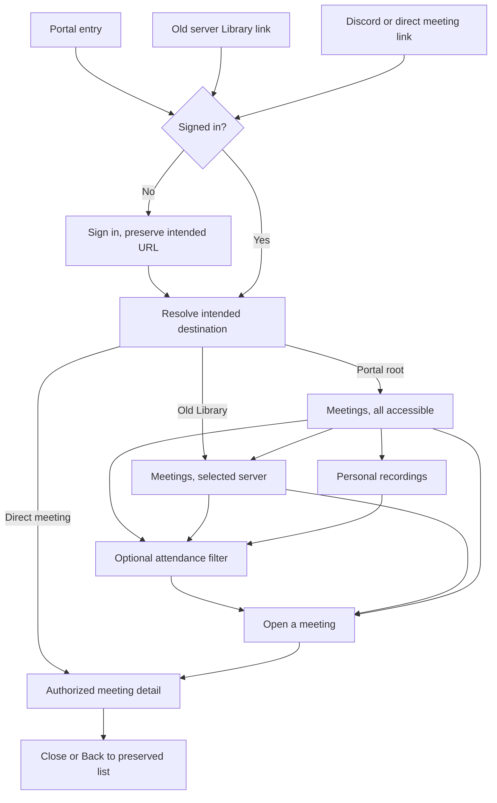
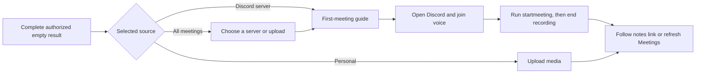

# One Meetings page

## Outcome and review decision

Approved by BASIC on October 28, 2026. The approval covers this design and preparation of an implementation plan, not a production inventory, repair or deployment.

Replace the separate My Meetings and server Library destinations with one Meetings page. People should find every meeting they can access, narrow the list by Discord server or personal recording, and open notes without learning two libraries. This also puts first-meeting guidance in the place new users actually land.

The user approved the clickable prototype, including its visible server icons in the left sidebar and the checkbox "Only meetings I attended." This document records the approved production behavior beneath that layout, including permission, attendance, empty-state and link rules. No product implementation or deployment is authorized by this document alone.

Recommended scope is one UI and one shared discovery path using the existing meeting authorization and detail components. It includes discovery pointers for personal recordings shared with a whole server. No new dependencies, DynamoDB tables or physical indexes, permission grants, recording commands or billing changes are proposed. Historical pointer repair requires a separately reviewed and authorized production metadata operation before full activation.

## Confirmed direction

- One navigation destination named Meetings.
- Default to all meetings the signed-in user may access. Attendance filtering is off.
- Show All meetings, Personal recordings and individual Discord servers as visible icon/name choices on the left. Do not put them in a dropdown.
- Use a checkbox labeled "Only meetings I attended."
- Keep the approved populated and first-meeting layouts. Use the existing Discord-style example-notes embed for onboarding.
- Cover actual permissions and responsive layouts with automated checks and screenshot tests.

The prototype uses example data. Its results, counts and working buttons do not establish backend authorization or production acceptance.

## Approach

Use the existing cross-server discovery service behind `meetings.myList`, extend its internal filtering where necessary, and reuse the existing meeting access checks and library detail components. Keep existing MCP input defaults and its legacy attended mode compatible. The portal sends explicit accessible mode and a separate attendance filter.

Keeping both current list implementations behind a new sidebar would retain different defaults, empty states and detail behavior. Rewriting the authorization system would expand the work beyond navigation. The shared-query approach is the single recommended path. The UI direction and backend rules below are approved for implementation planning.

## What the user sees

### Browse and open a meeting

The portal opens `/portal/meetings`. It shows active, non-archived meetings across all accessible sources, newest first and with no date cutoff. Archived meetings and existing date/tag/channel filters remain available under a compact Filters control. Existing upload, personal settings, Ask, billing and server settings capabilities remain reachable.

The left sidebar shows the user's eligible Discord servers with icons and names, including servers with no meetings. Missing or broken icons use initials. It also shows All meetings and Personal recordings. On mobile, the source choices appear in the approved two-column group above the list. A long source list scrolls independently within a bounded region instead of pushing all meeting content off screen. Keyboard focus must be visible and selection announced.

Clicking a source changes this same page. All meetings includes authorized guild meetings, owned personal recordings and personal recordings shared with the viewer. Personal recordings includes accessible records with personal ownership, including recordings shared by another person. A Discord server filter includes records belonging to that server, not personal recordings merely shared with it.

The result count describes loaded authorized rows, for example "Showing 25 loaded meetings" when more remain. Prototype source badges used exact fixture totals. Omit per-source total badges in production unless the query can provide accurate authorized totals without extra full-history scans. Do not show raw table counts or use a page count as a total.

The current title, summary and channel search remains a search of loaded results, labeled "Search loaded meetings." Do not promise full-history search. Full-text infrastructure and an exhaustive history-search feature are deferred. Loading more records updates searchable results. Filtered-out loaded rows with further pages available do not establish an empty library.

Rows retain status, title, summary, source, channel, time and duration. Opening a row uses the existing meeting detail drawer and actions, with its fullscreen option. Refreshing or sharing that URL opens the same meeting. Closing the drawer returns to the same filtered list and scroll position. Existing direct meeting-detail URLs remain valid.

### User task: get to the right notes

### Empty states and recovery

An empty authorized list is different from an error, a filter mismatch or a partially scanned page.

| Condition                                                                   | What appears                                                                                                                                                                                   |
| --------------------------------------------------------------------------- | ---------------------------------------------------------------------------------------------------------------------------------------------------------------------------------------------- |
| Loading session, sources or first page                                      | Loading state, no onboarding flash                                                                                                                                                             |
| Selected server has no accessible active meetings and discovery is complete | Existing first-meeting guide scoped to that server, example notes and Open Discord                                                                                                             |
| All meetings is empty after complete discovery                              | First-meeting guidance with available server choices and a secondary upload path                                                                                                               |
| Personal recordings is empty                                                | Existing upload invitation, no Discord command required                                                                                                                                        |
| Search, attendance, date, tag or archive filter has no matches              | Filtered-empty copy with Clear filters, not first-meeting onboarding                                                                                                                           |
| More candidate records remain                                               | Load more or continue scanning, not an empty-library claim                                                                                                                                     |
| Permission check, source lookup or page fetch fails                         | Error/retry state; retain safe list context, do not call it a new account                                                                                                                      |
| Selected server is no longer in the membership list                         | Refetch its authorized list, clear old cached rows, disable management tools and preserve any existing retained attendee access. Show a return to All meetings if no accessible records remain |

The guide says there are no meetings the viewer can access. It must not reveal that hidden-channel meetings exist. Managers may see the existing setup/settings actions; ordinary members can still use the guide and browse permitted meetings.

### User task: make a first recording

## Permission contract

The redesign changes navigation, not who may read a meeting. Authenticate list and detail requests, resolve the actor on the server, and authorize each canonical MeetingHistory record before returning any title, summary, participant data, counts or artifact links. A client-supplied server ID, index pointer, cursor, checkbox or cached UI state grants nothing.

Preserve the existing policy in `meetingAccessService.ts` and its callers. Personal records require ownership or an active applicable share. Guild records use the existing membership and channel checks, plus the existing Attendee access override when enabled. Do not turn a visual filter into a new grant or silently remove an existing attendee entitlement.

An unknown Discord permission result must not allow a row. Distinguish dependency failure from a completed empty result so onboarding does not hide an outage. Existing bounded permission caches remain in force; do not claim immediate Discord revocation detection beyond their existing lifetime. Refresh/refetch and detail fetch must recheck access under the existing policy.

Recheck access before returning detail or delivering audio/transcripts even if the row was visible earlier. Apply current server artifact settings independently. A readable notes summary does not authorize a disabled transcript/audio download, edit, share, archive or recording control. Reuse existing action-specific backend authorization.

The sidebar source list may show eligible server metadata from the existing authenticated server-list endpoint. Membership does not guarantee access to every meeting. Authorized loaded records may also introduce a previous-server source when retained attendee access applies. That source offers its permitted meetings, not current membership or management capabilities. Use a neutral previous-server label if the name cannot be resolved; do not expose raw internal IDs as its name. A selected previous-server deep link must be authorized through the list service rather than denied solely because it is absent from the current membership menu. Billing/settings links use the selected server's actual management eligibility, with the existing backend checks. All meetings and Personal recordings must not inherit an unrelated persisted server's contextual tools.

### Attendance means attendance

Approved interpretation: use stored participant IDs or legacy attendee mentions. An owner, creator, recording trigger or direct-share recipient is not an attendee merely because MeetingUserIndex contains a pointer. A personal upload without attendance metadata remains available in All meetings and Personal recordings, but does not match the attendance checkbox. This is a stricter portal filter, not a change to the shared access policy or legacy MCP attended semantics.

Tests must pin this distinction. In particular, share-only records must not appear as attended, and checking attendance must never return a record the viewer otherwise cannot access. The portal first establishes accessible results, then intersects attendance.

## Discovery, filters and pagination

The existing accessible query gathers guild ranges but reads MeetingUserIndex only in attended mode. Its index includes personal owners and direct share recipients. The unified query must combine appropriate indexed candidates and guild candidates in accessible mode, fetch canonical records and recheck permission. A revoked share or stale pointer must not expose a summary. Personal ownership/share checks must run without attempting Discord membership against a synthetic personal partition. Indexed guild records retain the existing attendee-override entitlement where applicable, including after leaving a server; adding candidates must not retain the current accessible-mode membership precheck that excludes them.

### Personal recordings shared with a server

Current guild-range queries do not discover personal recordings in another owner's personal partition, and user-index writes do not create a pointer for a guild grant. Direct access understands those grants, but discovery needs an explicit path.

Approved builder decision: extend the existing MeetingUserIndex with namespaced guild-recipient pointers for personal guild shares. Keep raw-user partitions and the new guild-recipient namespace disjoint, including for non-snowflake mock user IDs. Query only guild-recipient partitions belonging to the authenticated viewer's verified current guild memberships. Merge those candidates into All meetings and Personal recordings, then fetch each canonical record and recheck its current grant and membership before returning anything. The selected-server source continues to mean recordings belonging to that server, not these personal recordings.

Update the existing write/replace index path used when meeting access grants change. Revocation removes obsolete pointers, but authorization must still deny access if stale deletion lags. Missing pointer writes must be observable and repairable, rather than silently claiming complete discovery. Do not broadcast copies to every guild member or enumerate all personal partitions during a portal request. A pointer contains only the existing index's lookup metadata, not notes or transcripts. Existing raw-user and MCP callers remain compatible.

Historical guild-share records need a bounded metadata-only repair tool with dry-run output, page/checkpoint continuation, deterministic pointer keys, idempotent writes and canonical grant rechecks before writing. No meeting content should be read or logged. Test it with synthetic data. A production inventory or write run is not authorized by this design; prepare a concrete operation request under the existing production rules. If the authorized inventory finds no missing pointers, its zero-gap receipt satisfies this prerequisite without a write run. Otherwise, full "all accessible" acceptance for historical guild shares requires the repair's authorized completion. Do not label a deployment missing those pointers complete, and do not schedule a table-wide repair inside application startup or requests.

Use explicit discriminated source selection: all, personal, or one guild. Resolve the viewer identity from the authenticated request. Keep existing `meetings.myList` callers and MCP contracts working; add optional internal/portal filters instead of changing default attended semantics globally. Do not use a fabricated personal guild ID from the client as an authorization shortcut.

Deduplicate by the stored guild/record key, then use stable newest-first ordering with a deterministic key tie-break. Bind continuation to user, source, date range, attendance and archive/tag filters. An old cursor cannot change the query's source or access. Reset pagination when any of these change. Keep the query's upper time boundary stable while loading subsequent pages.

Do not stop discovery merely because the first bounded batch contains inaccessible or nonmatching records. Continue using existing DynamoDB pagination in bounded work batches, exposing an opaque continuation when unfinished. A scan limit is a work budget, not proof of exhaustion. Preserve per-source progress so inaccessible prefixes and equal timestamps cannot skip visible older rows. Do not silently convert partial source/index failures into a complete empty result. No unbounded request-time scan or new physical index is included. The historical guild-share metadata repair remains a separate authorized operation.

Query caches include the signed-in user and all selection parameters. Changing source clears old rows immediately; late responses from a previous source or user must not populate the new view. Clear meeting-specific cached content on logout or access denial through the existing query-cache mechanisms.

## URL and navigation contract

The URL is authoritative for the Meetings source and filters. Local selected-server storage may continue supporting other server tools, but it must not overwrite a fresh All meetings entry, an explicit personal scope or a direct link.

- `/portal` opens the default unified list.
- `/portal/meetings` is the canonical destination.
- Validated search state represents source, selected server, attendance, existing date/archive/tag/channel filters and loaded-result search.
- Drawer state identifies both the meeting's storage server and record ID, independently of the list's selected source. A record ID alone is ambiguous across servers.
- `/portal/server/$serverId/library` redirects to the unified page with that server selected. Preserve meeting/event/fullscreen link parameters and use history replacement to avoid redirect loops.
- Existing `/portal/meetings/$serverId/$meetingId` links keep their authorized detail behavior. Public share routes keep their separate access rules.
- Login preserves the intended URL, then applies redirects and authorization after sign-in.
- Update existing link builders and call sites, including installer/onboarding, server cards, meeting links, upload return links and Ask-to-meeting navigation. Keep legacy parsing until old externally saved links remain functional.
- Browser Back/Forward restores the previous scope/filter/detail state. New source selection resets search, attendance and list pagination as the prototype does; it preserves the user's archive/date filter choices unless Clear filters is invoked.

The selected server remains the context for Ask, billing and settings. Personal settings and upload remain global. The production sidebar retains these existing destinations even though the focused prototype omits some of them.

## Tests and acceptance

### Authorization and discovery tests

Exercise the real shared service and authenticated router, with mocked provider/data boundaries rather than a frontend array standing in for authorization:

- Accessible guild meeting not attended, denied channel, attendee override enabled/disabled and unknown permission response.
- Personal owner, active user share, active guild share discovered through its guild-recipient pointer, revoked share, stale index and a user with no guild membership but an owned personal recording.
- Guild-recipient namespace collision, current membership loss, denied pointer access, failed pointer writes, idempotent historical repair and grant revocation racing a repair write.
- Owner/share/trigger index membership without attendance, legacy attendee mentions and an attended record whose access was revoked.
- Tampered server/source input and cursor; different-user cursor reuse; equal timestamps; overlapping index/guild candidates.
- Multiple batches of denied rows before an allowed result; sparse filters with a continuation; empty intermediate pages; per-source failure with other source results.
- Disabled transcript/audio access, and direct detail/action denial after a previously authorized list result.

### Navigation and behavior tests

Prove the default is accessible with attendance unchecked, sidebar selection and history navigation, personal/server scopes, drawer close/return, source switch during an in-flight request and logout/account switch. Cover ordinary member versus manager actions, old Library links, direct detail links, Ask/event links and sign-in return URLs. Preserve editing/correction/import, archive, transcript and Notion actions in reused detail components.

First-meeting tests cover global, empty server and personal upload states, with no onboarding shown for a filter mismatch, unknown permission, partially scanned result or failed request. A hidden meeting must not affect empty-state copy or counts.

### Screenshots and scrolling

Create production Storybook stories for the unified page and source navigation, not only the throwaway prototype. Use deterministic fictional fixtures with stable clocks, icons and font readiness. Capture desktop 1280x720, intermediate 768x900, mobile 390x844 and wide 1920x1080. Cover both supported themes for the main list and empty states.

Required screenshot states: mixed-source All meetings; one selected server; attendance checked; personal recordings; no-filter onboarding; filtered empty; denied/unavailable source; loading and error; meeting drawer; long server names/missing icons and enough servers to scroll. Test selection at the desktop/mobile breakpoint so labels and controls neither clip nor overlap.

Add route-level Playwright visual snapshots against the real page with API fixtures. Cover the same canonical page and legacy redirect, plus a selected meeting drawer. Reuse `test/e2e/scrollAssertions.ts` and assert actual scroll range and changing scrollTop for the production meeting content, long source list and long detail body. Test ordinary portal mode as well as screenshot mode, since PortalLayout changes scrolling for visual captures. Assert no horizontal page overflow at each width.

Run focused Jest/router tests, Storybook screenshot capture and Playwright visual/interaction tests. Review the resulting screenshots with a VLM before calling UI work complete. Snapshot updates require inspection; passing comparisons against unreviewed regenerated baselines are insufficient.

## Implementation sequence after design approval

1. Extend shared discovery and its service/router tests for all-accessible personal results, guild-share pointers, strict portal attendance and safe continuation. Keep existing clients compatible. Build and test the historical pointer repair as an operator tool; keep live execution separately gated.
2. Add validated URL state and legacy-link redirects, then migrate source selection into the production sidebar without removing existing server tools.
3. Connect the approved list, empty states and existing detail components. Migrate both old list entry paths to this page and remove the superseded frontend list logic after callers move.
4. Add production stories, route/permission regressions, responsive screenshots and scroll assertions. Update public navigation documentation through the docs-authoring workflow.
5. Independently review the whole change. Prepare a source PR only when authorized; production release remains a separate action. The later implementation plan will pin exact interfaces, files and commands for these tasks.

## Deferred work and risks

No new analytics events are necessary to ship this navigation change. Reuse existing events where applicable; any proposed widening requires its separate privacy-policy/What's New work. Full-history text search, exact per-server history totals, unrelated index backfills and changes to attendee access policy are deferred. The narrowly scoped historical guild-share pointer repair is an activation prerequisite, not deferred silently.

The main risks are losing personal/shared recordings in the default list, confusing index membership with attendance, treating incomplete discovery as a first-use empty state, stale cross-user/source caches, and breaking old notes links. These are release-blocking test cases, not visual polish. All-time multi-server discovery must remain bounded and paginated; do not solve it with unbounded history reads.

## Source and reference appendix

Independent builder review completed with no important questions remaining after correcting guild-share discovery. The review did not implement the feature or perform provider operations.

Source inspected in the local worktree on October 28, 2026. Prototype remains uncommitted on `codex/unified-meetings-prototype`; no production implementation was made for this design.

- Prototype: `src/frontend/prototypes/UnifiedMeetings.prototype.tsx` and its module/stories. Local preview: http://127.0.0.1:6019/iframe.html?id=prototypes-unified-meetings--interactive&viewMode=story
- Portal list and sidebar: `src/frontend/pages/MyMeetings.tsx`, `src/frontend/pages/library/LibraryPage.tsx`, `src/frontend/components/SiteNavbar.tsx`, `src/frontend/layouts/PortalLayout.tsx`, `src/frontend/contexts/GuildContext.tsx`, `src/frontend/router.tsx`.
- Query/access: `src/trpc/routers/meetings.ts`, `src/trpc/routers/servers.ts`, `src/services/mcpMeetingService.ts`, `src/services/meetingAccessService.ts`, `src/services/meetingArtifactAccessService.ts`, `src/services/meetingUserIndexService.ts`, `src/utils/meetingUserIndex.ts`.
- Detail/onboarding: `src/frontend/pages/library/components/MeetingDetailDrawer.tsx`, `src/frontend/pages/library/hooks/useMeetingDetail.ts`, `src/frontend/pages/library/components/FirstMeetingEmptyState.tsx`, `src/frontend/hooks/useInvalidateMeetingLists.ts`, `src/frontend/utils/portalLinks.ts`.
- Existing tests: `src/services/__tests__/mcpMeetingService.test.ts`, `src/services/__tests__/meetingAccessService.test.ts`, `src/frontend/pages/__tests__/MyMeetings.test.tsx`, `src/frontend/features/library/__tests__/LibraryPage.test.tsx`, `src/frontend/components/SiteNavbar.test.tsx`, `src/frontend/utils/__tests__/portalLinks.test.ts`, `.storybook/test-runner.ts`, `test/e2e/visual.spec.ts`.
- Reused Mobbin research: [Grain Meetings](https://mobbin.com/flows/a880e9c0-e3cb-4652-8fe2-f6e2c2610716), inspected October 28. Three returned preview positions show one Meetings destination, scope tabs and a scoped empty state. This supports a consistent destination; authentication, persistence, backend access and commercial effectiveness were not observed. The user's approved sidebar prototype, not Grain's tabs, decides the selector layout.
