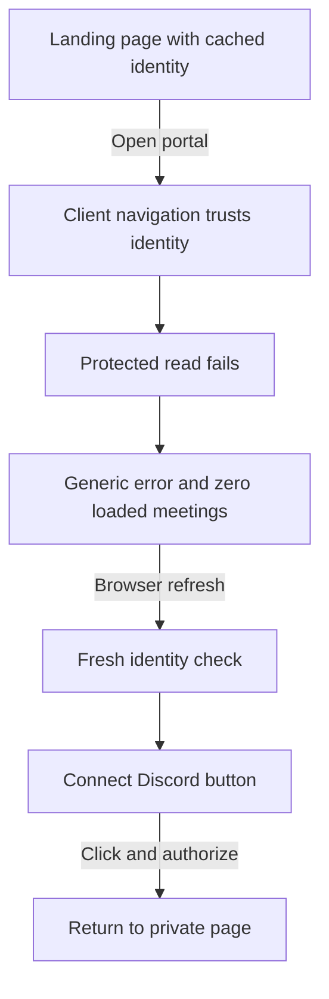
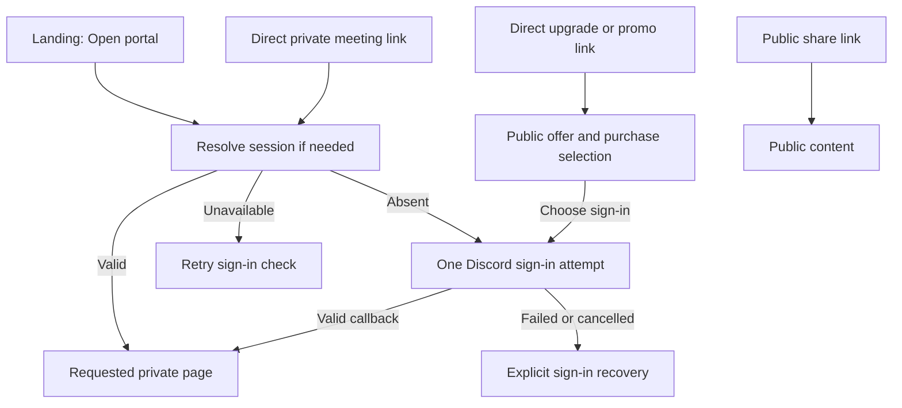
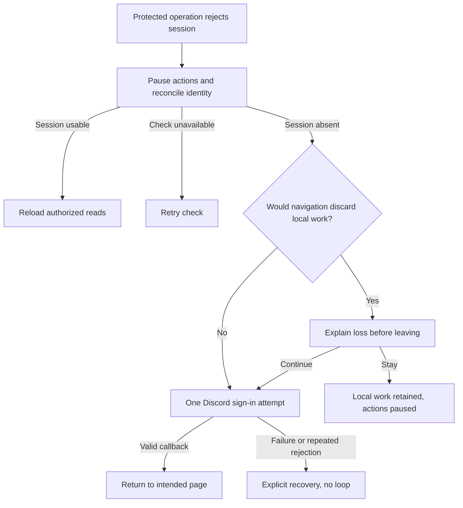

# Automatic portal sign-in recovery

Status: approved by BASIC on November 12, 2026. Automatic recovery, repeat-consent bypass and the safeguards below are the approved design. No implementation or deployment is included in this document.

## Outcome and scope

Opening the portal, following a private meeting link, or losing a session during portal use should lead back to the intended task without requiring a page refresh or an extra sign-in click. The page must not imply that meetings disappeared because authentication failed.

Use the existing session, Discord authorization-code flow and actor-aware query reset. Add shared session recovery, clear loading/error states and Discord's supported repeat-consent bypass for ordinary login. Keep session lifetime, scopes, permissions, CSRF protection, OAuth state validation and cookie/token validation unchanged.

This delivers two separate improvements:

- Recover automatically when Chronote's session expires, then return to the intended page.
- Skip another Discord approval click for returning users who already granted the requested permissions and have a usable Discord browser session. The brief trip through Discord should return them directly to Chronote.

The user's preference for automatic recovery is confirmed. Recommended exception: when leaving would discard an unfinished edit or interrupt an upload, pause and explain the consequence before navigating. Automatic recovery resumes when the user chooses to continue. This draft does not promise automatic draft restoration.

## Approaches

| Approach                  | User experience                                  | Tradeoff                                                             | Decision         |
| ------------------------- | ------------------------------------------------ | -------------------------------------------------------------------- | ---------------- |
| Automatic recovery        | One sign-in attempt returns to the intended page | Needs bounded retries and protection against lost edits              | Chosen direction |
| Always show Sign in again | User starts every recovery                       | Fewer automatic redirects, but adds the click the user wants removed | Not selected     |

Changing only the meetings error text leaves cached authentication wrong elsewhere. Longer sessions and a new auth framework do not repair that cause and are deferred.

## User experience

### Opening a private page

Entering the portal from the landing page or a direct private link checks the session before protected queries begin if session knowledge is missing or stale. A fresh successful auth result may be reused. The server still authorizes every protected operation.

Show "Checking your sign-in..." while resolving identity. If the session is absent, start one top-level Discord authorization. After a valid callback, return to the same permitted path, search parameters and fragment, then load the page. A private URL remains private throughout.

A network failure, rate limit or server error shows "We couldn't check your sign-in" with Retry. It does not trigger Discord login. Public landing pages and public shares stay usable without authentication. Upgrade and promo pages retain their public offer and selected purchase parameters until their existing sign-in action is used.

### Expiry during portal use

An authenticated API rejection closes the protected-action gate and starts one shared identity check. Parallel failures join that check. If the current session is still usable, resume normal protected reads once identity is ready. If it is absent, automatically start authorization and restore the destination.

If the identity check succeeds but the retried protected read again rejects the same current actor, stop automatic recovery. Show "We couldn't restore access" with explicit sign-in and Retry actions. Do not repeatedly recheck identity or force another automatic OAuth attempt. Retry is a deliberate new attempt; saves and other mutations still never replay.

If the current page has an unfinished edit, selected file or active upload that a full navigation would discard, show an accessible warning instead of leaving automatically. Offer "Continue to sign in" with the loss explained, and "Stay here". Staying does not re-enable authenticated requests. Retain the local work until the user chooses to leave; do not unmount it first and then warn. No new server data is loaded while signed out. Never show one actor's retained work to another actor.

The first implementation does not serialize meeting notes, prompts, tokens or selected files into browser storage to save drafts. It does not add an upload-resume system. The warning makes the existing full-navigation limitation explicit.

### Skipping repeat Discord approval

The intended returning-user experience is: open the portal, pass through Discord's existing-approval check, then return to the requested Chronote page without clicking Approve again. This also applies when a user deliberately starts ordinary sign-in, separately from automatic recovery of an expired Chronote session.

Ordinary login requests `prompt=none` with the current scopes. Discord can skip repeat consent when the browser has a usable provider session and the same scopes were previously granted. Login or consent may still require interaction for a first-time grant, a revoked grant or a browser without the needed Discord session. Bot installation remains a separate consent flow.

Research found that Chronote's ordinary authorization path currently leaves `prompt` unset. A local URL-generation test confirmed the installed `passport-discord` library accepts `prompt=none` while retaining the same scopes and OAuth state. The change therefore uses the existing library; it does not need a new login system. Controlled-browser acceptance remains outstanding.

### Finishing or failing sign-in

After cancellation, provider failure or a callback that still leaves no usable session, show a recovery page with an explicit sign-in action and a way back to the public site. Do not launch another automatic attempt. An explicit retry starts a new authorization transaction with fresh state and the validated destination.

Keep Switch account interactive. That action must not immediately pass through the same Discord account as ordinary recovery. An explicit interactive authorization can request consent; it does not guarantee a credential challenge or account chooser. Verify the existing account-switch experience in a controlled browser.

### Where each state belongs

| State                                   | What the page shows                                   | Recovery                         |
| --------------------------------------- | ----------------------------------------------------- | -------------------------------- |
| Identity unknown or rechecking          | Checking sign-in, no empty count                      | Await the identity result        |
| Identity lookup unavailable             | Sign-in check failed                                  | Retry the check                  |
| Confirmed session absent                | Returning through Discord, or unfinished-work warning | One automatic attempt when safe  |
| Authorization failed or cancelled       | Sign-in recovery page                                 | Explicit retry                   |
| Identity valid, data pending            | Loading meetings                                      | Await data                       |
| Identity valid, forbidden resource      | Access unavailable                                    | Choose an accessible destination |
| Identity valid, data request failed     | Data error                                            | Retry the read                   |
| Successful complete empty discovery     | Existing first-recording guidance                     | Start or upload a recording      |
| Successful query with no filter matches | No matching meetings                                  | Clear filters                    |

Forbidden access is a page-level result, not a global signed-out state. Counts appear only when a successful result makes their meaning known. Preserve the existing distinction between partial discovery and complete empty discovery.

## Flows

### Current: recovering from cached sign-in knowledge

### Proposed: open a private page

### Proposed: session expires during use

## Engineering contract

### One owner for session state

Keep `AuthContext` as the source of session truth. Model checking, authenticated, signed-out, recovering and unavailable outcomes explicitly rather than inferring all outcomes from query-data truthiness. Data retained after a failed auth request is not proof of a currently usable session.

Integrate protected-entry revalidation with the existing protected layouts. Integrate auth rejection at the shared tRPC operation boundary for queries and mutations, using semantic `UNAUTHORIZED` errors rather than HTTP batch status alone. Do not convert ordinary 403/404, rate limits, CSRF rejection, non-JSON outage pages or generic transport failures into session-expiry recovery.

For one rejection episode, allow one identity reconciliation and one normal protected-read attempt after it succeeds. A second current-generation rejection terminates automatic reconciliation and presents explicit recovery. Deduplicate the episode across concurrent operations; do not let each query create a fresh budget.

Use one in-flight check/recovery for the current actor generation. Cancel outstanding protected reads and prevent their late responses or failures from changing a newer actor. Reuse the existing private-query reset when identity changes. Preserve its public-query exemptions and the readiness barrier before protected reads resume. Reconcile `auth.me` and protected middleware so both agree on what makes a session usable.

Do not replay mutations. A failed or interrupted save, recording control, checkout or upload completion may need the user to inspect current state and retry deliberately. Normal authorized reads may reload after recovery.

### Bound recovery across full-page navigation

An in-memory boolean is insufficient because OAuth reloads the app. Carry a short-lived indication that an automatic attempt was already consumed across that round trip. Store only recovery metadata, never content or credentials. Bind the server-side return target and recovery outcome to the OAuth transaction and validate them before use.

A callback success followed immediately by another absent-session result must reach explicit recovery, not restart OAuth. Cancellation, invalid state and callback errors must not enable automatic fallback loops. While recovery is failing, only deliberate retry or later deliberate navigation outside that failed recovery clears the consumed-attempt state. A reload of the failed destination does not count as deliberate retry. After a valid identity and a successful protected read confirm recovery, clear the marker so a later, separate expiry can recover normally.

Keep metadata handling small. The builder may choose an opaque transaction marker with browser-session metadata or an equivalent existing session mechanism, provided blocked cookies and a missing server session still terminate automatic recovery. If reliable loop detection cannot survive navigation, use explicit recovery instead of starting an unbounded automatic attempt. Do not place tokens, raw errors or draft contents in a URL.

### Preserve destinations and existing security boundaries

Reuse the existing same-origin redirect validator and return-to plumbing. Preserve the intended portal destination, meeting/filter parameters and fragment. Preserve upgrade/promo selections in their existing routes. Save before redirect and preserve the target through Passport session regeneration.

Bind failure recovery to the original validated destination rather than accepting arbitrary callback redirect input. Concurrent authorization tabs must not exchange return targets or consume each other's recovery state. Preserve MCP, desktop and install callback routing and flow-specific state stores.

Add `prompt=none` only to ordinary login. Keep install scopes and consent separate. Keep an explicit interactive login option for account switching and recovery. Do not broaden scopes, relax state/CSRF/cookie/token validation, extend sessions or change production auth settings as part of this fix.

### Local work must survive until the departure decision

Audit editable protected pages, modals and uploads for local state. There is no discovered shared unsaved-work guard in the inspected frontend. Notes editing and admin configuration track dirty state; other forms hold local values without a common guard.

Use the smallest shared navigation-safety signal that covers these callers. Capture whether work would be lost before the auth gate changes the rendered tree. Keep that local state alive, block protected requests, and show the warning. Cleanup must not clear the signal and accidentally trigger a redirect after the editor is already gone. On actor change, discard the old actor's work before rendering the new actor's page.

The builder chooses the component mechanism. A general draft store, persistent local notes and per-feature autosave are out of scope. If a caller cannot meet the no-silent-loss contract with the shared guard, keep its recovery explicit until it can; do not ship a blanket redirect that discards its local work.

## Implementation reach and verification

Expected shared code: `AuthContext`, QueryClient/tRPC error handling, protected layouts, guild loading/error handling, browse counts/status, ordinary login and callback handling. Audit REST callers before changing `AuthNeededError`, because it currently groups 401 and 403 and must not silently feed the global redirect decision. Audit login callers in public offer pages, live/private pages, account switching and existing MCP/desktop/install flows.

Update auth/query mocks and stories for the new states. Extend the existing tests rather than creating a parallel auth test framework. Add focused integration cases:

- A mounted landing page has a cached identity; the synthetic server session disappears; client navigation reaches sign-in and returns without a manual refresh. Cover stale signed-out knowledge after sign-in in another tab too.
- Parallel protected query and mutation errors share one recovery. A mixed tRPC batch is classified per operation. No mutation repeats, and actor-A responses cannot change actor B. A successful identity check followed by another protected rejection stops with explicit recovery instead of a reconciliation loop.
- Initial and background auth network/429/5xx failures reach unavailable/retry. Forbidden data stays forbidden. Successful complete empty discovery still shows the existing guidance.
- Expiry with dirty notes, other editable forms, a selected file or an upload warns before losing state. Staying retains local work but cannot call protected APIs; changing actors never reveals old work.
- Ordinary OAuth uses `none`, the same scopes and fresh state. Account switching stays interactive; install and MCP/desktop flows keep their routing and security tests.
- Success, denial, invalid/replayed state, parallel sign-in tabs, blocked cookies and a callback without a usable session preserve permitted destinations and end without a loop. External return targets remain rejected.
- Controlled-browser acceptance covers prior grant, first grant, Discord signed out, revoked grant, cancellation, private browsing and Switch account. Verify the actual return page rather than the authorization URL alone.

Run Storybook screenshot capture and visual review for UI changes, plus relevant Playwright snapshots. Add scroll assertions only if a changed recovery layout affects the scroll container. Existing production deployment gates remain separate.

## Evidence and deferred work

Source inspection found a persistent auth provider above the router, no protected-entry revalidation, and no shared reconciliation on protected tRPC rejection. A synthetic check reproduced the cached-identity mechanism. It did not reproduce a particular production browser request. No customer data or operational identifiers are included in this design.

Existing journey references were reused. Sampled [Hootsuite login](https://mobbin.com/flows/1de545d9-31d6-498f-9867-7ce8f085fe9d?tab=screens) positions 1, 3 and 4 distinguish logged-out, sign-in and application pages. Sampled [Motion login](https://mobbin.com/flows/0924b247-926a-46ce-9d1b-029955ab729b?tab=screens) positions 1, 3 and 4 distinguish sign-in from preparation. Provider transitions, expired deep-link recovery and position 2 were not inspected. These samples support clear states; automatic recovery is the user's chosen direction, not a proven result of those captures.

[Discord OAuth2 documentation](https://docs.discord.com/developers/topics/oauth2#authorization-code-grant) supports skipping repeat consent for previously granted scopes using `prompt=none`. Browser login and first-time/failed authorization branches require acceptance testing. [Express session documentation](https://expressjs.com/en/resources/middleware/session/#rolling) explains cookie lifetime behavior; this design leaves that policy unchanged.

Deferred: rolling or longer sessions, persistent drafts, resumable uploads, new auth providers, silent iframe login, extra scopes and new analytics. No new analytics event is needed to establish functional correctness.

### Source appendix

Inspected deployed-source baseline: `c13ddc94cd1c170c79e38ac773ebac4e48c20fce`. Selected relevant files in the lead checkout still match that baseline at inspection. This document is written in the older shared checkout without altering unrelated work; implementation must refresh its actual base.

Key sources: `src/frontend/contexts/AuthContext.tsx`, `src/frontend/queryClient.ts`, `src/frontend/services/trpcClient.ts`, `src/frontend/services/apiClient.ts`, `src/frontend/layouts/PortalLayout.tsx`, `src/frontend/pages/hooks/useMeetingBrowse.ts`, `src/frontend/pages/UnifiedMeetingResults.tsx`, `src/webserver.ts`, `src/services/discordAuthService.ts`, `src/services/oauthRedirectService.ts` and `src/services/discordInstallAuth.ts`.

The synthetic reproduction used the local query dependency version rather than the deployed lockfile version. It is evidence for the mechanism, not release acceptance. No implementation, live authorization or deployment has run for this design.
