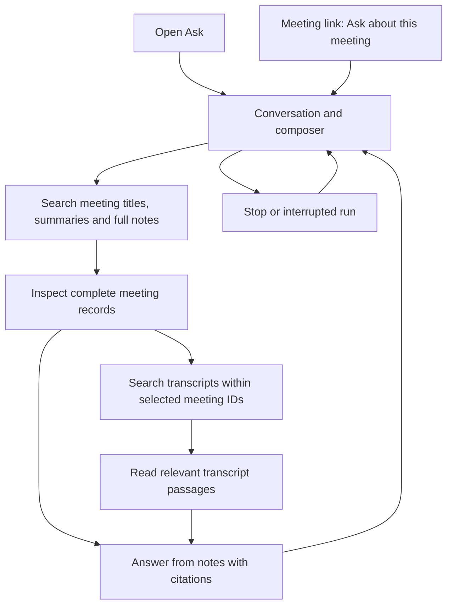

# Ask agent with S3 Vectors

## Outcome and decisions

Give every tier an Ask agent that searches all accessible retained meeting history, reads relevant evidence and answers with citations. Keep the existing Ask UI and conversation storage. Use Pi with direct calls to the shared meeting services behind MCP, bound to the logged-in user.

BASIC approved implementation on November 17, including pending indexing with retries. Use two S3 Vectors ENHANCED indexes in an environment-specific vector bucket, rather than adding PostgreSQL or another database platform. This replaces the earlier PostgreSQL/Neon proposal. The application and infrastructure are implemented locally. Hosted integration acceptance has not passed yet.

Confirmed product decisions: remove the last-5/25/100-meetings entitlement on all tiers; keep each meeting's title, summary, metadata and complete notes together; discover and inspect meetings before transcript investigation; require a nonempty meeting set for transcript search; support server filters and voice-or-text channel matching. No title/summary field boosts or global transcript search.

Current retained-record byte/token measurements passed the complete-note fit check. Live synthetic Sandbox qualification passed BM25/hybrid retrieval, summary/deep-note search, combined filters and query-embedding failure fallback; all temporary resources were removed. Document embeddings remain a publication dependency: AWS rejected records without a vector. Approved behavior is explicit pending-index state with durable retry for new/changed documents, while keyword-only retrieval continues for already indexed current records. BASIC accepted this publication dependency before implementation. Do not truncate/split notes, invent a placeholder vector or add a second search engine to hide this limitation. Detailed measurements and provider receipts are private chronote-ops evidence dated November 17.

## User experience

Ask opens ready for a question. Recent cards and direct meeting links supply context without requiring navigation away. Full meeting search stays on Ask and adds removable meeting context. Example questions fill an editable draft without sending it.

Default scope remains the selected server. Personal/cross-server scope uses the existing source model and must be explicitly selected. Pi cannot widen it. Selected meetings are prioritized context, not a restriction against finding other meetings in the permitted scope.

### Find evidence and answer a question

Use honest source/indexing states. Show an exact authorized count only when computable. Empty, indexing, unavailable and permission-denied outcomes must not collapse into a misleading zero. Adapt the existing local Ask cards/chips, mobile drawer, draft handling and focus behavior rather than rebuilding the page.

## Tool and identity boundary

The exact [arguments and outputs](2026-11-17-ask-agent-tools.md) remain the contract. Five tools: search_meetings, search_transcripts, list_meetings, read_meeting_notes and read_transcript_passage.

Meeting search returns title, summary, metadata and complete notes, hydrated from canonical records. Before either Pi transcript operation, the current run must have received that complete meeting record through search, notes read or loaded selected context. A metadata-only list does not satisfy this. To widen transcript investigation, find/load more meetings first. A transcript-only term cannot directly discover an unknown meeting; that is the agreed flow.

Bind identity, allowed scope, timezone and cancellation on the backend. Pi supplies ordinary queries and narrowing filters, never user identity, OAuth scopes, credentials, raw AWS filters or arbitrary URLs. Reuse current meeting access, guild membership, attendee override, personal sharing, artifact policy and mention resolution. Public MCP retains its own OAuth/token restrictions and uses the same services without importing Pi run state. No internal MCP HTTP/OAuth loopback or Hub Executor grant.

Issue citation handles only for validated sources. Store their canonical ref, revision and actual passage/event location privately. Reuse Ask citation rendering and backend-generated links; do not accept invented handles or event IDs.

## S3 Vectors layout

Use one new vector bucket per environment, with two generation-named indexes: meetings-<generation> and transcript-passages-<generation>. This is separate from the ordinary transcript S3 bucket. Configure ENHANCED explicitly or verify it after creation, float32, 1,536 dimensions and cosine distance. Names, dimensions, metric and non-filterable metadata choices require careful provisioning/replacement; stage new generations for model/schema changes and preserve the old one for rollback.

| Index               | One record contains                                                                                             | Search scope                                                                 |
| ------------------- | --------------------------------------------------------------------------------------------------------------- | ---------------------------------------------------------------------------- |
| Meetings            | One combined text field with current meetingName, summarySentence/summaryLabel, tags and complete current notes | Current authorized scope and server/channel/date/tag/archive/meeting filters |
| Transcript passages | Canonical transcript passage, source offsets and real event/time mapping where present                          | Required previously loaded meeting set, intersected with current access      |

Configure one non-filterable text metadata key, such as search_text, as full-text searchable using textSearchConfigurations. Avoid copying titles into every transcript passage. Put canonical parent identity, server/ownership scope, resolved voice/text channel IDs, epoch timestamp, archive state, filter tags and compact version information in filterable metadata. Keep large text and ancillary source-location data non-filterable. Application reads still resolve canonical names and text before disclosure.

The summary is part of search_text, alongside title and full notes. S3 calls this field metadata in its API, but it is configured as searchable body text, not merely carried as display/filter metadata. The live summary-only term check passed.

Date ranges use numeric epoch comparisons. Server arrays use membership; channelId means voiceChannelId OR textChannelId with the existing legacy fallbacks; different filters combine with AND. Use a server-qualified meetingKey for meeting arrays to avoid cross-server collisions. The adapter builds AWS expressions after validation.

ENHANCED indexes prefilter before similarity ranking. Enforce scope/artifact eligibility before querying, then recheck canonical access and revision before exposing any title, text, count or source to Pi/browser. Index metadata is not authority. If current permission predicates or long lists exceed AWS constraints, fan out only across authorized subsets with tested merging/continuation; never silently drop filters or return a global top-N and call it complete. Stop at a documented resource boundary with partial coverage rather than promising exhaustive recall.

Use S3's native BM25 + vector hybrid query within each tool's dataset. Keyword-only queries can omit the query vector. Do not blend meeting and transcript indexes, implement application-side field boosts or promise exact nearest-neighbor ranking. Hydrate full notes from DynamoDB after candidate validation; transcript reads use canonical DynamoDB/S3 data.

## Qualification findings and hard limits

Official AWS announced hybrid search on November 16, 2026. Some fetched older pages still describe vector-only requests. The new announcement, query-text schema and active searchable-field state must be verified against the actual SDK and intended test region.

| Requirement                   | Evidence and decision                                                                                                                                                                                                                                                                                                                                                                |
| ----------------------------- | ------------------------------------------------------------------------------------------------------------------------------------------------------------------------------------------------------------------------------------------------------------------------------------------------------------------------------------------------------------------------------------ |
| Full-text and semantic search | New QueryVectors supports queryTexts, queryVector or both, with native BM25/RRF. Validate both modes and returned scores/continuation using synthetic records.                                                                                                                                                                                                                       |
| Complete notes in one record  | Current documented total metadata limit is 40 KB, with 2 KB filterable metadata. Measure UTF-8 bytes of the complete serialized metadata, not characters. Determine actual longest notes before claiming complete history. Text-search configuration does not establish an exemption from this limit.                                                                                |
| Missing/oversized embedding   | PutVectors currently requires vector data. Query-embedding failure can fall back to keyword-only search of existing indexed records, but new vectorless records cannot be assumed indexed. Prove a supported lexical-only ingestion path; otherwise report this as a change to the earlier immediate lexical-availability requirement for product review. No zero/random embeddings. |
| Large selected sets           | ENHANCED filters allow 100 constraints; values in an IN list each consume constraints. Count the whole expression, including scope/date/channel/tag predicates. Test boundary and over-boundary cases.                                                                                                                                                                               |
| Result pagination             | Current limit documentation describes topK up to 10,000 and pages up to 100. Prove actual service token behavior. A bounded topK result is not exhaustive history; distinguish exhausted query results from an incomplete provider window.                                                                                                                                           |
| Freshness and deletes         | Query access and source revision are checked canonically. Prove overwrite/delete visibility and stale-writer handling; ordinary S3 object conditional-write semantics cannot be assumed for PutVectors.                                                                                                                                                                              |

Qualification checkpoint: the actual retained meeting corpus fit conservative 40 KB metadata and the embedding-token limit. The live service accepted searchable and non-searchable values above 40 KB and rejected a larger record with a 102,400-byte maximum error, while the fetched documentation still says 40 KB. Keep conservative byte validation until the supported limit is confirmed; the exact boundary was not established. New vectorless ingestion was rejected, so the pending-index behavior above is the approved product decision. No unannounced notes truncation/chunking or permanent lexical omission.

## Synchronization and recovery

DynamoDB/S3 stay authoritative. Build a resumable backfill and asynchronous change projection covering all canonical writers: new/finalized guild/personal meetings, notes/summary/name corrections, tags, archive/shares, transcript replacement and deletion. Missing processing outcomes remain unknown, not transcription failure.

Prefer MeetingHistory DynamoDB Streams into one projection Lambda with failure destination, plus reconciliation/backfill for events beyond stream retention. Verify existing stream configuration and infrastructure before enabling it. Reuse existing shared projection/worker patterns where they meet this contract. S3 transcript writes are projected only when their canonical reference/revision is ready; changes that bypass MeetingHistory need an explicit trigger or writer correction. Never block meeting delivery on embeddings/indexing.

Maintain projection generation, intended record keys, revision/hash and tombstones in a small DynamoDB search-state record. Use immutable generation/revision-qualified keys rather than assuming S3 Vectors offers compare-and-swap. Persist write intent before external writes; discard stale work, validate current source before publication, and reconcile old/uncertain writes and tombstones until stale writers cannot restore deleted data. Canonical checks prevent disclosure during that interval. Test backfill/live races, late embedding completion, uncertain writes, delete/recreate and missed stream recovery.

Coverage must distinguish text indexing, semantic readiness and source freshness. A failed document stays visible in coverage/retry accounting. Index replacement/backfill has an explicit ready checkpoint and reconciliation before publishing the new generation.

## Embeddings, cost and operational footprint

Default to OpenAI text-embedding-3-small, 1,536 dimensions, through the existing SDK/provider. Compare only text-embedding-3-large at explicitly requested 1,536 dimensions if retrieval fixtures show meaningful misses. Current standard rates are $0.02 and $0.13 per million input tokens respectively. Changing models requires a new generation; equal dimensions do not make model spaces compatible.

Embed the combined meeting text once and each transcript passage separately. Persist source/input hash, model/dimensions and status; access-only changes do not reembed unchanged content. Both candidate models have an 8,192-token input limit. Count tokens; do not truncate meeting notes. Start transcript passages near 3,000 characters with overlap, then enforce token/byte limits and preserve real event/source mappings. Query/document embeddings use the same model. Cache identical query vectors only within the run.

S3 Vectors removes an always-on database host but adds usage charges. Published us-east-1 base examples list $0.06/GB-month storage, $0.20/GB PUT with a 128 KB minimum per PUT, $2.50/million query requests, processing tiers starting at $0.004/TB, and returned-data charges. Batch writes where practical. Processing depends on index size; a narrow meeting filter must not be assumed to reduce billing proportionally. Non-filterable text is excluded from vector query processing bytes, but its storage and returned bytes still matter. The new hybrid/full-text charges must be explicitly checked; do not quote the older vector-only examples as an all-in hybrid estimate.

Task 1 must estimate actual record count/bytes, changes, questions, queries per question, backfill, development/test copies, hybrid costs, embeddings, DynamoDB, Lambda/failure queue, KMS and network. No corpus inventory or live AWS bill was collected for this design.

## SDK, infrastructure and permissions

Repo package declarations use AWS SDK 3.1161.0, while the inspected installed S3 client is 3.1156.0; client-s3vectors is absent. Add only the official client-s3vectors package at a tested pinned version exposing queryTexts, metadata configuration and pagination. Compile against actual types and run contract tests; do not hand-sign HTTP to bypass missing SDK support.

Live qualification used isolated client-s3vectors 3.1170.0 with the verified existing local AWS SSO route after the connected machine tool rejected the new fields during SDK validation. This proves that SDK's tested runtime calls, not the connected tool's parity or a Chronote dependency upgrade. No auth/credential/integration configuration was changed.

The inspected Terraform AWS lock is 6.71.0. Current upstream resource documentation reviewed here describes vector buckets/indexes and non-filterable metadata but does not expose the new textSearchConfigurations property. Prove the actual provider schema. If unavailable, Terraform owns bucket/index/encryption/IAM and an explicit versioned, idempotent AWS SDK configuration step owns the searchable text field. It must read state, update only when needed, wait for ACTIVE, detect drift and avoid replacing unrelated resources. Do not conceal this in local-exec. Replace the step with native provider support when available.

Keep resources/environment identities and index ARN configuration explicit. Apply existing saved-plan/environment approval rules. Backend read roles need QueryVectors and GetVectors for filtered/text queries; projection roles get only the required index write/delete/list/source-read actions. Test least privilege, encryption and backend-only access. No new database password or browser-facing AWS access is needed.

## Pi runtime, sharing and product changes

Keep one Pi agent in the API process, existing Ask conversation storage and explicit tools. Validate model/Responses parameters, Langfuse and saved tool history before pinning Pi. Reuse Hub's streaming, independent Stop, request identity, drafts, isolation and interrupted-run lessons. Do not copy Convex, private session files, router/Executor credentials, workflows or general shell/filesystem tools.

Stable send IDs return the original run on uncertain retry. One active run per conversation, durable ownership/cancel state, prompt cancellation and stale-owner fencing. Reconnect reads stored state; process loss becomes interrupted without automatic replay. Reauthorize source-bearing saved tool and assistant context each turn and preserve provenance across compaction. Saved answers remain visible under existing sharing rules; new private tool history never enters shared/public projections.

Proposed Discord /ask replies are ephemeral from deferral onward because actor access can exceed the channel audience. Preserve allowedMentions suppression and citations. This audience change remains a product-review point.

Remove maxAskMeetings and all 5/25/100 pricing/docs/reminder claims across portal and Discord. Other entitlements remain. Complete-note tool results must fit the remaining model context by reducing page size and preserving continuation, never truncating notes. A single non-fitting record returns context_limit and is not marked loaded.

Track shape-only PostHog events, existing guild/user identity rules, Langfuse embedding/answer cost and search operating costs. No query/snippet/notes content in analytics. Update privacy/provider/date/What's New for material changes before activation.

## Acceptance and evidence

Required: oldest retained history beyond 100 meetings, notes after character 900, selected-meeting transcript facts, identical eligible history across tiers, combined server/date/channel filters, personal/sharing access, transcript denial, injection, citations, corrections/deletion races, stream failures, SDK/infra drift, duplicate sends, two replicas, Stop/reconnect, and short-desktop/mobile screenshots with real scroll assertions.

Qualification created only isolated synthetic Sandbox vector buckets/indexes and removed them, with independent inventory confirmation. Production and existing Sandbox meeting data were read only. Chronote product dependencies and runtimes remain unchanged; qualification packages stayed isolated. Deterministic fixture vectors and an injected timeout tested service behavior, not actual OpenAI semantic quality or a real provider outage. Corpus fit and the listed query cases passed; lifecycle integration, the full permission/pagination boundary matrix, IaC and all-in cost remain unproven. Private evidence lives under chronote-ops/evidence/2026-11-17-s3-vectors-qualification.

Primary references checked November 17: [hybrid announcement](https://aws.amazon.com/about-aws/whats-new/2026/11/s3-vectors-hybrid-search/), [new query contract](https://docs.aws.amazon.com/cli/latest/reference/s3vectors/query-vectors.html), [text configuration](https://docs.aws.amazon.com/AmazonS3/latest/userguide/s3-vectors-configuring-full-text-search.html), [metadata filters](https://docs.aws.amazon.com/AmazonS3/latest/userguide/s3-vectors-metadata-filtering.html), [limits](https://docs.aws.amazon.com/AmazonS3/latest/userguide/s3-vectors-limitations.html), [PutVectors](https://docs.aws.amazon.com/cli/latest/reference/s3vectors/put-vectors.html), [pricing](https://aws.amazon.com/s3/pricing/), [Terraform resource schema](https://github.com/hashicorp/terraform-provider-aws/blob/main/website/docs/r/s3vectors_index.html.markdown), [OpenAI embedding limits](https://developers.openai.com/api/docs/guides/embeddings).

Hub conversation/November 16 UI evidence remains the reuse reference. Existing inspected [Apollo](https://mobbin.com/flows/99f2fb61-8a8d-4c44-bf62-9eede46f93fe) and [Cohere](https://mobbin.com/flows/a78b82e7-a954-4fcf-8cd5-57e069136749) previews support answer-first chat with collapsed activity; they do not establish Stop or approval behavior. No new navigation research is needed for this storage revision.
